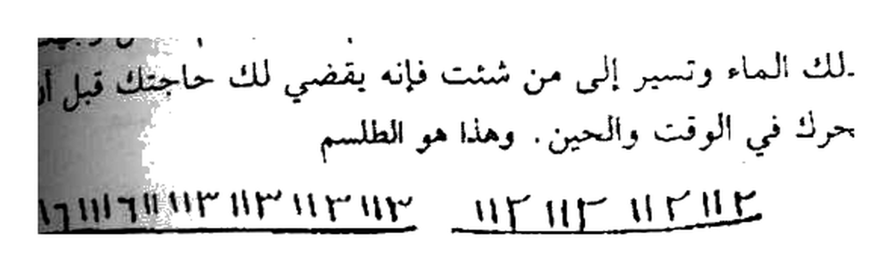
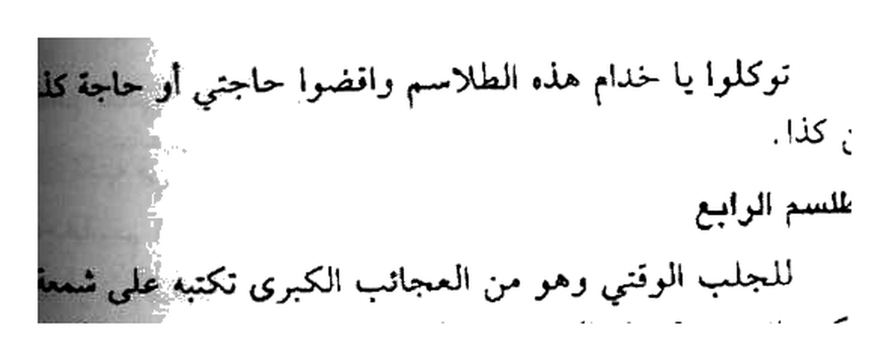
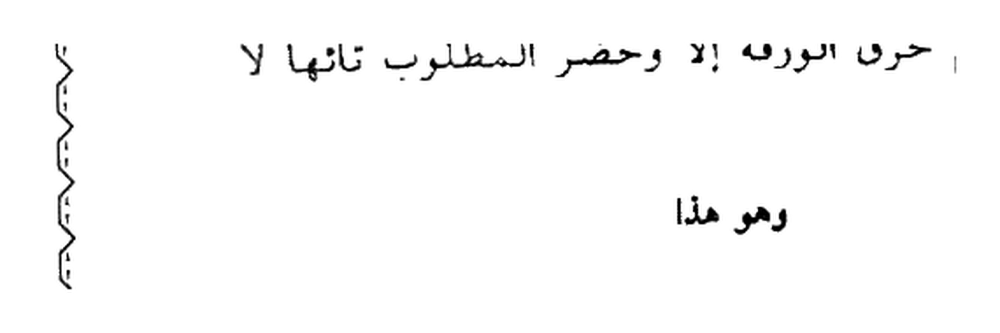
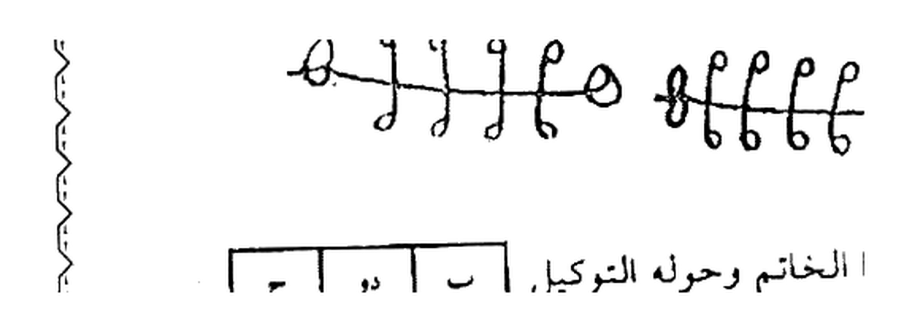
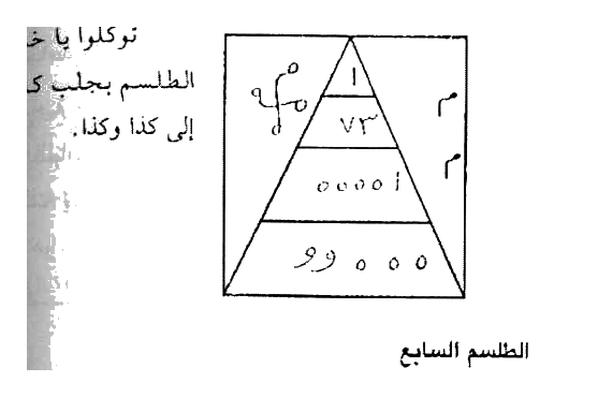
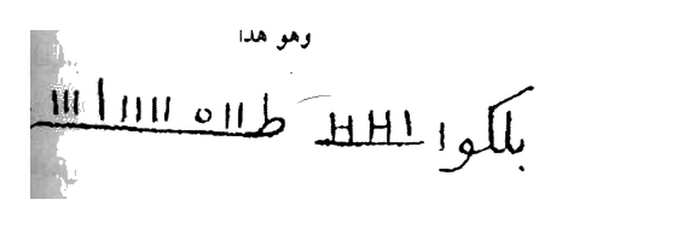

# Terjemahan Lengkap — Batch 31 — Halaman 150–154
## Kitab Asrar wa Khofayyat — Fashal Tsalis — Syaikh Athiyah
### Sumber: Picture 076 (150-151) + Picture 077 (152-153) + Picture 078 kanan (154)

> Format 2 tingkat: **[Teks Arab Asli]** di atas — **[Terjemahan Indonesia]** di bawah. Rajah crop presisi 4×.

---

## Halaman 150 — Fashal Tsalis Muqaddimah — Picture 076 kanan
### [Teks Arab Asli]
```
الفصل الثالث

فى الدعوة الأولى من دعوات الطلاسم

وهم أربعون طلسماً من المجربات العظام

لأن هذه الطلاسم منتخبة من أفخر العلوم التي لا تخيب أبداً
ولا يضعف ناموسها على الدوام ولكل قسم منهم دعوة خاصة به
وهذه الدعوة هي الأولى لها عشرة طلاسم

[halaman penerbit — daftar terbitan, sama dengan Hal.002 dan Hal.135. Tidak diulang di sini.]
```
### [Terjemahan Indonesia]
**FASAL KETIGA**

**Tentang Doa Pertama dari Doa-Doa Thilasm**

**Dan mereka itu empat puluh thilasm dari (amalan) yang sudah teruji lagi agung.**

**Sebab thilasm-thilasm ini dipilih dari ilmu-ilmu yang paling mulia, yang tidak pernah gagal selamanya, dan "nāmūs"-nya tidak melemah sepanjang masa. Dan setiap bagian dari mereka memiliki doa khusus. Dan doa ini adalah yang pertama — ia memiliki sepuluh thilasm.**

> *Di bawahnya pada scan tercetak blok daftar terbitan Syaikh Athiyah Abdul Hamid — isinya identik dengan halaman 2 dan halaman 135, jadi tidak diulang di sini.*

## Halaman 151 — Tilasm Tsalits & Rabi' — Picture 076 kiri
### [Teks Arab Asli]
```
الطلسم الثالث

وهو من العجائب الكبرى للمحبة والجلب الوقتي تكتبه في
كف يدك اليمنى بيدك اليسرى بزعفران وتطلق البخور وهو جاوي
ولبان ذكر تحت كفك وتتلو القسم ١١ مرة ثم تطبق كفك وتلمس
به من شئت فإنه يتبعك ويخرج من عقله بحبك.

وهذا هو الطلسم

[THILASM ١ — dua baris angka/rumus: ١١٣٩ ط ط ٣ ٣ ٧ ٩ ١ ١ ١ ٩ ٧ ٤ ٨ ٨ / dan baris kedua. Angka dan huruf TIDAK diubah — lihat rajah asli halaman 151.]

الطلسم الرابع

تكتبه في آنية بزعفران وماء ورد وذوبه برطل ماء وتتلو على
الماء القسم ١١ مرة ثم تغسل وجهك ويديك وتسلم على من
شئت أو تخاطبه فإنه يتبعك ويخرج من عقله بحبك ولا يستطيع
الصبر عنك ساعة واحدة. وكذلك إذا كتب وشربه المطلوب صار
كالمجنون من شدة المحبة والتهييج لأنه من المدهشات الكبرى
التي لا يتمثل لها بقياس وهو هذا

[THILASM ٢ — kotak 3×3 dengan angka di tepi + simbol huruf di sekitarnya. Angka dan huruf TIDAK diubah — lihat rajah asli halaman 151.]
```
### [Terjemahan Indonesia]
**THILASM KETIGA**

**Ia termasuk keajaiban besar untuk mahabbah (cinta) dan jalb (penarikan) yang seketika.** **Engkau menulisnya di telapak tangan kananmu dengan tangan kirimu memakai za'farān**; **lepaskan bakhur, yaitu jawi dan lubān dzakar, di bawah telapak tanganmu**; **bacakan Qasam 11 kali**; lalu **tutupkan telapak tanganmu** dan **sentuhkanlah kepada orang yang engkau kehendaki** — maka **ia akan mengikutimu dan akalnya hilang karena cinta kepadamu**.

**Dan inilah thilasm-nya** — *(dua baris angka dan rumus; angka dan hurufnya dijaga pada rajah asli hal. 151, tidak diubah).*

**THILASM KEEMPAT**

**Engkau menulisnya pada sebuah wadah (āniyah) dengan za'farān dan air mawar**, lalu **larutkan dengan satu rithl air**; **bacakan Qasam 11 kali atas air itu**; kemudian **basuhlah wajahmu dan kedua tanganmu**, lalu **beri salam kepada orang yang engkau kehendaki atau ajaklah ia berbicara** — maka **ia akan mengikutimu dan akalnya hilang karena cinta kepadamu, dan ia tidak mampu bersabar darimu walau sesaat**.

**Dan demikian pula apabila thilasm itu ditulis lalu diminumkan kepada si terget** — maka **ia menjadi seperti orang gila karena sangatnya cinta dan tahyij**, sebab **thilasm ini termasuk keheranan-keheranan besar yang tidak dapat dinalar dengan ukuran**.

**Dan inilah dia** — *(kotak 3×3 beserta angka dan simbol di sekelilingnya; dijaga pada rajah asli, tidak diubah).*

## Halaman 152 — Tilasm Tsalits & Rabi' — Picture 077 kanan

### [Teks Arab Asli — Halaman 152]
```
الطلسم الثالث
لقضاء الحوائج المتعسرة وهو من عجائب الروماني الكبرى
تكتبة في آنية وتمحوه بالماء وتتلو القسم 11 مرة ثم تغسل وجهك
بذلك الماء وتسير إلى من شئت فإنه يقضي لك حاجتك قبل أن
يتحرك في الوقت والحين. وهذا هو الطلسم
ا٢ر١١٤ ١١٣ ١١٣ ١١٣ اا ١١٣ ١١٣ ١١٣ ١٦٦٦١١٣
الب٣١٦٥٠ ١١١٣ ١٦ ١١١٦١١
الطلسم الرابع
للجلب الوقتي وهو من العجائب الكبرى نكتبه على شمعة
اسكندراني وتوقدها والبخور عمال واتلو القسم 11 مرة فما تكمل
العدد إلا وقد حضر المطلوب حيراًنا تائهاً وهو هذا.
١٣و ز١٤ ٤م ١١١٩ ## ٨٩٤٤٩٣٠٠١٩
... 
```

### [Terjemahan Indonesia — Halaman 152]
**Tilasm 3 — untuk Qadha’ Hawa’ij (memenuhi kebutuhan sulit) — ‘Aja’ib Rumani Kubra:** Tulis di aniyah, hapus dengan air, baca 11×, cuci muka, datangi siapa saja — hajatmu tertunaikan sebelum bergerak.


*152 Atas — `ا٢ر١١٤ ١١٣ ١١٣ ١١٣ / الب٣١٦٥٠ ١١١٣ ١٦ ١١١٦١١` — aniyah — 161K*

**Tilasm 4 — Jalb Waqti Shama’ Iskandarani — 11× hadir hayran.**


*152 Tengah — `١٣و ز١٤ ٤م ١١١٩ ## ٨٩٤٤٩٣٠٠١٩ / ...` — shama Iskandarani — 159K*

---

## Halaman 153 — Tilasm Khamis & Sadis — Picture 077 kiri

### [Teks Arab Asli — Halaman 153]
```
توكلوا يا خدام هذه الطلاسم واقضوا حاجتي أو حاجة كذا من كذا.
الطلسم الخامس
للمحبة السريعة والجلب الوقتي نكتبه في ورقة وتمالأ
الورقة من اللبان الذكر وترميها في النار ليلة الجمعة وتتلو القسم
11 مرة فما يتم حرق الورقة إلا وحضر المطلوب تائهاً لا
يدري أين هو.
وهو هذا
ه٨ ٨٨٨٨٥ و ه٨ ه٨ ه٨ ٤٤٥
وتكتب هذا الخاتم وحوله التوكيل
| ب | دو | ح |
| ح | دو | ع |
| دو | ب | ع |
تقول توكلوا يا خدام هذه الطلاسم واجلبوا كذا وكذا إلى كذا وكذا.
الطلسم السادس
للجلب الوقتي أيضاً نكتبه في سبع ورقات وتضع في كل
ورقة حصوة لبان ذكر وترمي واحدة بعد واحدة في النار وتقرأ
القسم على كل ورقة 3 مرات فما يتم حرق الورقة إلا والمطلوب
قد حضر ذليلاً.
```

### [Terjemahan Indonesia — Halaman 153]
**Tilasm 5 — Mahabbah Sari’ah lilin Jum’ah — waraqah luban dzakar nar Jum’ah.**


*153 Atas — `ه٨ ٨٨٨٨٥ و ه٨ ه٨ ه٨ ٤٤٥` — Jum'ah — 67K*

**Khatam untuk Tilasm 5:**


*153 Tengah — `ب دو ح / ح دو ع / دو ب ع` — 127K*

**Tilasm 6 — 7 waraqah + haswah luban — 3× tiap waraqah.**

---

## Halaman 154 — Tilasm Sabi' & Tsamin — Picture 078 kanan

### [Teks Arab Asli — Halaman 154]
```
وهذا هو الطلسم
توكلوا يا خدام هذا
الطلسم بحلب كذا وكذا
إلى كذا وكذا.
الطلسم السابع
للجلب والمحبة أيضاً التبعية نكتبه في كفك وتطلق البخور
من تحت كفك وتتلو القسم 11 مرة وتطبق كفك وتلمس به من
شئت فإنه يتبعك.
وهو هذا
بلكوا ١١١١ طااا ١١١١ س
الطلسم الثامن
للمحبة أيضاً نكتبه في كاغد في ساعة سعيدة من أي يوم
وتعلقه في سبية وتتلو عليه القسم 11 مرة وتحمله وتخاطب من
شئت فإنه يهيج لوفته وساعته ويصبح في غرام عظيم ولا يستطيع
الصبر عنك ساعة واحدة.
```

### [Terjemahan Indonesia — Halaman 154]
**Tilasm 7 — Jalb Mahabbah Tabi’iyah — kaf — 11×,**


*154 Pyramid — segitiga `١ / ٧٣ / ٠٠٠٠١ / ٩٠٠٠` + `ت وك ل وا` — kaf — 210K*

**Tilasm 8 — Mahabbah Sa’ah Sa’idah — kaghad sibyah — 11× hayaj.**


*154 Bawah — `بلكوا ١١١١ طااا ١١١١ س` — kaghad — 91K*

---

> **Catatan Batch 31:** 5 hal (150-154) = **8 Rajah HQ 4×** (151×2 +152×2 +153×2 +154×2) — Fashal Tsalis baru mulai 40 tilsam — Total kumulatif **137 Rajah** (129+8). Next Batch32 Hal155-159.
