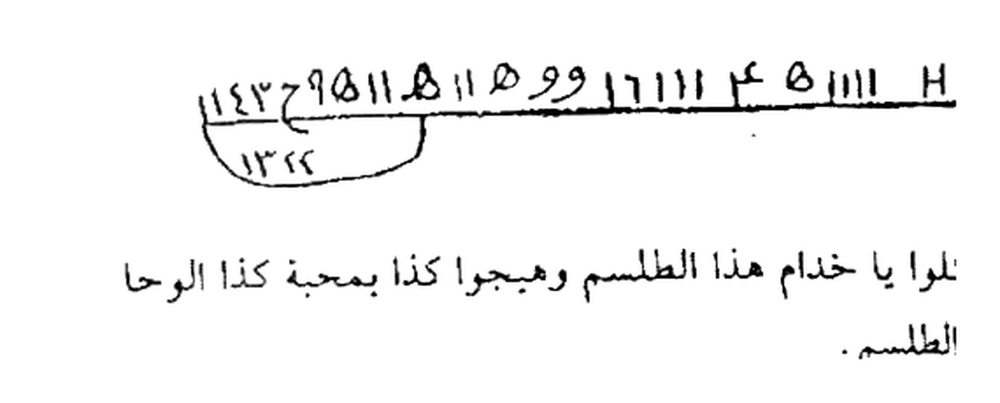
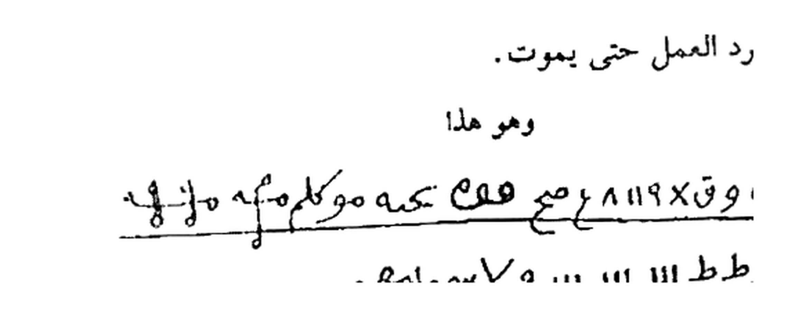
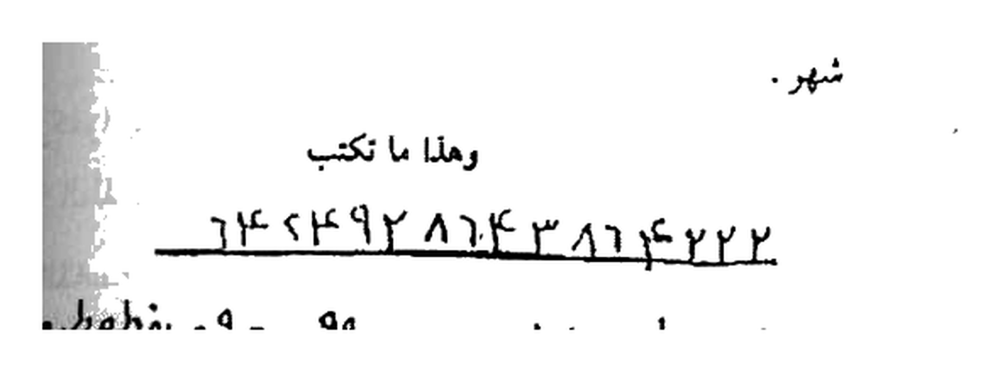

# Terjemahan Lengkap — Batch 32 — Halaman 155–159
## Kitab Asrar wa Khofayyat — Fashal Tsalis — Tilasm 9-11
### Sumber: Picture 078 kiri (155) + Picture 079 (156-157) + Picture 080 (158-159)

> Format 2 tingkat: **[Teks Arab Asli]** di atas — **[Terjemahan Indonesia]** di bawah. 3 Rajah HQ 4×.

---

## Halaman 155 — Tilasm Tasi' & 'Asyir — Picture 078 kiri

### [Teks Arab Asli — Halaman 155]
```
وهذا هو الطلسم
١٣٨ ١١١ ٤م ١١١١١ ٨١١ ١١٥ ١١٩
٩ ١١١ ١١١ ٩ ١١١ ٩١١٩ ٩ ١١١ ١١١ ٩١٤٣٩٤٥١١٥ا١١ ٥٩ ١٧١١١ ٤ ٥١١١ ٩ ١١١ و ١٢٤٢٩٥١١٥ا١١
توكلوا يا خدام هذا الطلسم وهيجوا بمحبة كذا كذا الوحا
بحق هذا الطلسم.
الطلسم التاسع
للمحبة أيضاً ليس له مثل نكتبه على رغيف خبز وتعلقه في
سبية وتتلو عليه القسم 11 مرة وتأخذه وتخرج خارج البلد فإن
قابلك كلب فاعطه الرغيف فإن المعمول له يصير كالمجنون ولا
يقر له قرار ولا هدو ولا اصطبار ولا يستطيع الصبر عنك طرفة
عين ولا يريد العمل حتى يموت.
وهو هذا
٩ ٢ ٨١١٩٨ × ٥ ٤٤ ٨١١٩٨٥ هـ ٤٤ ٨١١٩٨٥ هـ
اطط ١١١ ١١١ ١١١ ولا سهمامحي
بحق هذه الأحرف والأسماء العظام أن تجلبوا وتهيجوا كذا وكذا إلى كذا وكذا.
```

### [Terjemahan Indonesia — Halaman 155]
**Tilasm 9 — untuk Mahabbah yang tiada tanding:** Tulis pada **roti (raghif khubz)**, gantung di sibyah, baca 11×, bawa keluar kota, jika bertemu anjing berikan roti itu — maka si target jadi gila, tidak tenang.


*155 Atas — `١٣٨ ١١١ ٤م ١١١١١ ٨١١ ١١٥` — 134K 4×*


*155 Bawah — `٩ ٢ ٨١١٩٨ × ٥ ٤٤ هـ` — 129K 4×*

---

## Halaman 156 — Tilasm 'Asyir Mahabbah Da'imah — Picture 079 kanan

### [Teks Arab Asli — Halaman 156]
```
الطلسم العاشر
للمحبة الدائمة بين المرأة وزوجها وهو من العجائب الكبرى
نكتبه في آنية وتذيبه بماء وتقرأ عليه القسم ٢١ مرة وتنثره في
طريق المطلوب فعندما خطاه اشتعلت نار المحبة في فؤاده ولا
يستطيع الفراق طرفة عين ويجب في ذلك تجديد العمل في كل شهر.
وهذا ما تكتب
٦٢٤٢٩٢٨٦٤٣٦٦م٢٢٢
٨ سد ٨٧ ٩٩١١٧
طقعو غط عطما عطاما وطفوال
الوحا الوحا العجل العجل الساعة الساعة.
العجل العجل الساعة الساعة
وهذا هو القسم الشريف الذي تقرءه على العشرة طلاسم
التي مضت تقول:
بسم الله الرحمن الرحيم
لو أنزلنا هذا القرآن على جبل لرأيته خاشعاً متصدعاً من
خشية الله وتلك الأمثال نضربها للناس لعلهم يتفكرون وهو الله
الذي لا إله إلا هو عالم الغيب والشهادة هو الرحمن الرحيم ...
```

### [Terjemahan Indonesia — Halaman 156]
**Tilasm 10 — Mahabbah Da'imah Zawjain — ‘Aja’ib Kubra (sama dengan Tilasm 27 di Hal112):** Tulis di aniyah, larutkan, baca 21×, percikkan di jalan — tajdid tiap bulan.


*156 — `٦٢٤٢٩٢٨٦٤٣٦٦م٢٢٢ / ٨ سد ٨٧ ٩٩١١٧ / طقعو غط عطما` — 3 baris — 4×*

*Setelah Tilasm 10, masuk **Qasam Syarif** yang dibaca untuk 10 tilsam — Basmalah + “Law anzalna hadzal Qur'an…”*

---

## Halaman 157 — Qasam Syarif lanjutan — Picture 079 kiri

### [Teks Arab Asli — Halaman 157]
```
إلا هو الملك القدوس السلام المؤمن المهيمن العزيز الجبار
المتكبر سبحانه الله عما يشركون وهو الله الخالق البارئ المصور
له الأسماء الحسنى يسبح له ما في السموات والأرض وهو العزيز
الحكيم برهيم يالوش هيمالوش عن طياروش طلوش طش طلووش
عيرخش دهيليش مراهيش أسرعت الأنوار وتأججت النار على من
عصى داعي الملك الجبار أقسمت عليكم بجلال الله يا خدام
أسمائه أن تقضوا حاجتي وتجيبوا دعوتي بعزة الربوبية وبعظمة
الألوهية وبحق ذاته المنزه عن الكيفية أدعوكم بالله الحي القيوم
... إلخ
```

### [Terjemahan Indonesia — Halaman 157]
*Lanjutan Qasam Syarif — asma-asma: Barhīm Yālūsy Hīmālūsy … ‘Ayrakh Dahaylīsy … — tanpa Rajah.*

---


## Halaman 158
### [Teks Arab Asli]
```
واعلموا أن الله عزيز ذو انتقام أين خدام اسمه المؤمن المهيمن
العزيز الجبار أجيبوا طائعين بنور الأنوار وسر الأسرار أين خدام
اسمه المتكبر أين خدام اسمه الخالق البارئ المصور الله الله الله
سطحت خوارق بوارق نوره على من سمع اسمه وعصاه دعوتكم
لخدمتي فاسعوا لطاعتي أيها الخدام الطائعون بجلال من أمره بين
الكاف والنون الله الله الله من أطاعه فقد نال رضاه ومن عصى
الداعي بأسمائه قتل بسيف ما أمضاه سبحان الله ما أسرع براهين
أسمائه الكرام الحمد لله قد أشرقت أنوار آياته الكرام وأسمائه
العظام لا إله إلا الله مالك الملك ذو الجلال والإكرام الله أكبر
أجلب من الخدام من تأخر وعجباً لمن يتأخر وسيوف القهر
مسلولة عليه وملائكة الزجر محتاطة به وسائقة إليه فلا فرار من
دعوتي سريعاً فاقضوا حاجتي بعزة الأبدي الأبد الفرد الصمد الذي
لا يزول أبداً لا إله إلا هو لم يتخذ صاحبة ولا ولداً أنزل في كتابه
تذكرة لمن اهتدى قل أوحي إلي أنه استمع نفر من الجن فقالوا إنا
سمعنا قرآناً عجباً يهدي إلى الرشد فآمنا به ولن نشرك بربنا أحداً
وأنه تعالى جد ربنا ما اتخذ صاحبة ولا ولداً أجيبوا وافعلوا كذا
الوحا العجل الساعة.

تم القسم الشريف والاستنزال به عجيب لأن خدام
يحضرون من مرة واحدة وأعمالهم بالفور والسرعة وحرام عليهم
الكذب لأن خدام أسماء الله وخدام الطلاسم لا يكذبون.
```
### [Terjemahan Indonesia]
**Ketahuilah bahwa Allah Mahaperkasa lagi Maha Membalas.** **Di manakah para khadim nama-Nya al-Mu'min, al-Muhaimin, al-'Aziz, al-Jabbar?** **Sahutlah dengan taat, demi cahaya segala cahaya dan rahasia segala rahasia.** **Di manakah para khadim nama-Nya al-Mutakabbir? Di manakah para khadim nama-Nya al-Khaliq, al-Bari', al-Mushawwir?** *Allah, Allah, Allah.* **Terpancarlah kilauan cahaya-Nya atas siapa yang mendengar Nama-Nya lalu mendurhakai seruan kalian** — maka **bersegeralah melayani aku, wahai para khadim yang taat, demi keagungan Dzat yang perintah-Nya antara "Kāf" dan "Nūn"**. *Allah, Allah, Allah.* **Siapa yang menaati-Nya sungguh ia memperoleh keridhaan-Nya; dan siapa yang mendurhakai si penyeru dengan nama-nama-Nya, ia dibunuh dengan pedang yang Dia tajamkan.** **Mahasuci Allah, betapa cepatnya bukti-bukti nama-nama-Nya yang mulia.** **Segala puji bagi Allah, sungguh telah terbit cahaya ayat-ayat-Nya yang mulia dan nama-nama-Nya yang agung.** *Lā ilāha illallāh, Mālikul-Mulk, Dzul-Jalāli wal-Ikrām. Allāhu Akbar.*

**Tariklah dari para khadim orang yang menunda — dan sungguh mengherankan orang yang menunda!** **Pedang-pedang keperkasaan telah terhunus atasnya, dan para malaikat hardikan telah mengelilinginya serta menggiringnya kepadanya — maka tidak ada pelarian dari seruanku.** **Segeralah tunaikan kebutuhanku, demi keperkasaan Dzat Yang Mahaabadi, Yang Maha Awal, Yang Maha Esa, Yang Maha Dibutuhkan, yang tidak pernah lenyap.** *Tiada tuhan selain Dia; Dia tidak mengambil istri dan tidak pula anak.* **Dia menurunkan dalam kitab-Nya: "Peringatan bagi siapa yang mau mendapat petunjuk"** *(QS. Al-Jinn 1–2)* — **"Katakanlah: telah diwahyukan kepadaku bahwa sekelompok jin telah mendengarkan; mereka berkata: kami telah mendengar Al-Qur'an yang menakjubkan, yang memberi petunjuk ke jalan yang benar, lalu kami beriman kepadanya, dan kami tidak akan menyekutukan sesuatu pun dengan Tuhan kami. Dan sesungguhnya Mahatinggi kebesaran Tuhan kami; Dia tidak mengambil istri dan tidak pula anak."**

**Sahutlah dan lakukanlah demikian —** *al-Waḥā al-'Ajal as-Sā'ah.*

**Selesailah Qasam Syarif ini, dan istinzāl (penurunan) dengannya sangat menakjubkan** — sebab **para khadim hadir hanya dengan satu kali (seruan)**, dan **kerja mereka seketika dan cepat**; **dan haram atas mereka berdusta**, sebab **para khadim nama-nama Allah dan para khadim thilasm tidak berdusta**.

## Halaman 159
### [Teks Arab Asli]
```
الطلسم الحادي عشر

لعاقة الرجل عن الزواج وهبوطه عن الزنى والحرام تكتبه
على شيء من أثره وتعلق الأثر في السبية على البخور وهو مقل
وحنيت وتتلو القسم ١١ مرة ثم تضع الأثر في مكحلة وتسد عليها
بزفت وادفنه في بيت المطلوب فإن كنت موكلاً بالمنع عن الزنى
فإنه لا يزني أبداً ويمتنع عن اتباع الشهوات وإن كنت موكلاً بالمنع
عن الزواج فإنه لا يتزوج أبداً وإن كنت موكلاً بالاثنين فلا مانع.

وهو هذا الطلسم

[THILASM ١١ — satu baris rumus Arab panjang + kotak berisi simbol dan huruf. Angka dan huruf TIDAK diubah — lihat rajah asli halaman 159.]

الطلسم الثاني عشر

لعاقة المرأة عن الزواج والحرام كذلك تكتبه على بيضة بنت
يومها ويكون يوم الخميس وتطلق البخور المذكور وتتلو عليه
القسم ٩ مرات ثم تدفنها في قبر لا يزار فإن المعمول له لا يتزوج.
```
### [Terjemahan Indonesia]
**THILASM KESEBELAS**

**Untuk menghalangi lelaki dari pernikahan dan menjatuhkannya dari zina serta yang haram.** **Engkau menulisnya pada sesuatu dari bekas (atsar) dirinya**, dan **menggantungkan atsar itu pada as-sabiyyah di atas bakhur, yaitu muql dan ḥantīt**; **bacakan Qasam 11 kali**; lalu **letakkan atsar itu di dalam mukhulah (wadah celak)**, **tutup rapat dengan zift (ter)**, dan **kuburkan di rumah si terget**.

- **Jika engkau di-tawakkal-kan untuk mencegah zina** → **ia tidak akan berzina selamanya** dan **menahan diri dari mengikuti syahwat**.
- **Jika engkau di-tawakkal-kan untuk mencegah pernikahan** → **ia tidak akan menikah selamanya**.
- **Dan jika engkau di-tawakkal-kan untuk keduanya** → **tidak ada penghalang (keduanya berlaku)**.

**Dan inilah thilasm-nya** — *(satu baris rumus Arab panjang beserta kotak berisi simbol dan huruf; dijaga pada rajah asli, tidak diubah).*

**THILASM KEDUA BELAS**

**Untuk menghalangi perempuan dari pernikahan dan yang haram — demikian pula.** **Engkau menulisnya pada telur yang baru dihasilkan pada hari itu**, dan **harus pada hari Kamis**; **lepaskan bakhur yang telah disebutkan**, **bacakan Qasam 9 kali atasnya**, lalu **kuburkan telur itu di kuburan yang tidak diziarahi** — maka **orang yang menjadi sasaran tidak akan menikah**.
