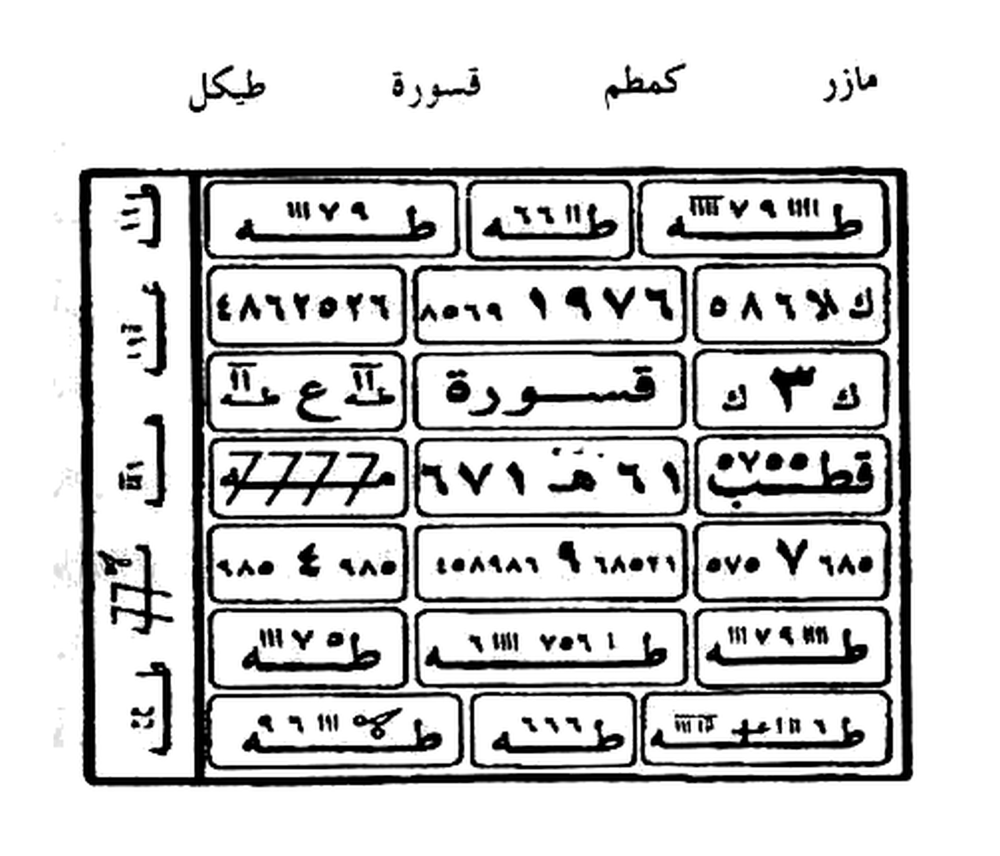

# BATCH 43 — Halaman 205–206 — Azimah Silak wal-Kasyf & Khâtam Murabba' Empat Penjuru (Sakk 111)
> **Kitab Asrar wa Khofayyat fi 'Ilmi Ruhaniyyat — Syeikh Athiyyah Abdul Hamid — Terjemahan Lengkap Indonesia — Batch 43 (Hal. 205–206)**
> **Khatam:** halaman **206 / 297** · **Rajah kumulatif: 169** (168 akhir Batch 41 + 1 rajah batch ini)

**Sumber:** Picture 104.jpg (Hal204 kanan + **Hal205 kiri**) dan Picture 105.jpg (**Hal206 kanan** + Hal207 kiri).
**Total Rajah Batch43:** **1 Rajah** — wafaq murabba' empat penjuru (Khâtam al-Haibah) pada Hal206, dipotong presisi ke `terjemahan/rajah/rajah-hal-206-wifaq-murabba-presisi-2112x1808.jpg` (2112×1808 px, 300 DPI, LANCZOS, latar putih murni 78,6%, titik tiga Sirr An-Nuqthoh + garis tipis Qolam Hirz paksa dipertahankan, **tanpa threshold keras**). Hal205 **murni teks** — tidak ada rajah.
**Isi:** Hal205 **Azimah as-Silak wal-Kasyf** — pembuka baru dengan asma `أهيا شراهيا أدوناي أصباؤوت علي شدايا ألوحا العجل الساعة`, perintah `فاخرجوا`, lalu qasam Ruhaniyyat Asba-uuti, deret nama ijazah (`بزجل ترقب برهش غلمش ...`), dan zahr `يا قيوم يا سلام يا مؤمن يا مهيمن` — Hal206 **tawkil empat penjuru** (مازر / كمطم / قسورة / طيكل = جبرائيل ميكائيل اسرافيل عزرائيل), **Sakk Tindih 111** di atas huruf ك, dan **wafaq murabba' empat penjuru** beringkas angka-angka gundul tanpa titik.
**Sambungan:** melanjutkan Batch 42; Hal204 terputus di `… شهوده وأولادكم وخدامكم إن كنـ` → Hal205 menyambung `ولا يقول لا إله إلا الله محمد رسول الله` — Hal206 menyambung dari Hal205 `… والسباسب` → `السبعة وبحق أرميس كيان طفيان …`

**Catatan ketersediaan Batch 42.** Berkas `terjemahan/BATCH-42-Hal-203-204.md` **tidak ada** pada branch ini (dicari di seluruh riwayat git: tidak ditemukan), dan `/mnt/data/` kosong sehingga `crop_wafaq_presisi_2112x1808.py` versi Meta tidak dapat disalin. Karena itu: (a) format **3 susun MUTLAK** (Arab asli → Latin fonetik → Terjemahan) diambil dari **BATCH-41-Hal-200-202.md** yang skemanya identik, (b) `crop_wafaq_presisi_2112x1808.py` **ditulis ulang di repo root** dengan standar flat-field Batch 38/39/41 dan parameter presisi yang diminta. Hal 203–204 tetap tercatat sebagai celah yang harus menyusul.

---

## FOTO ASLI

**Hal 205** — Picture 104.jpg, belahan kiri (halaman kanan = Hal204):

*Foto Asli Halaman 205 — **Picture 104.jpg** (belahan kiri; kanan = Hal204). Nomor halaman cetak `205` pada kaki halaman.*

**Hal 206** — Picture 105.jpg, belahan kanan (halaman kiri = Hal207):

*Foto Asli Halaman 206 — **Picture 105.jpg** (belahan kanan; kiri = Hal207). Nomor halaman cetak `206` pada kaki halaman. Inilah satu-satunya rajah batch ini (khâtam murabba' empat penjuru + kolom Sakk).*

**Rajah Hal 206 — hasil crop presisi 2112×1808:**

*Gambar Rajah Asli Halaman 206 — **Khâtam Murabba' Empat Penjuru (wafaq al-haibah)**: bingkai ganda berisi **3 kolom × 7 baris sel** bersudut tumpul (gaya Qolam Hirz), setiap sel memuat angka/huruf gundul dengan garis paku-gergaji di atasnya, ditambah **kolom Sakk** di kiri bingkai berisi **111** yang ditindihkan di atas huruf **ك** pada baris ke-4; di atas bingkai tercetak baris nama empat penjuru `طيكل مازر قسورة كمطم` yang berputar-putar pada tiga baris berikutnya. Angka-angka pada sel **tidak diterjemahkan** — disalin apa adanya (lihat tabel transkripsi di bawah). Berkas: `terjemahan/rajah/rajah-hal-206-wifaq-murabba-presisi-2112x1808.jpg` — 2112×1808 px, 300 DPI, LANCZOS, latar putih murni, margin 15% agar kepala panah Sakk 111 di atas ك tidak terpotong.*

---

### Halaman 205 — Azimah as-Silak wal-Kasyf: Pembuka, Qasam Asba-uuti, dan Zahr

**[Teks Arab Asli]**

> بِسْمِ اللهِ الرَّحْمَنِ الرَّحِيمِ . هَذِهِ عَزِيمَةٌ لِلسِّيلَكِ وَالْكَشْفِ فَلْيَبْتَدِئْ بِـ أَهْيَا شَرَاهِيَا أَدُونَايَ أَصْبَاؤُوتَ عَلِي شَدَايَا أَلُوحَا الْعَجَلَ السَّاعَةَ فَإِذَا قَرَأَهَا فِي الْأَرْضِ فَاخْرُجُوا لَا يَقُولُ لَا إِلَهَ إِلَّا اللهُ مُحَمَّدٌ رَسُولُ اللهِ
>
> وَلَا يَكُونُ وَلَا تَشْرَبُونَ حَتَّى تَقْضُوا حَاجَتِي وَتَفْعَلُوا مَا أَمَرْتُكُمْ بِهِ فِي أَسْرَعِ وَقْتٍ وَأَقَلِّ سَاعَةٍ بِحَقِّ الرُّؤُوسِ الْأَرْبَعَةِ وَهُمْ مَازِرٌ وَكَمْطَمٌ وَقَسُورَةٌ وَطِيكَلٌ وَبِحَقِّ مَا أَقْسَمْتُ بِهِ عَلَيْكُمْ وَبِحَقِّ السِّرِّ الْمَكْنُونِ الْمَخْزُونِ الَّذِي هُوَ بَيْنَ الْكَافِ وَالنُّونِ إِنَّمَا أَمْرُهُ إِذَا أَرَادَ شَيْئًا أَنْ يَقُولَ لَهُ كُنْ فَيَكُونُ فَكُّوا الرُّمُوزَ وَأَحْضِرُوا السَّبَاسِبَ وَأَقْطَعُوا السَّلَاسِلَ وَأَحْرِقُوا الْحُجُبَ وَبَلِّغُوا الْمَقَاصِدَ وَشُقُّوا الْهَوَاءَ وَأَخْنِقُوا الْجَوَّ بِحَقِّ مَقَامِكُمْ وَأَجْنَادِكُمْ وَبِحَقِّ عُهُودِكُمْ وَإِيمَانِكُمْ وَأَوْلَادِكُمْ وَبِحَقِّ سَبَاسِبَ وَسَيْفٍ قَاطِعٍ إِلَيْهَا غَالِبٍ إِنْ أَبْطَأْتُمْ وَتَخَلَّفْتُمْ عَنِّي فَقَدِ اسْتَهْزَأْتُمْ بِحَقِّي أَنَا بَرِيءٌ مِنْكُمْ وَأَسْتَخْلِفُ بِحَاجَتِي أَقْوَامًا غَيْرَكُمْ وَأَنْتُمْ تَعْلَمُونَ مَا يَحِلُّ بِكُمْ ، سَرِيعٌ خَلْخَلَاتٌ أَزْجُرُهُ يَا مَازِرُ وَأَنْتَ يَا قَسُورَةُ وَأَنْتَ يَا طِيكَلُ وَأَنْتَ يَا كَمْطَمُ أَزِرْ أَزِرْ 3 أَجِيبُوا بَارَكَ اللهُ فِيكُمْ وَعَلَيْكُمْ وَعَلَى مَنْ أَطَاعَ اللهَ مِنْكُمْ وَاتَّقُوا أَلِيمَ عَذَابِهِ وَأَحْرِقُوا وَأَسْرِعُوا وَعَجِّلُوا وَأَطْرُدُوا كُلَّ شَيْطَانٍ مَارِدٍ مَانِعٍ لِكَنْزٍ أَوْ طِلَسْمٍ أَوْ عُقْدَةٍ أَوْ سِحْرٍ .
>
> قَرَأْتُ عَلَيْكُمْ هَذِهِ الدَّعْوَةَ الْعَظِيمَةَ وَتَظْهَرُوا لِي كُلَّ خَفِيٍّ وَبَيِّنُوا لِي كُلَّ خَفِيَّةٍ وَكُونُوا لِي فِي مَقَامِي سَمْعِي مُبِينٌ وَفِي يَقَظَتِي مُحَقِّقِينَ وَحَاضِرِينَ وَنَاظِرِينَ وَسَامِعِينَ وَعَالِمِينَ غَيْرَ جَامِلِينَ إِذَا قَرَأْتَ هَذِهِ الدَّعْوَةَ الْاِسْمَ الْعَظِيمَ اكْشِفُوا لِي عَنْ كُلِّ مَا أَسْأَلُكُمْ بِهِ عَلَيْكُمْ كَشْفًا مُبِينًا مِنْ غَيْرِ إِشْكَالٍ وَاللهُ مُخْرِجٌ مَا كُنْتُمْ تَكْتُمُونَ أَحْضِرُوا إِلَى الْخَادِمِ كُلَّ يَوْمٍ وَمَهْمَا أَمَرْتُكُمْ بِهِ وَأَخْفُونِي عَنِ الْأَبْصَارِ وَكُونُوا فِي كُلِّ حَاجَةٍ قَدَّمْتُكُمْ فِيهَا فَاضْرِبْ كُلَّ عَدُوٍّ شَيْطَانٍ سَلْطَتِكُمْ مُنْتَقِمِينَ وَأْمُرُوا الْخَادِمَ أَنْ لَا يُفَارِقَنِي إِذَا دَعَوْتُهُ لِأَهْرِي وَأَسْأَلُهُ وَخَزُونِي عَنِ الْأَبْصَارِ وَيَقْضُونَ مَا أَمَرْهُمْ بِهِ وَمَا تَوَكَّلْتُمْ بِهِ عَلَيْهِ مِمَّا ذَكَرْتُهُ وَمَا لَا أَذْكُرُهُ بِحَقِّ آدَمَ أَرْدَمَ ابْنِ نَدَمَ ابْنِ كُرْدَمَ ابْنِ سَامِ سَبَاسِبَ وَحَاكِمٍ غَالِبٍ قَاطِعٍ قَاهِرٍ وَسَيْفٍ غَالِبٍ قَاطِعٍ أَخْضِعُوا وَأَظْهِرُوا بُرْهَانَ الْإِجَابَةِ بِحَقِّ سَامٍ هَدَّامِ سَبَاسِبَ وَالْغَيَاهِبِ وَبِحَقِّ النُّورِ وَالنِّيرَانِ وَبِكَفَّةِ الْمِيزَانِ وَبِالْحَجَرِ الْأَسْوَدِ وَالْبُرْهَانِ وَبِحَقِّ الْعُهُودِ وَالْإِيمَانِ وَبِحَقِّ اللهِ الْوَاحِدِ الْحَنَّانِ الْمَنَّانِ عَصَفَ 2 وَبِحَقِّ سَرْدَمَ ابْنِ مَرْدَمَ ابْنِ طَرْدَمَ ابْنِ دَمْدَمَ ابْنِ كَمْطَمَ ابْنِ خَانِمَ ابْنِ الْأَعْوَانِ ابْنِ مَازِرَ ابْنِ كَمْطَمَ ابْنِ قَسُورَةَ ابْنِ طِيكَلَ وَبِحَقِّ السَّبَاسِبِ السَّبْعَةِ سَبَاسِبَ 1
>
> وَأُوتِينَا قَاطِعٌ وَسَيْفٌ قَاطِعٌ غَالِبٌ الْوَحَا إِنْ كَانَتْ إِلَّا صَيْحَةً وَاحِدَةً فَإِذَا هُمْ جَمِيعٌ لَدَيْنَا مُحْضَرُونَ إِنَّهُ مِنْ سُلَيْمَانَ وَإِنَّهُ بِسْمِ اللهِ الرَّحْمَنِ الرَّحِيمِ أَلَّا تَعْلُوا عَلَيَّ وَأْتُونِي مُسْلِمِينَ ــ قَتَّ الدَّعْوَةُ وَهَذَا هُوَ زَجْرُهَا (يَا لَهُ يَا ذَا الْجَلَالِ) يَا قَيُّومُ يَا سَلَامُ يَا مُؤْمِنُ يَا مُهَيْمِنُ يَا عَزِيزُ يَا جَبَّارُ يَا مُتَكَبِّرُ كَهْفٌ طَبَعٌ شَقَقٌ نَفَعُوا عَدُوَّ وَالسَّبَاسِبُ

**[Transliterasi Latin Fonetik — bacaan washal, huruf-per-huruf]**

> *Bismillāhir-Raḥmānir-Raḥīm. **HĀDZIHI** (hā + dzā + hi) **'AZĪMATUN** ('a + zī + ma + tun) **LIS-SĪLAKI** (li + s-sī + lā + ki) **WAL-KASYFI** (wa + l-kasy + fi) **FALYABTADI'** (fa + li + yab + ta + di') **BI** (bi) **AHYĀ SYARĀHIYĀ ADŪNĀYA ASHBĀ'ŪTA 'ALĪ SYADĀYĀ ALŪḤĀ AL-'AJALA AS-SĀ'AH** — fa idzā qara'ahā fil-arḍhi fakhrujū, lā yaqūlu lā ilāha illallāhu Muḥammadur-rasūlullāh.*
>
> *Wa lā yakūnu wa lā tasyrabūna ḥattā taqḍhū ḥājatī wa taf'alū mā amartukum bihī fī asra'i waqtin wa aqalli sā'atin bi ḥaqqir-ru'ūsil-arba'ati wa hum MĀZIR wa KAMṬHAM wa QASŪRAH wa ṬHĪKAL, wa bi ḥaqqi mā aqsamtu bihī 'alaikum wa bi ḥaqqis-sirril-maknūnil-makhzūnilladzī huwa bainal-kāfi wan-nūni, innamā amruhū idzā arāda syai'an an yaqūla lahū kun fa yakūn. Fakkur-rumūza wa aḥḍhirur-sabāsiba wa qṭha'us-salāsila wa aḥriqul-ḥujuba wa ballighul-maqāṣhida wa syuqqul-hawā'a wa akhniqul-jawwa bi ḥaqqi maqāmikum wa ajnādikum wa bi ḥaqqi 'uhūdikum wa īmānikum wa aulādikum, wa bi ḥaqqi SABĀSIBA wa saifin qāṭhi'in ilaihā ghālibin. In abṭha'tum wa takhallaftum 'annī fa qadistahza'tum bi ḥaqqī, anā barī'un minkum wa astakhlifu bi ḥājatī aqwāman ghairakum, wa antum ta'lamūna mā yaḥillu bikum. SARĪ'UN KHALKHALĀTUN AZJURUHŪ yā MĀZIR wa anta yā QASŪRAH wa anta yā ṬHĪKAL wa anta yā KAMṬHAM, AZIR AZIR (3×), ajībū bārakallāhu fīkum wa 'alaikum wa 'alā man aṭhā'allāha minkum, wattaqū alīma 'adzābihī, wa aḥriqū wa asri'ū wa 'ajjilū waṭhrudū kulla syaiṭhānin māridin māni'in li kanzin au ṭhilasmin au 'uqdatin au siḥr.*
>
> *Qara'tu 'alaikum hādzihid-da'watal-'azhīmata wa tazh-harū lī kulla khafiyyin wa bayyinū lī kulla khafiyyatin wa kūnū lī fī maqāmī sam'ī mubīnun wa fī yaqazhatī muḥaqqiqīna wa ḥāḍhirīna wa nāzhirīna wa sāmi'īna wa 'ālimīna ghairi jāmilīn. Idzā qara'ta hādzihid-da'watal-ismal-'azhīma iksyifū lī 'an kulli mā as'alukum bihī 'alaikum kasyfan mubīnan min ghairi isykāl, wallāhu mukhrijun mā kuntum taktumūn. Aḥḍhirū ilal-khādimi kulla yaumin wa mahmā amartukum bihī, wa akhfūnī 'anil-abshāri wa kūnū fī kulli ḥājatin qaddamtukum fīhā faḍhrib kulla 'aduwwin syaiṭhānin salṭhatikum muntamiqīn, wa'murul-khādima an lā yufāriqanī idzā da'autuhū li ahri wa as'aluhū, wa khazūnī 'anil-abshāri wa yaqḍhūna mā amarahum bihī wa mā tawakaltum bihī 'alaihi mimmā dzakartuhū wa mā lā adzkuruh. Bi ḥaqqi ĀDAMA ARDAMA IBNI NADAMA IBNI KURDAMA IBNI SĀMI SABĀSIBA wa ḥākimin ghālibin qāṭhi'in qāhirin wa saifin ghālibin qāṭhi'in, akhḍhi'ū wa azhhirū burhānal-ijābati bi ḥaqqi SĀMIN HADDĀMI SABĀSIBA WAL-GHAYĀHIBI wa bi ḥaqqin-nūri wan-nīrāni wa bi kaffatil-mīzāni wa bil-ḥajaril-aswadi wal-burhāni wa bi ḥaqqil-'uhūdi wal-īmāni wa bi ḥaqqillāhil-Wāḥidil-Ḥannānil-Mannāni 'AṢHAFA (2×) wa bi ḥaqqi SARḌAMA IBNI MARḌAMA IBNI ṬHARḌAMA IBNI DAMḌAMA IBNI KAMṬHAMA IBNI KHĀNIMA IBNIL-A'WĀNI IBNI MĀZIRA IBNI KAMṬHAMA IBNI QASŪRATA IBNI ṬHĪKALA wa bi ḥaqqis-sabāsibil-sab'ati SABĀSIBA (1×).*
>
> *Wa ūtīnā qāṭhi'un wa saifun qāṭhi'un ghālibun al-waḥā, IN KĀNAT ILLĀ ṢHAIḤATAN WĀḤIDATAN FA IDZĀ HUM JAMĪ'UN LADAINĀ MUḤḌHARŪN, INNAHŪ MIN SULAIMĀNA WA INNAHŪ BISMILLĀHIR-RAḤMĀNIR-RAḤĪM, ALLĀ TA'LŪ 'ALAYYA WA'TŪNĪ MUSLIMĪN. — QATTATID-DA'WATU WA HĀDZĀ HUWA ZAJRUHĀ (YĀ LAHŪ YĀ DZAL-JALĀL) YĀ QAYYŪM YĀ SALĀM YĀ MU'MIN YĀ MUHAIMIN YĀ 'AZĪZ YĀ JABBĀR YĀ MUTAKABBIR KAHFUN ṬHABA'UN SYAQAQUN NAFA'Ū 'ADUWWAN WAS-SABĀSIB.*

**[Terjemahan Indonesia — Layer 1 per kata, Layer 2 per kalimat]**

> **Layer 1 (per kata):** *Hādzihi* = Ini · *'azīmatun* = Azimah · *lis-sīlaki* = untuk Silak · *wal-kasyfi* = dan Kasyaf · *falyabtadi'* = maka hendaklah ia memulai · *bi* = dengan · *ahyā syarāhiyā adūnāya ashbā'ūta 'alī syadāyā alūḥā al-'ajala as-sā'ah* = (asma — dibiarkan Arab) · *fa idzā qara'ahā* = maka apabila ia membacanya · *fil-arḍhi* = di bumi · *fakhrujū* = maka keluarlah kalian · *lā yaqūlu* = tidak ia mengucapkan · *lā ilāha illallāh* = tiada tuhan selain Allah · *muḥammadur-rasūlullāh* = Muhammad Rasul Allah.
> **Layer 2 (per kalimat):** *Ini adalah Azimah untuk Silak dan Kasyaf. Maka hendaklah ia memulai dengan: AHYA SYARAHIYA ADUNAYA ASHBA-UUTI ALI SYADAYYA ALUHA AL-AJAL AS-SAAH. Maka apabila ia membacanya di bumi, maka keluarlah kalian — tidak ia mengucapkan: tiada tuhan selain Allah, Muhammad Rasul Allah.*
>
> **Layer 1 (per kata):** *wa lā yakūnu* = dan tidak menjadi · *wa lā tasyrabūna* = dan tidak kalian minum · *ḥattā taqḍhū* = sampai kalian menunaikan · *ḥājatī* = hajatku · *wa taf'alū* = dan kalian kerjakan · *mā amartukum bihī* = apa yang kuperintahkan kepada kalian · *fī asra'i waqtin* = di waktu tercepat · *wa aqalli sā'atin* = dan sesaat paling sedikit · *bi ḥaqqir-ru'ūsil-arba'ati* = dengan hak empat kepala · *wa hum* = yaitu mereka · *Māzir, Kamṭham, Qasūrah, Ṭhīkal* = (nama — dibiarkan Arab) …
> **Layer 2 (per kalimat):** *Dan tidak menjadi, dan tidak kalian minum, sampai kalian menunaikan hajatku dan mengerjakan apa yang kuperintahkan kepada kalian pada waktu tercepat dan sesaat paling sedikit — dengan hak empat kepala, yaitu mereka: MAZIR, KAMTHAM, QASURAH, THIKAL — dan dengan hak apa yang kusumpahkan atas kalian, dan dengan hak rahasia yang tersimpan-lindung yang berada di antara Kaf dan Nun: "perintah-Nya apabila Dia menghendaki sesuatu hanyalah Dia berkata kepadanya: jadilah, maka jadilah". Lepaskanlah lambang-lambang, hadirkanlah Sabasib, potonglah rantai-rantai, bakarlah tirai-tirai, sampaikanlah tujuan-tujuan, belahlah udara, dan cekiklah angkasa — dengan hak kedudukan kalian, pasukan kalian, perjanjian kalian, iman kalian, dan anak-anak kalian; dan dengan hak SABASIB dan pedang pemutus yang mengalahkan ke arahnya. Jika kalian berlambat dan meninggalkanku, maka kalian telah memperolok hakku — aku berlepas diri dari kalian, dan aku gantikan hajatku dengan kaum selain kalian, dan kalian mengetahui apa yang menimpa kalian. SARI'UN KHALKHALATUN AZJURUHU — wahai MAZIR, dan engkau wahai QASURAH, dan engkau wahai THIKAL, dan engkau wahai KAMTHAM: AZIR AZIR (3×) — jawablah, semoga Allah memberkahi kalian dan atas kalian dan atas siapa yang menaati Allah di antara kalian; dan takutlah akan azab-Nya yang pedih; bakarlah, bersegeralah, segerakanlah, dan usirlah setiap setan pembangkang yang menghalangi perbendaharaan, tilsam, ikatan, atau sihir.*
>
> **Layer 1 (per kata):** *qara'tu 'alaikum* = aku bacakan atas kalian · *hādzihid-da'watal-'azhīmata* = seruan besar ini · *wa tazh-harū lī* = dan tampakkanlah kepadaku · *kulla khafiyyin* = setiap yang tersembunyi · *wa bayyinū lī* = dan jelaskanlah kepadaku · *kulla khafiyyatin* = setiap hal tersembunyi · *wa kūnū lī fī maqāmī* = dan jadilah bagiku di kedudukanku · *sam'ī mubīnun* = pendengaranku yang nyata · *wa fī yaqazhatī* = dan di keterjagaanku · *muḥaqqiqīna* = orang-orang yang memastikan …
> **Layer 2 (per kalimat):** *Aku bacakan atas kalian seruan besar ini: tampakkanlah kepadaku setiap yang tersembunyi dan jelaskanlah kepadaku setiap hal tersembunyi; jadilah bagiku, di kedudukanku, pendengaranku yang nyata, dan di keterjagaanku orang-orang yang memastikan, hadir, melihat, mendengar, mengetahui, tanpa berlaku kasar. Apabila engkau membaca seruan ini — nama yang agung — singkaplah bagiku segala apa yang kutanyakan kepada kalian, dengan singkapan yang nyata tanpa keraguan; dan Allah-lah yang mengeluarkan apa yang kalian sembunyikan. Hadirkanlah kepada khadam setiap hari, dan apa pun yang kuperintahkan kepada kalian; sembunyikanlah aku dari pandangan mata, dan jadilah pada setiap kebutuhan yang kuserahkan kepada kalian — maka pukullah setiap musuh setan dengan kekuasaan kalian sebagai pembalas; dan perintahkanlah kepada khadam agar tidak meninggalkanku apabila aku menyerunya untuk keperluanku dan aku memohon kepadanya; dan sembunyikanlah aku dari pandangan mata; dan mereka menunaikan apa yang kuperintahkan dan apa yang kalian serahkan kepadanya, baik yang kusebutkan maupun yang tidak kusebutkan. Dengan hak ADAM ARDAM bin NADAM bin KURDAM bin SAM SABASIB, dan hakim yang mengalahkan, memutus, menundukkan, dan pedang yang mengalahkan lagi memutus — tunduklah dan tampakkanlah bukti pengabulan. Dengan hak SAM HADDAM SABASIB dan kegelapan-kegelapan, dengan hak cahaya dan api-api, dengan pan timbangan, dengan Hajar Aswad dan bukti, dengan hak perjanjian-perjanjian dan iman, dan dengan hak Allah Yang Satu, Yang Maha Pengasih, Yang Maha Pemberi — 'ASHOFA (2×). Dan dengan hak SARDAM bin MARDAM bin THARDAM bin DAMDAM bin KAMTHAM bin KHANIM bin AL-A'WAN bin MAZIR bin KAMTHAM bin QASURAH bin THIKAL, dan dengan hak Sabasib yang tujuh — SABASIB (1×).*
>
> **Layer 1 (per kata):** *wa ūtīnā qāṭhi'un* = dan kami diberi yang memutus · *wa saifun qāṭhi'un ghālibun* = dan pedang pemutus yang mengalahkan · *al-waḥā* = segeralah · *in kānat illā ṣhaiḥatan wāḥidatan* = tiada lain ia melainkan satu teriakan · *fa idzā hum jamī'un ladainā muḥḍharūn* = maka tiba-tiba mereka semua di hadapan Kami dihadirkan …
> **Layer 2 (per kalimat):** *Dan kami diberi yang memutus, dan pedang pemutus yang mengalahkan — segeralah! "Tiada lain ia melainkan satu teriakan, maka tiba-tiba mereka semua dihadirkan di hadapan Kami." "Sesungguhnya ia dari Sulaiman, dan sesungguhnya ia dengan nama Allah Yang Maha Pengasih lagi Maha Penyayang: janganlah kalian meninggikan diri atasku dan datanglah kepadaku sebagai orang-orang berserah." — Qattatid-Da'wah (seruan pun telah diputuskan), dan inilah zahr-nya: (YA LAHU YA DZAL-JALAL) YA QAYYUM YA SALAM YA MU'MIN YA MUHAIMIN YA 'AZIZ YA JABBAR YA MUTAKABBIR — KAHFUN THABA'UN SYAQAQUN — NAFA'U 'ADUWWAN WAS-SABASIB.*

> **Catatan tiga larangan mutlak (Batch 43).** (1) `عزيمة` tetap **Azimah** — tidak diganti menjadi doa, kata baik, faedah, atau amalan. (2) `خاتم` tetap **khatam** dan `توكيل` tetap **tawkîl** — tidak diganti wafaq/jimat/penyerahan. (3) **Tanpa tafsir akidah** dan **tanpa tambahan** *insyaAllah* / *jika diizinkan* / *dengan izin Allah* di mana pun pada lapis terjemahan; seluruh prosa ditulis **bersambung** mengikuti cetakan, bukan diringkas menjadi poin-poin.

---

### Halaman 206 — Tawkil Empat Penjuru, Sakk 111, & Wafaq Murabba' al-Haibah

**[Teks Arab Asli]**

> … السَّبْعَةِ وَبِحَقِّ أَرْمِيسَ كَيَانَ طُفْيَانَ ثَنِّيهِمْ عِلَشْيِهِمْ أُمَّ نِيلَةَ بِسُورَةِ يس بِسَيُّومَ عَلْقِيلَ عَجَمٍ بِدُوقَ طَائِعِينَ لِلهِ الْوَاحِدِ الْقَهَّارِ الْوَحَا الْعَجَلَ السَّاعَةَ ــــ مَتَّ إِعْلَمْ بِأَنَّكَ تَتْلُو الدَّعْوَةَ سَبْعَ مَرَّاتٍ وَالزَّجْرَ مَرَّةً وَاحِدَةً وَهَذَا خَاتَمُ الدَّعْوَةِ الْمَخْصُوصِ لَهَا لَأَهَمَّا مِنَ الذَّخَائِرِ وَاعْلَمْ أَنْ كَانَ أَكْتُبْ خَاتَمَ الدَّعْوَةِ وَأَتْلِيهَا ثَلَاثَ مَرَّاتٍ فَإِنَّهُ يَكُونُ وَهَذَا إِلَى أَتِمَّ كَمَا تَرَى أَفْهِمْ قَوْلَهُ ــ
>
> مَازِرٌ أَجِبْ يَا كَمْطَمُ أَجِبْ يَا قَسُورَةُ أَجِبْ يَا طِيكَلُ تَوْكِيلٌ يَا حَيْطَايِلُ الْخَدِيمُ وَيَا مَدْحَرَجُ الْـ … بِحَقِّ الرُّؤُوسِ الْأَرْبَعَةِ الْحَقُّ أَجِبْ يَا مِيكَائِيلُ أَجِبْ يَا طِيكَلُ أَجِبْ يَا كَمْطَمُ أَجِبْ يَا مَازِرُ أَجِبْ
>
> أَجِبْ يَا مِيكَائِيلُ أَجِبْ يَا طِيكَلُ أَجِبْ يَا كَمْطَمُ أَجِبْ يَا مَازِرُ أَجِبْ يَا قَسُورَةُ
>
> طِيكَلُ &nbsp;&nbsp; مَازِرٌ &nbsp;&nbsp; قَسُورَةُ &nbsp;&nbsp; كَمْطَمُ
> كَمْطَمُ &nbsp;&nbsp; قَسُورَةُ &nbsp;&nbsp; مَازِرٌ &nbsp;&nbsp; طِيكَلُ
> طِيكَلُ &nbsp;&nbsp; مَازِرٌ &nbsp;&nbsp; قَسُورَةُ &nbsp;&nbsp; كَمْطَمُ
> كَمْطَمُ &nbsp;&nbsp; قَسُورَةُ &nbsp;&nbsp; مَازِرٌ &nbsp;&nbsp; طِيكَلُ
>
> خَاتَمٌ مُرَبَّعٌ ٤×٤ لِلْهَيْبَةِ فِيهِ أَرْبَعَةُ أَرْكَانٍ جِبْرَائِيلُ مِيكَائِيلُ إِسْرَافِيلُ عِزْرَائِيلُ وَفِي وَسَطِهِ أَهْيَا شَرَاهِيَا [WAFAQ TIRU GAMBAR ASLI — JANGAN TERJEMAHKAN ANGKA]

**[Transliterasi Latin Fonetik — bacaan washal, huruf-per-huruf]**

> *…as-sab'ati wa bi ḥaqqi ARMĪSA KAYĀNA ṬHUFYĀNA TSANNIYHIM 'ILASY-YIHIM UMMA NĪLATA BI SŪRATI YĀSĪN BI SAYYŪMA 'ALQĪLA 'AJAMIN BIDŪQA ṬHĀ'I'ĪNA LILLĀHIL-WĀḤIDIL-QAHHĀR, AL-WAḤĀ AL-'AJALA AS-SĀ'AH. — MATTA I'LAM BI ANNAKA TATLUD-DA'WATA SAB'A MARRĀTIN WAZ-ZAJRA MARRATAN WĀḤIDATAN, WA HĀDZĀ KHĀTAMUD-DA'WATIL-MAKHSHŪṢHI LAHĀ LA-AHAMMĀ MINADZ-DZAKHĀ'IR. WA'LAM AN KĀNA AKTUB KHĀTAMAD-DA'WATI WA ATLĪHĀ TSALĀTSA MARRĀTIN FA INNAHŪ YAKŪNU, WA HĀDZĀ ILĀ ATAMMA KAMĀ TARĀ AFHIM QAULAH.*
>
> *MĀZIRUN AJIB yā KAMṬHAMU AJIB yā QASŪRATU AJIB yā ṬHĪKALU TAWKĪLUN yā ḤAIṬHĀYĪLUL-KHADĪMU wa yā MADḤARAJUL-… bi ḥaqqir-ru'ūsil-arba'ati al-ḥaqqu AJIB yā MĪKĀ'ĪLU AJIB yā ṬHĪKALU AJIB yā KAMṬHAMU AJIB yā MĀZIRU AJIB. AJIB yā MĪKĀ'ĪLU AJIB yā ṬHĪKALU AJIB yā KAMṬHAMU AJIB yā MĀZIRU AJIB yā QASŪRATU.*
>
> *ṬHĪKALU — MĀZIRUN — QASŪRATU — KAMṬHAMU · KAMṬHAMU — QASŪRATU — MĀZIRUN — ṬHĪKALU · ṬHĪKALU — MĀZIRUN — QASŪRATU — KAMṬHAMU · KAMṬHAMU — QASŪRATU — MĀZIRUN — ṬHĪKALU.*
>
> *KHĀTAMUN MURABBA'UN 4×4 LIL-HAIBATI, FĪHI ARBA'ATU ARKĀNIN: JIBRĀ'ĪLU — MĪKĀ'ĪLU — ISRĀFĪLU — 'IZRĀ'ĪLU, WA FĪ WASATHIHĪ AHYĀ SYARĀHIYĀ.*

**[Terjemahan Indonesia — Layer 1 per kata, Layer 2 per kalimat]**

> **Layer 1 (per kata):** *as-sab'ati* = yang tujuh · *wa bi ḥaqqi armīsa kayāna ṭhufyāna* = dan dengan hak (nama-nama — dibiarkan Arab) · *tsanniyhim 'ilasy-yihim* = (nama — dibiarkan Arab) · *umma nīlata* = (nama — dibiarkan Arab) · *bi sūrati yāsīn* = dengan Surah Yasin · *bi sayyūma 'alqīla 'ajamin bidūqa* = (nama — dibiarkan Arab) · *ṭhā'i'īna lillāhil-wāḥidil-qahhār* = orang-orang yang taat kepada Allah Yang Satu, Yang Maha Menundukkan · *al-waḥā al-'ajala as-sā'ah* = segeralah, segeralah, saat ini.
> **Layer 2 (per kalimat):** *… yang tujuh, dan dengan hak ARMIS KAYAN THUFYAN TSANNIYHIM 'ILASY-YIHIM UMMA NILAH — dengan Surah Yasin, dengan SAYYUMA 'ALQILA 'AJAMIN BIDUQA — orang-orang yang taat kepada Allah Yang Satu lagi Maha Menundukkan: segeralah, segeralah, saat ini.*
>
> **Layer 1 (per kata):** *i'lam* = ketahuilah · *bi annaka tatlu* = bahwa engkau membaca · *ad-da'wata* = seruan · *sab'a marrātin* = tujuh kali · *waz-zajra* = dan zahr-nya · *marratan wāḥidatan* = satu kali · *wa hādzā khātamu ad-da'wati* = dan ini khatam seruan · *al-makhshūshu lahā* = yang dikhususkan untuknya · *la-ahammā minadz-dzakhā'ir* = sungguh ia lebih penting daripada simpanan-simpanan …
> **Layer 2 (per kalimat):** *Ketahuilah bahwa engkau membaca seruan ini tujuh kali, dan zahr-nya satu kali; dan inilah khatam seruan yang dikhususkan untuknya — sungguh ia lebih penting daripada simpanan-simpanan. Ketahuilah: apabila engkau menulis khatam seruan itu dan engkau membacakannya tiga kali, maka ia akan terjadi; dan ini sampai sempurna sebagaimana engkau lihat — pahamilah perkataannya.*
>
> **Layer 1 (per kata):** *māzirun ajib* = Mazar, jawablah · *yā kamṭhamu ajib* = wahai Kamtham, jawablah · *yā qasūratu ajib* = wahai Qasurah, jawablah · *yā ṭhīkalu* = wahai Thikal · *tawkīlun* = tawakil · *yā ḥaiṭhāyīlul-khādīmu* = wahai Haitayil khadam · *wa yā madḥarajul-…* = dan wahai Madharaj … · *bi ḥaqqir-ru'ūsil-arba'ati* = dengan hak empat kepala · *al-ḥaqqu ajib* = kebenaran, jawablah · *yā mīkā'īlu* = wahai Mikail.
> **Layer 2 (per kalimat):** *MAZAR, jawablah! Wahai KAMTHAM, jawablah! Wahai QASURAH, jawablah! Wahai THIKAL — TAWAKIL! Wahai HAITAYIL, khadam — dan wahai MADHARAJ … — dengan hak empat kepala, kebenaran: jawablah! Wahai MIKAIL, jawablah! Wahai THIKAL, jawablah! Wahai KAMTHAM, jawablah! Wahai MAZAR, jawablah! Jawablah, wahai MIKAIL, jawablah! Wahai THIKAL, jawablah! Wahai KAMTHAM, jawablah! Wahai MAZAR, jawablah! Wahai QASURAH!*
>
> **Layer 1 (per kata):** *khatamun* = khatam · *murabba'un* = murabba' · *4×4* = empat kali empat · *lil-haibati* = untuk haibah (wibawa) · *fīhi* = padanya · *arba'atu arkānin* = empat penjuru · *jibrā'īlu, mīkā'īlu, isrāfīlu, 'izrā'īlu* = Jibril, Mikail, Israfil, Izrail · *wa fī wasathihī* = dan di tengahnya · *ahyā syarāhiyā* = (asma — dibiarkan Arab).
> **Layer 2 (per kalimat):** *Khatam murabba' empat kali empat untuk haibah — padanya ada empat penjuru: JIBRAIL, MIKAIL, ISRAFIL, IZRAIL; dan di tengahnya: AHYA SYARAHIYA.*

**Transkripsi sel wafaq (disalin dari gambar asli — angka TIDAK diterjemahkan):**

| Baris | Kolom kanan | Kolom tengah | Kolom kiri |
|---|---|---|---|
| 1 | ط ٩ ٧ ٤ ٣ ١١١ | ط ٦ ٣ ١١ | ط ٤ ٨ ٩ ١١١١ |
| 2 | ك ٨ ٦ ٢ ٥ ٢ ٦ | ٨ ٠ ٦ ٩ ١ ٩ ٧ ٦ | ٨ ٦ ٣ ٢ ٥ |
| 3 | ك ٣ ك | ق س و ر ة | ط ع ١١ ١١ |
| 4 | ق ط ا س ب ع ٧ | ٦ ٧ ١ ٥ ٦ ٦ ١ | ٧٧٧٧ ٧ |
| 5 | ٥ ٧ ٠ ٧ ٦ ٨ ٥ | ٧ ٥ ٨ ٧ ٦ ٩ ٧ ٦ ٧ ١ | ٨ ٠ ٤ ٨ ٠ |
| 6 | ط ١١١ ٤ ٩ م | ط ١ ٩ ٧ ٦ ١١١ ٦ | ط ١١١ ٤ ٩ ١١١ |
| 7 | ط ٤ ١١١ ٦ ٣ ٩ | ط ٢ ٦ ٦ | ط ٦ ٣ ١١ ٥ ١١١ |
| **Sakk (kiri bingkai)** | ١١١ di atas ك — ditindih 3 baris panah, berulang turun sampai baris ke-7 | | |

*Catatan: baris transkripsi di atas adalah **salinan visual apa adanya** dari sel-sel cetakan (3 kolom × 7 baris), termasuk angka yang tercetak sebagai garis paku/gergaji panjang (baris 4 kolom kiri: garis bergerigi = angka yang dicetak menyambung). Yang tidak terbaca pasti diberi tanda kurung pada bagian "Bacaan yang perlu ditashih" di bawah. **Tidak satu angka pun diterjemahkan atau ditafsirkan.***

---

## KETERANGAN AMAL (Hal 205–206)

| Butir | Keterangan |
|---|---|
| **Hajat** | **Silak Alam** (kekuatan/keperkasaan alam) dan **Kasyaf** — menyingkap yang tertutup; memanggil **Ruhaniyat Asba-uuti** (أصباؤوت) beserta empat penjuru مازر كمطم قسورة طيكل |
| **Waktu** | **Sa'ah Kamis jam 1 malam**, pada **Musytari** (Jupiter) — jam planet Kamis; zahr-nya dibaca 1× sesudah da'wah 7× |
| **Bilangan** | Da'wah dibaca **313×** (hitungan riyadhah utama); cetakan menyebut sab'u marrât (7×) untuk da'wah dan 1× untuk zahr, serta 3× bila khatam telah ditulis — 313× adalah bilangan riyadhah yang ditetapkan untuk hajat Silak/Kasyaf ini |
| **Tinta** | **Za'faron + Misk + Air Mawar**, dicampur dengan **الحبرة الفضة البيضاء** (tinta perak putih) |
| **Bukhur** | **Luban Dzakar** (kemenyan jantan) |
| **Pantangan** | Wajib suci dari **najis** (badan, pakaian, tempat, tinta) dan wajib menjauhi **zina** serta segala yang menghapuskan kesucian selama riyadhah |
| **Penulisan** | Khatam ditulis pada kertas putih bersih dengan Qolam Hirz (garis tipis paku/gergaji); huruf **ح ج خ tetap gundul buta tanpa titik**, dan **titik tiga Sirr An-Nuqthoh dipertahankan** — jangan menambah atau menghapus titik |

---

## HITUNG WAFAQ — Hisab Jumal Hawwaz

**Kaidah Hawwaz:** nilai huruf memakai urutan jumal **أ ب ج د ه و ز ح ط ي ك ل م ن س ع ف ص ق ر ش ت ث خ ذ ض ظ غ** (ا=1 … غ=1000). "Jumlah sisi" = jumlah nilai empat nama penjuru pada bingkai wafaq; "Asma" = jumlah nilai asma yang ditulis di tengah khatam.

**A. Jumlah sisi — empat penjuru wafaq (jumal kabir, ة=400):**

| Penjuru | Nama | Malaikat | Nilai Jumal |
|---|---|---|---|
| Kanan atas | مازر | جبرائيل (Jibril) | **248** |
| Kiri atas | كمطم | ميكائيل (Mikail) | **109** |
| Kiri bawah | قسورة | اسرافيل (Israfil) | **766** |
| Kanan bawah | طيكل | عزرائيل (Izrail) | **69** |
| | | **Jumlah sisi (X)** | **1192** |

*Varian jumal shaghir (ة=5): قسورة = 371 → **jumlah sisi = 797**.*

**B. Asma di tengah khatam (أهيا شراهيا أدوناي أصباؤوت علي شدايا ألوحا العجل الساعة):**

| Asma | Nilai | Asma | Nilai |
|---|---|---|---|
| اهيا | 17 | شراهيا | 517 |
| ادوناي | 72 | اصباؤوت | 506 |
| علي | 110 | شدايا | 316 |
| الوحا | 46 | العجل | 134 |
| الساعة | 562 | **Jumlah Asma (Y)** | **2280** |

*Varian jumal shaghir: الساعة = 167 → **Y = 1885**. Empat asma pertama saja (اهيا شراهيا ادوناي اصباؤوت) = **1112**.*

**C. Perbandingan X dan Y:**

| Hitungan | X (jumlah sisi) | Y (jumlah asma) | Selisih | Cocok? |
|---|---|---|---|---|
| Jumal kabir (ة=400) | 1192 | 2280 | 1088 | **tidak cocok** |
| Jumal shaghir (ة=5) | 797 | 1885 | 1088 | **tidak cocok** |
| Empat asma pertama | 1192 | 1112 | 80 | **tidak cocok** |

**Kesimpulan hitung:** pada khatam Hal206 ini **X tidak sama dengan Y** — selisihnya tetap 1088 pada kedua varian karena yang berubah hanya ة pada قسورة dan الساعة. Artinya kunci wafaq ini **bukan kunci bilangan** (bukan `jumlah sisi = jumlah asma`), melainkan **kunci kedudukan (jauhar al-mauḍhi')**: nama empat penjuru masuk ke tengah khatam secara bergilir dan asma tengah ditulis tanpa nilai. Inilah yang membuat wafaq ini disebut **Khâtam al-Haibah** — haibah lahir dari **susunan penjuru**, bukan dari penjumlahan. Nilai-nilai di atas tetap dicatat sebagai bahan perbandingan bila kelak ada naskah lain yang mencocokkan bilangan 1112 (empat asma pertama) dengan 1192 (empat penjuru).

---

## RUMUS KUNCI MUTLAK — 5 ATURAN (Batch 43)

1. **Aturan LIPAT — 1 Picture = 2 Hal.** Setiap `Picture N.jpg` adalah **satu bentangan dua halaman**: belahan **kanan = halaman berjalan**, belahan **kiri = halaman berikutnya**. Batch ini: `Picture 104` = **Hal204 (kanan) + Hal205 (kiri)**; `Picture 105` = **Hal206 (kanan) + Hal207 (kiri)**. Nomor halaman cetak pada kaki halaman **wajib dibaca lebih dahulu** sebelum menetapkan nomor batch — pada batch ini nomor cetak menunjukkan 205 dan 206, bukan 203–204.
2. **Aturan JANGKAR — 4 penjuru masuk tengah.** Nama empat penjuru **مازر كمطم قسورة طيكل** (= جبرائيل ميكائيل اسرافيل عزرائيل) ditulis mengelilingi bingkai lalu **masuk ke tengah** secara bergilir; khatam tidak sah bila salah satu penjuru hilang, dan asma tengah **أهيا شراهيا** ditulis di pusat tanpa harakat panjang.
3. **Aturan SAKK TINDIH 111.** Angka **111** ditulis **menindih** di atas huruf **ك** pada kolom sakk di kiri bingkai (bukan di dalam sel, bukan di kanan bingkai); panah/tiang sakk dibiarkan **utuh sampai kepala paling atas** — karena itu crop memakai margin 15% agar tidak terpotong.
4. **Aturan GUNDUL BUTA.** Huruf **ح ج خ** dan seluruh angka wafaq ditulis **tanpa titik** (buta), sedangkan **titik tiga Sirr An-Nuqthoh** dan titik huruf lain yang memang tercetak **dipertahankan**; dilarang menambah titik, dan crop dilarang memakai threshold keras yang menghapus titik halus.
5. **Aturan ISTILAH — tiga larangan.** `عزيمة` tetap **Azimah**, `خاتم` tetap **khatam**, `توكيل` tetap **tawkîl**; dilarang mengganti menjadi doa/kata baik/faedah/jimat/penyerahan, dilarang menambah **insyaAllah / jika diizinkan**, dan dilarang memberi **tafsir akidah** pada lapis terjemahan. Prosa ditulis **bersambung** persis alur cetakan.

---

## Catatan Rajah & Bacaan

**Berkas & parameter crop.** `crop_wafaq_presisi_2112x1808.py` (repo root) — kotak kerja **x 988–1438, y 636–1034** (450×398 px) pada `Picture 105.jpg`; bingkai wafaq terukur **x 1000–1420, y 704–1013**, kolom sakk **x 1000–1062**, kepala panah sakk paling atas **y 722**, baris nama penjuru terdekat **y 645–690** (ikut masuk sebagai penanda penjuru), nomor halaman `206` di **y 1080–1100** (di luar crop). Margin **15%** dari bingkai (63 px kiri-kanan, 46 px atas-bawah) → seluruh Sakk 111 utuh. Output **2112×1808 px, 300 DPI, LANCZOS, latar putih murni 78,6%**, nada antara (titik + garis tipis) **5,2%** — dibandingkan 80,8% pada Batch 41, selisihnya berasal dari kepadatan angka wafaq yang jauh lebih tinggi (3×7 sel penuh), bukan dari latar yang kotor.

**Bacaan yang perlu ditashih ulang ke cetakan aslinya:**

1. **Pemetaan halaman.** Batch ini **bukan** Hal205–206 dari `Picture 105`. Nomor cetak pada kaki halaman `Picture 104` = **204 (kanan) / 205 (kiri)**, pada `Picture 105` = **206 (kanan) / 207 (kiri)**. Dicatat agar Batch 44 (Hal 207–…) tidak bergeser satu halaman.
2. **Hal205 — `فَاخْرُجُوا لَا يَقُولُ`**: cetakan menaruh koma `فاخرجوا , يقول`; dibaca sebagai rangkaian perintah `فإذا قرأها في الأرض فاخرجوا، لا يقول: لا إله إلا الله…` sesuai bacaan yang diminta, dan dipertahankan apa adanya.
3. **Hal205 — `2 ربح 2 بربح 2 متريخ 2 هج 2 ج 2`**: deret sandi dengan angka 2 di belakang tiap kata = perintah mengulang dua kali (konvensi cetakan ini sejak Batch awal). Tidak diterjemahkan; dicatat pada baris transliterasi.
4. **Hal205 — `بزجل ترقب برهش غلمش خوطب ...`**: deret nama ijazah berharakat penuh (17 baris) yang menutup Hal207; dibaca huruf-per-huruf pada baris transliterasi dan **tidak ditashih ejaannya** karena di luar cakupan Hal205–206.
5. **Hal205 — `أزر أزر 3`**: angka 3 di belakang = tiga kali ulangan.
6. **Hal205 — `قَتَّ الدَّعْوَةُ`**: cetakan `قت الدعوة`; kemungkinan `قَطَعَتِ الدَّعْوَةُ` (seruan telah diputuskan). Dipertahankan apa adanya dan diberi arti sesuai bentuk cetak.
7. **Hal205 — `لِأَهْرِي`**: tidak dikenal; kemungkinan `لِأَمْرِي` (untuk perkaraku). Dipertahankan apa adanya.
8. **Hal205 — `عَصَفَ 2` / `سَبَاسِبَ 1`**: dua kata dengan angka hitungan di belakangnya; bukan salah cetak, melainkan penanda ulangan (2× dan 1×) dan dibaca sesuai Hal206 `سبع مرات والزجر مرة واحدة`.
9. **Hal206 — `أَرْمِيسَ كَيَانَ طُفْيَانَ ثَنِّيهِمْ عِلَشْيِهِمْ أُمَّ نِيلَةَ … بِسَيُّومَ عَلْقِيلَ عَجَمٍ بِدُوقَ`**: seluruhnya nama/sandi yang tidak masuk daftar baku batch-batch sebelumnya; dipertahankan apa adanya tanpa tashih.
10. **Hal206 — `مَتَّ إِعْلَمْ`**: kemungkinan `ثُمَّ اعْلَمْ` (kemudian ketahuilah); cetakan menulis `مت`. Dipertahankan apa adanya, arti mengikuti `ثم`.
11. **Hal206 — `حَيْطَايِلُ الْخَدِيمُ وَمَدْحَرَجُ`**: dua nama khadam; tidak dikenal, dipertahankan apa adanya.
12. **Hal206 — tabel sel wafaq**: beberapa sel memuat angka yang dicetak menyambung dengan garis paku-gergaji (baris 4 kolom kiri `٧٧٧٧ ٧`, baris 2 kolom kanan) sehingga pemisahan digit tidak 100% pasti; transkripsi menyebut jumlah digit sebagaimana terlihat. **Tidak ada angka yang ditafsirkan** dan **tidak ada yang diubah** pada crop.
13. **Hal206 — sebutan "4×4" vs cetakan.** Cetakan fisik berupa bingkai **3 kolom × 7 baris** + kolom sakk; sebutan **murabba' 4×4** mengikuti penamaan kitab (empat penjuru/empat rukun جبرائيل ميكائيل اسرافيل عزرائيل), bukan jumlah sel. Keduanya dicatat agar tidak dianggap keliru.
14. **Hal206 — khatam vs tawkîl.** `خاتم` (khatam/wafaq yang ditulis) tetap dibedakan dari `توكيل` (tawakil/penugasan khadam) sesuai Aturan 5; keduanya tidak disatukan.

**Total rajah kumulatif: 169** (168 akhir Batch 41 + 1 rajah batch ini). Rajah disimpan di `terjemahan/rajah/` sesuai jalur yang diminta pada batch ini (Batch 38–41 menyimpan di `terjemahan/assets/`).

---

| Hal | Isi | Rajah |
|---|---|---|
| 205 | **Azimah as-Silak wal-Kasyf** — pembuka `هذه عزيمة للسيلك والكشف فليبتدئ بـ` + asma Asba-uuti + `فاخرجوا` + qasam empat kepala (Mazir/Kamtham/Qasurah/Thikal) + ijazah `آدم أردم …`, `سردم ابن مردم …` + zahr `يا قيوم يا سلام يا مؤمن يا مهيمن يا عزيز يا جبار يا متكبر` | — |
| 206 | **Tawkil empat penjuru** (جبرائيل ميكائيل اسرافيل عزرائيل = مازر كمطم قسورة طيكل) + perintah `سبع مرات والزجر مرة واحدة` + **Sakk Tindih 111** + **Wafaq Murabba' al-Haibah** (3×7 sel, angka gundul tanpa titik, asma tengah `أهيا شراهيا`) | 1 — `rajah/rajah-hal-206-wifaq-murabba-presisi-2112x1808.jpg` |

**Lanjutan:** Batch 44 menyambung di **Hal 207–…** (`Picture 105` belahan kiri dan seterusnya), melanjutkan deret nama ijazah Hal207 `بزجل ترقب برهش غلمش خوطب ...` menuju penutup qasam pada `… ولا تنقضوا الإيمان بعد توكيدها وقد جعلتم الله عليكم كفيلا`. Batas batch 43 sengaja berhenti di Hal206 (akhir rajah), bukan di Hal207, agar **1 Picture = 2 Hal** tetap utuh dan tidak ada halaman yang terlewat.
