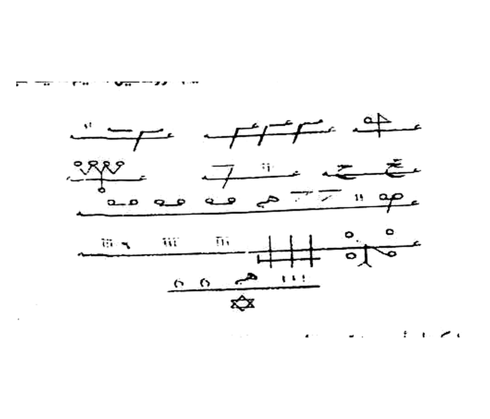

# BATCH 44 — Halaman 207–208 — Da‘wat al-Barhatiyyah dan Azimah al-Abluqiyyah

**Status: belum khatam.** Ini identifikasi sumber dan transkripsi awal, bukan terjemahan lengkap halaman 207–208. Bagian yang belum dapat dibaca dengan yakin tidak ditebak; harakat pada kutipan di bawah adalah tambahan pembacaan, bukan tanda yang harus dianggap pasti dari cetakan.

## FOTO ASLI

**Halaman 207:** Picture 105.jpg, belahan kiri. Angka 207 terlihat di kaki halaman. Belahan kanannya adalah halaman 206.

**Halaman 208:** Picture 106.jpg, belahan kanan. Angka 208 terlihat di kaki halaman. Belahan kirinya adalah halaman 209 dan berada di luar batch ini.

## Identifikasi rajah dan batas bacaan

Pada bagian atas halaman 207 terdapat susunan tanda dan garis rajah, bukan halaman teks penuh. Bentuk garis berpaku dan bersilang tampak menyerupai **hirzi**; tanda-tanda yang tidak terbaca dibiarkan sebagai gambar, bukan diberi titik atau diubah menjadi huruf. Halaman 208 berisi teks; tidak tampak kotak wafaq pada halaman itu. Tidak tampak kotak 3×3 يا الله يا رحمن pada kedua halaman ini. Nama-nama yang tampak dalam prosa tidak cukup untuk memastikan klasifikasi seluruhnya sebagai Fusha Suryani. Kaidah lipat/buka, buta, sakk tindih, jangkar, dan angka 111 tidak dapat dipastikan hanya dari gambar ini; jangan dipindahkan dari rajah halaman 206 ke halaman 207 tanpa pemeriksaan.

Crop diambil dari **Picture 105.jpg**, bukan Picture 106.jpg: kotak sumber `(245, 78, 740, 355)` pada gambar 1755×1275, dengan ruang sekitar tanda termasuk bintang di bawahnya. Diproses dengan fungsi skrip `crop_wafaq_presisi_2112x1808.py`, flat-field tanpa threshold keras, WHITE_SNAP 250, LANCZOS, kanvas 2112×1808 dan metadata 300 DPI. Resolusi optik tetap dibatasi scan. Pengukuran skrip sebelum kompresi JPEG menunjukkan 94,8% putih murni pada piksel non-tinta, bukan 78,6%; keutuhan setiap titik halus belum diverifikasi dan file sumber tetap acuan. Tanda-tanda gundul tidak ditranskripsikan sebagai huruf pasti.

## Halaman 207 — judul

**[Teks Arab]**

> دَعْوَةُ الْبَرْهَتِيَّةِ ((الْعَهْدِ الْقَدِيمِ))

**[Latin]**

> Da‘watu al-Barhatiyyah (al-‘ahdu al-qadīm).

**[Terjemahan Indonesia]**

> **Layer 1 (per kata):** *da‘watu* = seruan · *al-Barhatiyyah* = Barhatiyyah · *al-‘ahdu* = perjanjian · *al-qadīm* = yang lama.
>
> **Layer 2 (per kalimat):** Seruan Barhatiyyah (perjanjian lama).

Teks sebelum dan sesudah judul, termasuk rangkaian nama dalam seruan, masih memerlukan pembacaan dan penyandingan baris demi baris dengan scan. Halaman ini berlanjut ke halaman 208.

## Halaman 208 — judul dan pembuka

**[Teks Arab]**

> عَزِيمَةُ الْأَبْلُوقِيَّةِ الْحَارَّةِ
>
> هَذِهِ عَزِيمَةُ الْأَبْلُوقِيَّةِ الْحَارَّةِ عَلَى الْخُدَّامِ وَتَعْمَلُ بِهَا مَا شِئْتَ.

**[Latin]**

> ‘Azīmatu al-Ablūqiyyati al-ḥārrati.
>
> Hādhihi ‘azīmatu al-Ablūqiyyati al-ḥārrati ‘alā al-khuddāmi wa ta‘malu bihā mā shi’ta.

**[Terjemahan Indonesia]**

> **Layer 1 (per kata):** *‘azīmatu* = Azimah · *al-Ablūqiyyati* = Abluqiyyah · *al-ḥārrati* = yang panas · *hādhihi* = ini · *‘alā* = atas · *al-khuddāmi* = para khadam · *wa* = dan · *ta‘malu* = engkau melakukan · *bihā* = dengannya · *mā* = apa yang · *shi’ta* = engkau kehendaki.
>
> **Layer 2 (per kalimat):** Azimah Abluqiyyah yang panas. Ini adalah Azimah Abluqiyyah yang panas atas para khadam, dan dengannya engkau melakukan apa yang engkau kehendaki.

Teks di atas judul merupakan sambungan dari halaman 207. Paragraf sesudah pembuka juga belum ditranskripsi lengkap. Nama dan ejaan khusus perlu dicek kembali terhadap scan sebelum dianggap final.

## Keterangan yang masih perlu verifikasi

Hajat, sa‘ah, bahan tinta, bukhur, bilangan dan pantangan harus dicatat hanya jika benar-benar terbaca pada halaman ini; rincian dari batch sebelumnya tidak otomatis berlaku. Bagian bawah halaman 208 tampak menyebut tiga hari dan tujuh kali, tetapi keseluruhan kalimat perlu diverifikasi sebelum diterjemahkan. Tidak ada matriks angka yang dapat dihitung sebagai wafaq Hawwaz pada dua halaman ini; karena itu tidak ada jumlah baris/kolom yang dapat dilaporkan. Contoh washal `lil-ḥarq` adalah *li* (lam jar) + *al-ḥarq* (majrur), bukan bukti bahwa kata itu muncul di halaman ini.
