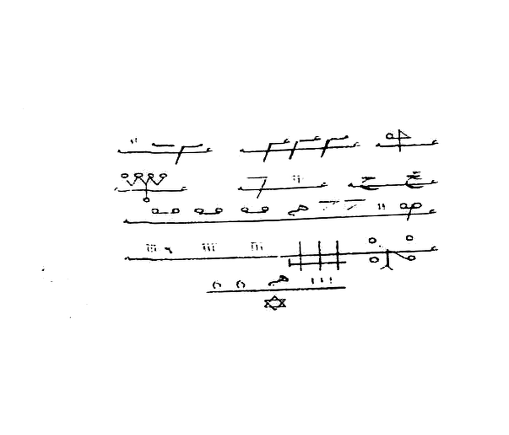

# BATCH 44 — Halaman 207–208 — Da'wah al-Barhatiyyah (al-'Ahd al-Qadim) & Azimah al-Abluqiyyah al-Harrah
> **Kitab Asrar wa Khofayyat fi 'Ilmi Ruhaniyyat — Syeikh Athiyyah Abdul Hamid — Terjemahan Lengkap Indonesia — Batch 44 (Hal. 207–208)**
> **Khatam:** halaman **208 / 297** · **Rajah kumulatif: 170** (169 akhir Batch 43 + 1 rajah batch ini)

**Sumber:** Picture 105.jpg (**Hal207 kiri** + Hal206 kanan) dan Picture 106.jpg (**Hal208 kanan** + Hal209 kiri).
**Total Rajah Batch44:** **1 Rajah** — rajah bergaris (khatam garis paku/gergaji) pada Hal207, dipotong presisi ke `terjemahan/rajah/rajah-hal-207-rajah-bergaris-presisi-2112x1808.jpg` (2112×1808 px, 300 DPI, LANCZOS, **tanpa threshold keras**, bulatan kecil, tanda gundul, dan garis tipis dipertahankan). Hal208 **murni teks** — tidak ada rajah.
**Isi:** Hal207 **Da'wah al-Barhatiyyah (al-'Ahd al-Qadim)** — tawkil empat penjuru (`الملك عزرائيل … كمطم … قسورة … طيكل … مازر … إسرافيل`) + judul + pembuka `بسم الله القديم الأزلي المحيط` + qasam Ruhaniyyat Ulwiyyah/Sufliyyah + deret nama ijazah (`بزهل ترقب برهش غلمش خوطير …`) + penutup `فمن آمن بالله يكون …` — Hal208 **Azimah al-Abluqiyyah al-Harrah**: sambungan qasam (`استمعوا وأطيعوا وكونوا عوني`) + deret asma Suryani + `عزيمة الأبلوقية الحارة` + kaidah amal (3 hari puasa, 7×, bukhur luban dzakar + muql azraq).
**Sambungan:** melanjutkan Batch 43 (Hal206 berakhir pada `… وجعلتم الله عليكم كفيلا`, yang bersambung ke Hal207 baris pertama `بسم الله القديم الأزلي المحيط …`).

**Catatan ketersediaan Batch 42.** Seperti Batch 43: `terjemahan/BATCH-42-Hal-203-204.md` tidak ada pada branch ini. Batch ini disusun dari scan langsung, bukan menyalin batch lain.

---

## FOTO ASLI

**Hal 207** — Picture 105.jpg, belahan **kiri** (belahan kanan = Hal206):


*Foto Asli Halaman 207 — **Picture 105.jpg** (belahan kiri; kanan = Hal206). Nomor halaman cetak `207` pada kaki halaman.*

**Hal 208** — Picture 106.jpg, belahan **kanan** (belahan kiri = Hal209):


*Foto Asli Halaman 208 — **Picture 106.jpg** (belahan kanan; kiri = Hal209). Nomor halaman cetak `208` pada kaki halaman.*

**Rajah Hal 207 — hasil crop presisi 2112×1808:**


*Gambar Rajah Asli Halaman 207 — **rajah bergaris (khatam garis)**: lima baris garis paku/gergaji bertumpuk tanpa bingkai tertutup, memuat tanda-tanda gundul, bulatan-bulatan kecil, garis silang tegak, dan **bintang segi enam (khatam Sulaiman)** di bawah baris terakhir. Bentuknya bukan wafaq bersel (bandingkan Hal206), melainkan deret garis bergerigi gaya Qolam Hirz. Tanda-tanda gundul **tidak diterjemahkan dan tidak digambar ulang** — disalin apa adanya sebagai gambar. Berkas: `terjemahan/rajah/rajah-hal-207-rajah-bergaris-presisi-2112x1808.jpg` — 2112×1808 px, 300 DPI, LANCZOS, latar putih bersih.*

---

## IDENTIFIKASI RAJAH & BATAS BACAAN (Hal 207–208)

**[Hal 207]**

| Unsur | Isi | Bukti pada cetakan |
|---|---|---|
| **FUSHA HIRZI — rajah bergaris paku/gergaji** | Rajah **bukan** wafaq bersel: tidak ada bingkai tertutup, tidak ada kolom/baris sel. Yang tercetak ialah **lima baris garis horizontal bergerigi** (paku/gergaji) bertumpuk, dengan **tanda-tanda gundul** (bulatan kecil, garis pendek, takik, garis silang tegak) menempel di atas tiap garis, ditutup **bintang segi enam** di bawah garis terakhir. Klasifikasi: **hirzi garis** (rajah garis/jimat garis), bukan khatam murabba'. | y 112–251 (lima garis: ±131, 178, 208, 265, 300), tanda gundul y 112–322, bintang y 310–326 |
| **KAIDAH LIPAT (Picture 105 = Hal206 + Hal207)** | Satu `Picture` = **satu bentangan dua halaman**: belahan **kanan = halaman berjalan (206)**, belahan **kiri = halaman berikutnya (207)**. Batch 43 memotong belahan kanan; batch ini memotong belahan kiri dari foto yang **sama**. | Nomor cetak `206` di kanan dan `207` di kiri pada Picture 105.jpg |
| **BUTA (gundul)** | Seluruh tanda pada rajah **buta/gundul**: tidak bertitik, tidak berharakat, tidak berbentuk huruf yang dapat dibaca pasti. **Tidak satu tanda pun diubah menjadi huruf.** Titik-titik yang memang tercetak (bulatan kecil, enam titik bintang) **dipertahankan** dan tidak ditambah. | pengamatan langsung pada crop |
| **SAKK TINDIH 111** | **Ada, dan terpisah dari rajah utama.** Angka **`١١١`** tercetak **menindih** di baris sakk tersendiri di **bawah** rajah (y ±296–304, x ±478–502), sebaris dengan dua bulatan kecil dan satu tanda berkait, tepat **di atas bintang segi enam**. Ini **bukan** sakk Hal206 (yang menindih huruf **ك** di kolom kiri bingkai) — pada Hal207 sakk berdiri sendiri tanpa huruf. | baris sakk y 290–305; bintang y 310–326 |
| **JANGKAR** | **Jangkar batch ini bukan empat penjuru wafaq, melainkan empat malaikat pada tawkil teks** di bawah rajah: `الملك عزرائيل … كمطم … قسورة … طيكل … مازر … إسرافيل` — empat nama penjuru (كمطم/قسورة/طيكل/مازر = ميكائيل/إسرافيل/عزرائيل/جبرائيل) diikat pada **satu baris tawkil** yang ditulis **dua kali** (baris 1 dan baris 2 saling mengulang). Jangkar tidak naik ke tengah rajah karena rajah Hal207 tidak berbingkai sel. | dua baris tawkil y 358–419 |

**[Hal 208]**

| Unsur | Isi | Bukti pada cetakan |
|---|---|---|
| **FUSHA SURYANI / GHAZALI** | Teks Hal208 dibuka dengan **deret asma Suryani** (`علشاقش مهراقش أقشامقش شقموهش شقمونهش`, `يا دهيوث أرخا أرخيم …`, `لغشون لغشون …`, `أرغى أرغى أرغون ترنون …`) dan ditutup qur'anik (`كن فيكون`, `سبحان الذي بيده ملكوت كل شيء`, `إن كانت إلا صيحة واحدة`). Ini **bukan** Fusha Hirzi (tidak ada rajah bergaris); klasifikasinya **Fusha Suryani/Ghazali** — bahasa asma Suryani bergaya Ghazali. | y 288–311 (asma Suryani), y 745–806 (asma Suryani kedua), y 829–938 (qur'anik) |
| **RAJAH** | **Tidak ada.** Hal208 murni teks; tidak ada garis, bintang, sakk, atau sel. | seluruh halaman |
| **SAKK / JANGKAR** | **Tidak ada** pada Hal208. | — |

**Batas bacaan yang jujur.** Huruf-huruf pada rajah Hal207 tidak dapat dipastikan; karena itu rajah **dibiarkan sebagai gambar** dan tidak diberi tafsir huruf. Sisa baris yang belum terbaca yakin ditandai `[…]` pada transkripsi. Tidak ada matriks angka pada Hal207–208; **hitung wafaq** di bawah karena itu dihitung dari **asma teks**, bukan dari sel rajah.

---

## Halaman 207 — Tawkil Empat Penjuru (dua baris, di bawah rajah)

**[Teks Arab Asli]**

> الْمَلَكُ عَزْرَائِيلُ أَجِبْ يَا كَمْطَمُ أَجِبْ يَا قَسُورَةُ أَجِبْ يَا طِيكَلُ أَجِبْ يَا مَازِرُ وَلَهُ إِسْرَافِيلُ أَجِبْ يَا مَازِرُ أَجِبْ يَا طِيكَلُ أَجِبْ يَا كَمْطَمُ أَجِبْ يَا قَسُورَةُ بَخُورُ الدَّعْوَةِ لُبَانٌ وَجَاوِي تَعْجِنُهُ بِمَاءِ الْوَرْدِ وَزَعْفَرَانٍ

**[Latin — huruf-per-huruf, washal]**

> *al-malaku 'azrā'īlu ajib yā kamṭamu ajib yā qasūratu ajib yā ṭīkalu ajib yā māziru wa-lahu isrāfīlu ajib yā māziru ajib yā ṭīkalu ajib yā kamṭamu ajib yā qasūratu bakhūru ad-da'wati lubānun wa-jāwī ta'jinuhu bi-mā'i al-wardi wa-za'farānin.*

**[Terjemahan Indonesia]**

> **Layer 1 (per kata):** *al-malaku* = malaikat · *'azrā'īlu* = Azrail · *ajib* = jawablah · *yā* = wahai · *kamṭamu* = Kamtham · *qasūratu* = Qasurah · *ṭīkalu* = Thikal · *māziru* = Mazir · *wa-lahu* = dan baginya · *isrāfīlu* = Israfil · *bakhūru* = bukhur · *ad-da'wati* = seruan · *lubānun* = luban · *wa-jāwī* = dan kemenyan Jawa · *ta'jinuhu* = engkau mengaduknya · *bi-mā'i* = dengan air · *al-wardi* = mawar · *wa-za'farānin* = dan za'faron.
>
> **Layer 2 (per kalimat):** Ini adalah Azimah untuk malaikat Azrail: jawablah, wahai Kamtham, jawablah, wahai Qasurah, jawablah, wahai Thikal, jawablah, wahai Mazir. Dan baginya Israfil: jawablah, wahai Mazir, jawablah, wahai Thikal, jawablah, wahai Kamtham, jawablah, wahai Qasurah. Bukhur seruan ini adalah luban dan kemenyan Jawa; engkau mengaduknya dengan air mawar dan za'faron.

---

## Halaman 207 — Judul Bab

**[Teks Arab Asli]**

> دَعْوَةُ الْبَرْهَتِيَّةِ ((الْعَهْدِ الْقَدِيمِ))

**[Latin]**

> *da'watu al-barhatiyyati (al-'ahdi al-qadīmi).*

**[Terjemahan Indonesia]**

> **Layer 1 (per kata):** *da'watu* = seruan · *al-barhatiyyati* = Barhatiyyah · *al-'ahdi* = perjanjian · *al-qadīmi* = yang lama.
>
> **Layer 2 (per kalimat):** Seruan Barhatiyyah (perjanjian lama).

---

## Halaman 207 — Pembuka Seruan (prosa bersambung)

**[Teks Arab Asli]**

> بِسْمِ اللهِ الْقَدِيمِ الْأَزَلِيِّ الْمُحِيطِ الَّذِي أَحَاطَ بِعِلْمِهِ جَمِيعَ الْمَخْلُوقَاتِ الْقَدِيمِ الْأَبَدِيِّ الَّذِي لَا ابْتِدَاءَ لِقِدَمِهِ وَلَيْسَ لَهُ انْتِهَاءٌ الَّذِي أَشْرَقَ بِسَاطِعِ نُورِ وَجْهِهِ جَمِيعَ الْأَكْوَانِ وَأَمَدَّهَا بِقُدْرَةِ هَيْبَتِهِ عَلَى كُلِّ مَلَكٍ وَفَلَكٍ وَجِنٍّ وَشَيْطَانٍ وَسُلْطَانٍ فَخَافَتْهُ جَمِيعُ الْمَخْلُوقَاتِ وَأَذْعَنَتْ وَتَوَاضَعَتِ الْمَلَائِكَةُ الْمُقَرَّبُونَ مِنْ أَعْلَى مَقَامِهَا وَسَجَدَتْ وَأَجَابَتْ دَعْوَةَ اسْمِهِ الْأَعْظَمِ لِمَنْ تَكَلَّمَ بِهِ وَأَسْرَعَتْ بِالْإِجَابَةِ وَالْبَرَاهِينِ الْحِكْمَةِ الْمَكْتُوبَةِ فِي أَلْوَاحِ قُلُوبِ الْمُتَصَرِّفِينَ بِسِرِّ بَطْشِ اجْتَهَزَطْ أَقْسَمْتُ عَلَيْكُمْ أَيُّهَا الْأَرْوَاحُ الرَّوْحَانِيَّةُ الْعُلْوِيَّةُ وَالسُّفْلِيَّةُ وَخُدَّامُ هَذَا الْعَهْدِ الْكَبِيرِ أَنْ تَجِيبُوا وَتَقْضُوا حَاجَتِي (وَهِيَ كَذَا) بِعِزَّةِ بَرْهَتِيَةَ بَرْهَتِيَةَ كَرْيَرَ كَرْيَرَ تَلْيَهْ تَلْيَهْ طُورَانَ طُورَانَ مَزْجَلَ مَزْجَلَ تَرْقَبْ تَرْقَبْ بَرْهَشْ بَرْهَشْ غَلْمَشْ غَلْمَشْ خُوطِيرْ خُوطِيرْ قَلْنُهُودْ قَلْنُهُودْ بَرْشَانَ بَرْشَانَ كَظْهِيرْ طَهِيرْ نَمُوشَلَخْ نَمُوشَلَخْ بَرْهَيُولَا بَرْهَيُولَا بَشْكَيْلَخْ بَشْكَيْلَخْ قَزْ قَزْ مَزْ مَزْ أَنْقَلَلَيْطْ أَنْقَلَلَيْطْ قَبَرَاتْ قَبَرَاتْ فَاهَا كَيْدَهُولَا كَيْدَهُولَا شَمْخَاهِرْ شَمْخَاهِرْ شَمْخَاهِيرْ شَمْخَاهِيرْ شَمْهَاهِيرْ شَمْهَاهِيرْ بِكَهْطَهُوَتِيَّةَ بِشَارِشْ بِشَارِشْ طُوطَشْ طُوطَشْ شَمْخَابَارُوخْ شَمْخَابَارُوخْ اللَّهُمَّ بِحَقِّ كَهْكَهَيْجْ يَغْطِشْ لِأَمْوَيْلَ جَلْدَمْ مَهْجَمَا هَجَلْمِيجْ وَرُودِيَهْ مَهْفِيَاجْ هُوَ اللهُ الَّذِي لَيْسَ كَمِثْلِهِ شَيْءٌ وَهُوَ السَّمِيعُ الْبَصِيرُ

**[Latin — bacaan washal, huruf-per-huruf untuk kata kunci]**

> *bismi allāhi al-qadīmi al-azaliyyi al-muḥīṭi alladhī aḥāṭa bi-'ilmihi jamī'a al-makhlūqāti al-qadīmi al-abadiyyi alladhī lā ibtidā'a li-qidamihi wa-laysa lahu intihā'un alladhī ashraqa bi-sāṭi'i nūri wajhihi jamī'a al-akwāni wa-amaddahā bi-qudrati haybatihi 'alā kulli malakin wa-falakin wa-jinnin wa-shayṭānin wa-sulṭānin fa-khāfathu jamī'u al-makhlūqāti wa-adh'anat wa-tawāḍa'ati al-malā'ikatu al-muqarrabūna min a'lā maqāmihā wa-sajadat wa-ajābat da'wata ismihi al-a'ẓami li-man takallama bihi wa-asra'at bi-al-ijābati wa-al-barāhīni al-ḥikmati al-maktūbati fī alwāḥi qulūbi al-mutaṣarrifīna bi-sirri baṭshin **IJTAHAZAṬ** (ij + ta + ha + za + ṭ) aqsamtu 'alaykum ayyuhā al-arwāḥu al-rūḥāniyyatu al-'ulwiyyatu wa-al-sufliyyatu wa-khuddāmu hādhā al-'ahdi al-kabīri an tujībū wa-taqḍū ḥājatī (wa-hiya kadhā) bi-'izzati **BARHATIYATA BARHATIYATA KARAYRA KARAYRA TALYAH TALYAH ṬŪRĀN ṬŪRĀN MAZJAL MAZJAL** tarqab tarqab barhash barhash ghalmash ghalmash khūṭīr khūṭīr qalnuhūd qalnuhūd barsyān barsyān kazhīr ṭahīr namūsyalakh namūsyalakh barhayūlā barhayūlā basykaylakh basykaylakh qaz qaz maz maz anqalālayṭ anqalālayṭ qabarāt qabarāt fāhā kaydahūlā kaydahūlā syamkhāhir syamkhāhir syamkhāhīr syamkhāhīr syamhāhīr syamhāhīr bikahṭahuwwatiyyah bisyārisy bisyārisy ṭūṭasy ṭūṭasy syamkhābārūkh syamkhābārūkh allāhumma bi-ḥaqqi **KAHKAHAYJ YAGHṬISY LI-AMWAYL JALDAM MAHJAMĀ HAJALMĪJ WARŪDIYAH MAHFIYĀJ** huwa allāhu alladhī laysa kamithlihi syay'un wa-huwa al-samī'u al-baṣīru.*

**[Terjemahan Indonesia]**

> **Layer 1 (per kata):** *bi* = dengan · *ismi* = nama · *allāhi* = Allah · *al-qadīmi* = Yang Dahulu · *al-azaliyyi* = Yang Azali · *al-muḥīṭi* = Yang Meliputi · *alladhī* = yang · *aḥāṭa* = meliputi · *bi-'ilmihi* = dengan ilmu-Nya · *jamī'a* = seluruh · *al-makhlūqāti* = makhluk · *al-abadiyyi* = Yang Abadi · *lā ibtidā'a* = tiada permulaan · *li-qidamihi* = bagi keberadaan-Nya yang dahulu · *wa-laysa lahu intihā'un* = dan tiada akhir bagi-Nya · *ashraqa* = menerangi · *bi-sāṭi'i* = dengan pancaran · *nūri* = cahaya · *wajhihi* = wajah-Nya · *al-akwāni* = alam-alam · *wa-amaddahā* = dan memberinya · *bi-qudrati* = dengan kekuatan · *haybatihi* = kehebatan-Nya · *'alā kulli* = atas setiap · *malakin* = malaikat · *falakin* = falak · *jinnin* = jin · *shayṭānin* = setan · *sulṭānin* = penguasa · *fa-khāfathu* = maka takut kepada-Nya · *jamī'u al-makhlūqāti* = seluruh makhluk · *wa-adh'anat* = dan tunduk · *wa-tawāḍa'ati* = dan merendahkan diri · *al-malā'ikatu al-muqarrabūna* = para malaikat yang didekatkan · *min a'lā maqāmihā* = dari kedudukan tertingginya · *wa-sajadat* = dan bersujud · *wa-ajābat* = dan menjawab · *da'wata* = seruan · *ismihi al-a'ẓami* = nama-Nya yang terbesar · *li-man takallama bihi* = bagi siapa yang mengucapkannya · *wa-asra'at bi-al-ijābati* = dan bersegera menjawab · *al-barāhīni* = bukti-bukti · *al-ḥikmati al-maktūbati* = hikmah yang tertulis · *fī alwāḥi* = pada lembaran-lembaran · *qulūbi al-mutaṣarrifīna* = hati para penggerak · *bi-sirri baṭshin* = dengan rahasia genggaman · *aqsamtu 'alaykum* = aku bersumpah atas kalian · *ayyuhā al-arwāḥu al-rūḥāniyyatu* = wahai ruh-ruh ruhani · *al-'ulwiyyatu wa-al-sufliyyatu* = yang tinggi dan yang rendah · *wa-khuddāmu* = dan para khadam · *hādhā al-'ahdi al-kabīri* = perjanjian besar ini · *an tujībū* = agar kalian menjawab · *wa-taqḍū ḥājatī* = dan menunaikan hajatku · *(wa-hiya kadhā)* = (yaitu demikian) · *bi-'izzati* = dengan keperkasaan · *bakhūru* = bukhur · *huwa allāhu alladhī laysa kamithlihi syay'un* = Dia Allah yang tidak ada sesuatu pun serupa dengan-Nya · *wa-huwa al-samī'u al-baṣīru* = dan Dia Yang Maha Mendengar, Maha Melihat.
>
> **Layer 2 (per kalimat):** Ini adalah Azimah dengan nama Allah Yang Dahulu, Yang Azali, Yang Meliputi, yang meliputi seluruh makhluk dengan ilmu-Nya, Yang Dahulu dan Abadi, yang tidak ada permulaan bagi keberadaan-Nya yang dahulu dan tidak ada akhir bagi-Nya; yang menerangi seluruh alam dengan pancaran cahaya wajah-Nya dan memberinya kekuatan kehebatan-Nya atas setiap malaikat, falak, jin, setan, dan penguasa. Seluruh makhluk takut kepada-Nya dan tunduk; para malaikat yang didekatkan merendahkan diri dari kedudukan tertingginya, bersujud, menjawab seruan nama-Nya yang terbesar bagi siapa yang mengucapkannya, dan bersegera menjawab, dengan bukti-bukti hikmah yang tertulis pada lembaran-lembaran hati para penggerak, dengan rahasia genggaman. Aku bersumpah atas kalian, wahai ruh-ruh ruhani yang tinggi dan yang rendah, dan para khadam perjanjian besar ini, agar kalian menjawab dan menunaikan hajatku (yaitu demikian), dengan keperkasaan Barhatiyata Barhatiyata Karayra Karayra Talyah Talyah Thuran Thuran Mazjal Mazjal, tarqab tarqab barhash barhash ghalmash ghalmash khuthir khuthir qalnuhud qalnuhud barsyan barsyan kazhir thahir namusyalakh namusyalakh barhayula barhayula basykaylakh basykaylakh qaz qaz maz maz anqalalayth anqalalayth qabarat qabarat faha kaydahula kaydahula syamkhahir syamkhahir syamkhahir syamkhahir syamhahir syamhahir bikahthahuwwatiyyah bisyarisy bisyarisy thutasy thutasy syamkhabarukh syamkhabarukh. Ya Allah, dengan hak Kahkahayj Yaghtisy Li-amwayl Jaldam Mahjama Hajalmij Warudiyah Mahfiyaj. Dia Allah yang tidak ada sesuatu pun serupa dengan-Nya, dan Dia Yang Maha Mendengar, Maha Melihat.

---

## Halaman 207 — Penutup Qasam (sambung ke Hal 208)

**[Teks Arab Asli]**

> فَمَنْ آمَنَ بِاللهِ يَكُونُ وَكِيلِي وَمَنْ أَخَذَ الْعَهْدَ عَلَيْكُمْ يَا خُدَّامَ هَذِهِ الْأَسْمَاءِ الِانْقِيَادِ وَالْإِنْفَاذِ فِيمَا أَمَرْتُكُمْ بِهِ فِي وَقْتِي هَذَا بِعِزَّةِ [الْعَزِيزِ الْمُعْتَزِّ] فِي عِزِّ عِزِّهِ وَأَوْفُوا بِعَهْدِ اللهِ إِذَا عَاهَدْتُمْ وَلَا تَنْقُضُوا الْإِيمَانَ بَعْدَ تَوْكِيدِهَا وَقَدْ جَعَلْتُمُ اللهَ عَلَيْكُمْ كَفِيلًا

**[Latin]**

> *fa-man āmana bi-llāhi yakūnu wakīlī wa-man akhadha al-'ahda 'alaykum yā khuddāma hādhihi al-asmā'i al-inqiyādi wa-al-infādhi fīmā amartukum bihi fī waqtī hādhā bi-'izzati [al-'azīzi al-mu'tazzi] fī 'izzi 'izzihi wa-awfū bi-'ahdi allāhi idhā 'āhattum wa-lā tanquḍū al-īmāna ba'da tawkīdihā wa-qad ja'altumu allāha 'alaykum kafīlan.*

**[Terjemahan Indonesia]**

> **Layer 1 (per kata):** *fa-man* = maka siapa · *āmana* = beriman · *bi-llāhi* = kepada Allah · *yakūnu* = ia menjadi · *wakīlī* = wakilku · *wa-man akhadha* = dan siapa yang mengambil · *al-'ahda* = perjanjian · *'alaykum* = atas kalian · *yā khuddāma* = wahai para khadam · *hādhihi al-asmā'i* = nama-nama ini · *al-inqiyādi* = ketundukan · *wa-al-infādhi* = dan pelaksanaan · *fīmā* = pada apa · *amartukum bihi* = yang aku perintahkan kepada kalian · *fī waqtī hādhā* = pada waktuku ini · *bi-'izzati* = dengan keperkasaan · *fī 'izzi 'izzihi* = dalam kemuliaan kemuliaan-Nya · *wa-awfū* = dan penuhilah · *bi-'ahdi allāhi* = perjanjian Allah · *idhā 'āhattum* = apabila kalian berjanji · *wa-lā tanquḍū* = dan jangan kalian melanggar · *al-īmāna* = iman · *ba'da tawkīdihā* = sesudah meneguhkannya · *wa-qad ja'altum* = dan sungguh kalian telah menjadikan · *allāha 'alaykum kafīlan* = Allah atas kalian sebagai penjamin.
>
> **Layer 2 (per kalimat):** Maka siapa yang beriman kepada Allah, ia menjadi wakilku. Dan siapa di antara kalian, wahai para khadam nama-nama ini, yang mengambil perjanjian ketundukan dan pelaksanaan atas apa yang aku perintahkan kepada kalian pada waktuku ini — dengan keperkasaan Yang Mahaperkasa di dalam kemuliaan kemuliaan-Nya — maka penuhilah perjanjian Allah apabila kalian berjanji, dan janganlah kalian melanggar iman sesudah kalian meneguhkannya, padahal kalian telah menjadikan Allah atas kalian sebagai penjamin.

---

## Halaman 208 — Sambungan Qasam dari Hal 207

**[Teks Arab Asli]**

> اسْتَمِعُوا وَأَطِيعُوا وَكُونُوا عَوْنِي عَلَى جَمِيعِ مَا أَمَرْتُكُمْ بِهِ (مَنْ فَعَلَ كَذَا) بِحَقِّ الْأَسْمَ الْأَعْظَمِ [الأَعْظَمِ] الَّذِي أَوَّلُهُ آلٌ وَآخِرُهُ آلٌ وَهُوَ آلٌ شَلْعٌ يَعُويَا بَهْ وَاهْ يَهْ يَهْ بَهْيَهْ بِتَكْهْ بِتَكْفَالْ بَصْعَى كَعْى مُمْيَالْ مُطِيعِينَ لِلَّهِ وَمَنْ أَعْظَمِ اسْمِكَ يَا آلَ زَرْيَالٍ مَا سَمِعَ اسْمَكَ رُوحٌ وَعَصَى إِلَّا صَعِقَ وَاحْتَرَقَ مِنْ نُورِكَ يَا ذَا النُّورِ الْأَعْظَمِ أَقْسَمْتُ وَعَزَمْتُ عَلَيْكُمْ بِعَالَمِ الْغَيْبِ وَالشَّهَادَةِ الْكَبِيرِ الْمُتَعَالِ وَبِحَقِّ الْأَسْمِ الَّذِي تَعَاهَدْتُ بِهِ عِنْدَ بَابِ الْهِيكَلِ الْكَبِيرِ وَهُوَ عَلْشَاقَشْ مِهْرَاقَشْ مِهْرَاقَشْ أَقْشَامْقَشْ أَقْشَامْقَشْ شَقْمُوهَشْ شَقْمُوهَشْ رَكْنَاهُ رَكْنَا كَشْلَخَ كَشْلَخَ وَمَنْ يَعْرِضْ عَنْ ذِكْرِ رَبِّهِ يَسْلُكْهُ عَذَابًا صَعَدًا وَبِحَقِّ أَهْيَا شَرَاهِيَا أَدُونَايَ أَصْبَاؤُوتَ آلَ شَدَايَا وَبِحَقِّ أَحَدٍ هُوزَ حَطِيَ وَبِحَقِّ بَطْلٍ زَهَجٍ وَاحِدٍ وَبِحَقِّ بِشْمَخِ دَالْهَامُو شَيْطِيْنٌ « يَا دَنَوَا مَلْخُوْثًا دِيْوُثُوْنْ » يَا كُورْعَشْ أَرْعِشْ طُوخْ لَاخُوْنْ يَا دَهْمُوثْ أَرْخَا أَرْخِيمْ أَرْخِيمُونْ يَا ثِيخُوثِيمْ أَزْيَشْ أَرْقَشْ دَارَ عِلْيَوْنْ يَا حَيْشُمَا مِينَوَا أَحْبُوْنَ مَنُوْنَ « يَا أَهْيَا شَرَاهِيَا أَدُونَايَ أَصْبَاؤُوتَ صَبَاوَتُونْ يَا دَهْمِيْثًا دَهْلِيْلَوْا إِلَهَ مِيطَطْرُوْنَ » يَا نُورْ بُورَقْ أَرْغَشِيْشْ لَغْنُوْنَ لَغْشُوْنَ يَاشْبِيْرًا شَرْوًا أَشْتَخْ أَشْغًا أَشْغَوْنَ يَا مَلَكُوتَ مَا لَخْ مَلَخْ مَلِيْخًا مَاخُوْرًا يَا عَالَمْ عَلَامْ أَرْغَلْ أَرْغَى أَرْغَا أَرْغُوْنَ ثَرْنُوْنَ كَزْنُوْنَ شَمْخَ شَمْخِيْثًا مِشْلَامُوْنَ إِنَّمَا أَمْرُهُ إِذَا أَرَادَ شَيْئًا أَنْ يَقُولَ لَهُ كُنْ فَيَكُونُ فَسُبْحَانَ الَّذِي بِيَدِهِ مَلَكُوتُ كُلِّ شَيْءٍ وَإِلَيْهِ تُرْجَعُونَ تَكُونُوا لِأَسْمَائِهِ طَائِعِينَ وَلِدَاعِيهِ مُجِيبِينَ إِنْ كَانَتْ إِلَّا صَيْحَةً وَاحِدَةً فَإِذَا هُمْ جَمِيعٌ لَدَيْنَا مُحْضَرُونَ وَإِنَّهُ لَقَسَمٌ لَوْ تَعْلَمُونَ عَظِيمٌ الْوَحَا الْوَحَا الْعَجَلَ الْعَجَلَ السَّاعَةَ السَّاعَةَ بَارَكَ اللهُ فِيكُمْ وَعَلَيْكُمْ وَلَا حَوْلَ وَلَا قُوَّةَ إِلَّا بِاللهِ الْعَلِيِّ الْعَظِيمِ

**[Latin — huruf-per-huruf pada frasa kunci]**

> *istami'ū wa-aṭī'ū wa-kūnū 'awnī 'alā jamī'i mā amartukum bihi (man fa'ala kadhā) bi-ḥaqqi **AL-ASMI AL-A'ẒAM(I)** alladhī awwaluhu **ĀL** wa-ākhiruhu **ĀL** wa-huwa **ĀL SYAL'** ya'ūyā bah wāh yah yah bahyah bitkah bitkfāl baṣ'ā ka'ā mumyāl muṭī'īna li-llāhi wa-man a'ẓami ismika yā **ĀLA ZARYĀL** mā sami'a ismaka rūḥun wa-'aṣā illā ṣa'iqa wa-iḥtaraqa min nūrika yā dhā al-nūri al-a'ẓami aqsamtu wa-'azamtu 'alaykum bi-'ālami al-ghaybi wa-al-syahādati al-kabīri al-muta'āli wa-bi-ḥaqqi al-asmi alladhī ta'āhattu bihi 'inda bābi al-haykali al-kabīri wa-huwa **'ALSYĀQASY MĪHRĀQASY MĪHRĀQASY AQSYĀMQASY AQSYĀMQASY SYAQMŪHASY SYAQMŪHASY RAKNĀHU RAKNĀ KASYLAKH KASYLAKH** wa-man yu'riḍ 'an dhikri rabbihi yaslukhu 'adhāban ṣa'adā wa-bi-ḥaqqi **AHYĀ SYARĀHIYĀ ADŪNĀYA AṢBĀŪTA ĀLA SYADĀYĀ** wa-bi-ḥaqqi **AḤADIN HŪZA ḤAṬIYA** wa-bi-ḥaqqi **BAṬLIN ZAHAJIN WĀḤIDIN** wa-bi-ḥaqqi **BISYMAKH DĀLHĀMŪ SYAYṬĪN** « yā **DANAWĀ MALKHŪTHĀ DĪWŪTHŪN** » yā **KŪR'ASY AR'ISY ṬŪKH LĀKHŪN** yā **DAHMŪTH ARKHĀ ARKHĪM ARKHĪMŪN** yā **THĪKHŪTHĪM AZYASY ARQASY DĀRA 'ILYŪN** yā **ḤAYSYUMĀ MĪNAWĀ AḤBŪNA MANŪNA** « yā **AHYĀ SYARĀHIYĀ ADŪNĀYA AṢBĀŪTA ṢABĀWATŪN** yā **DAHMĪTHĀ DAHLĪLAW ILĀHA MĪṬAṬRŪN** » yā **NŪR BŪRAQ ARGHASYĪSY LAGHNŪN LAGHSYŪN YĀSYBĪRĀ SYARWĀ ASYTAKH ASYGHĀ ASYGHAWN** yā **MALAKŪTA MĀ LAKH MALAKH MALĪKHĀ MĀKHŪRĀ** yā **'ĀLAM 'ALĀM ARGHAL ARGHĀ ARGHĀ ARGHŪN THARNŪN KAZNŪN SYAMKH SYAMKHĪTHĀ MISYLĀMŪN** innamā amruhu idhā arāda syay'an an yaqūla lahu kun fa-yakūnu fa-subḥāna alladhī bi-yadihi malakūtu kulli syay'in wa-ilayhi turja'ūna takūnū li-asmā'ihi ṭā'i'īna wa-li-dā'īhi mujībīna in kānat illā ṣayḥatan wāḥidatan fa-idhā hum jamī'un ladaynā muḥḍarūna wa-innahu la-qasamun law ta'lamūna 'aẓīmun al-waḥā al-waḥā al-'ajala al-'ajala al-sā'ata al-sā'ata bāraka allāhu fīkum wa-'alaykum wa-lā ḥawla wa-lā quwwata illā bi-llāhi al-'aliyyi al-'aẓīmi.*

**[Terjemahan Indonesia]**

> **Layer 1 (per kata):** *istami'ū* = dengarkanlah · *wa-aṭī'ū* = dan taatlah · *wa-kūnū* = dan jadilah · *'awnī* = penolongku · *'alā jamī'i* = atas semua · *mā amartukum bihi* = yang aku perintahkan kepada kalian · *(man fa'ala kadhā)* = (siapa yang melakukan demikian) · *bi-ḥaqqi al-asmi al-a'ẓami* = dengan hak nama yang terbesar · *alladhī awwaluhu āl wa-ākhiruhu āl* = yang awalnya āl dan akhirnya āl · *wa-huwa āl syal'* = dan ia adalah āl syal' · *muṭī'īna li-llāhi* = taat kepada Allah · *mā sami'a ismaka rūḥun wa-'aṣā* = tidak ada ruh yang mendengar nama-Mu lalu durhaka · *illā ṣa'iqa wa-iḥtaraqa* = melainkan tersambar dan terbakar · *min nūrika* = dari cahaya-Mu · *yā dhā al-nūri al-a'ẓami* = wahai Pemilik cahaya yang terbesar · *aqsamtu wa-'azamtu 'alaykum* = aku bersumpah dan menegaskan atas kalian · *bi-'ālami al-ghaybi wa-al-syahādati* = dengan Yang Mengetahui yang gaib dan yang nyata · *al-kabīri al-muta'āli* = Yang Mahabesar, Mahatinggi · *bi-ḥaqqi al-asmi* = dengan hak nama · *alladhī ta'āhattu bihi* = yang aku berjanji dengannya · *'inda bābi al-haykali al-kabīri* = di pintu Haikal yang besar · *wa-man yu'riḍ 'an dhikri rabbihi* = dan siapa yang berpaling dari mengingat Tuhannya · *yaslukhu 'adhāban ṣa'adā* = Dia menimpakan kepadanya azab yang mendaki · *bi-ḥaqqi aḥadin hūza ḥaṭiya* = dengan hak ahad huza hathiya · *wa-bi-ḥaqqi baṭlin zahajin wāḥidin* = dan dengan hak bathl zahaj satu · *innamā amruhu* = sesungguhnya perintah-Nya · *idhā arāda syay'an* = apabila Dia menghendaki sesuatu · *an yaqūla lahu kun* = bahwa Dia berkata kepadanya "jadilah" · *fa-yakūnu* = maka jadilah · *fa-subḥāna alladhī* = maka Mahasuci Dia yang · *bi-yadihi malakūtu kulli syay'in* = di tangan-Nya kerajaan segala sesuatu · *wa-ilayhi turja'ūna* = dan kepada-Nya kalian dikembalikan · *takūnū li-asmā'ihi ṭā'i'īna* = jadilah kalian taat kepada nama-nama-Nya · *wa-li-dā'īhi mujībīna* = dan menjawab penyeru-Nya · *in kānat illā ṣayḥatan wāḥidatan* = tiada lain melainkan satu teriakan · *fa-idhā hum jamī'un ladaynā muḥḍarūna* = maka tiba-tiba mereka semua dihadirkan di hadapan Kami · *wa-innahu la-qasamun law ta'lamūna 'aẓīmun* = dan sesungguhnya itu benar-benar sumpah yang besar, sekiranya kalian mengetahui · *al-waḥā* = segeralah · *al-'ajala* = cepatlah · *al-sā'ata* = saat ini · *bāraka allāhu fīkum wa-'alaykum* = Allah memberkahi kalian dan atas kalian · *wa-lā ḥawla wa-lā quwwata illā bi-llāhi al-'aliyyi al-'aẓīmi* = dan tiada daya dan tiada kekuatan selain dengan Allah Yang Mahatinggi, Mahaagung.
>
> **Layer 2 (per kalimat):** Dengarkanlah dan taatlah, dan jadilah penolongku atas semua yang aku perintahkan kepada kalian (siapa yang melakukan demikian), dengan hak nama yang terbesar — yang awalnya āl dan akhirnya āl, dan ia adalah āl syal' ya'uya bah wah yah yah bahyah bitkah bitkfal bas'a ka'a mumyal — yang taat kepada Allah, dan demi yang paling agung dari nama-Mu, wahai Āla Zaryāl: tidak ada ruh yang mendengar nama-Mu lalu durhaka melainkan tersambar dan terbakar oleh cahaya-Mu, wahai Pemilik cahaya yang terbesar. Aku bersumpah dan menegaskan atas kalian dengan Yang Mengetahui yang gaib dan yang nyata, Yang Mahabesar, Mahatinggi, dan dengan hak nama yang aku berjanji dengannya di pintu Haikal yang besar, yaitu 'Alsyāqasy Mīhrāqasy Mīhrāqasy Aqsyāmqasy Aqsyāmqasy Syaqmūhasy Syaqmūhasy Raknāhu Raknā Kasyalakh Kasyalakh. Dan siapa yang berpaling dari mengingat Tuhannya, Dia menimpakan kepadanya azab yang mendaki. Dan dengan hak Ahyā Syarāhiyā Adūnāya Aṣbāūta Āla Syadāyā, dan dengan hak Ahadin Hūza Hathiya, dan dengan hak Bathlin Zahajin Wāhidin, dan dengan hak Bismakh Dālhāmū Syaythīn — yā Danawā Malkhūthā Dīwūthūn — yā Kūr'asy Ar'isy Thūkh Lākhūn, yā Dahmūth Arkhā Arkhīm Arkhīmūn, yā Thīkhūthīm Azyasy Arqasy Dāra 'Ilyūn, yā Haysyumā Mīnawā Ahbūnā Manūnā — yā Ahyā Syarāhiyā Adūnāya Aṣbāūta Ṣabāwatūn, yā Dahmīthā Dahlīlaw Ilāha Mīthatrūn — yā Nūr Būraq Arghasyīsy Laghnūn Laghsyūn Yāsybīrā Syarwā Asytakh Asyghā Asyghawn, yā Malakūta Mā Lakh Malakh Malīkhā Mākhūrā, yā 'Ālam 'Alām Arghal Arghā Arghā Arghūn Tharnūn Kaznūn Syamkh Syamkhīthā Misylāmūn. Sesungguhnya perintah-Nya apabila Dia menghendaki sesuatu hanyalah Dia berkata kepadanya "jadilah", maka jadilah. Mahasuci Dia yang di tangan-Nya kerajaan segala sesuatu, dan kepada-Nya kalian dikembalikan. Jadilah kalian taat kepada nama-nama-Nya dan menjawab penyeru-Nya. Tiada lain melainkan satu teriakan, maka tiba-tiba mereka semua dihadirkan di hadapan Kami. Dan sesungguhnya itu benar-benar sumpah yang besar, sekiranya kalian mengetahui. Segeralah, segeralah; cepatlah, cepatlah; saat ini, saat ini. Allah memberkahi kalian dan atas kalian. Tiada daya dan tiada kekuatan selain dengan Allah Yang Mahatinggi, Mahaagung.

---

## Halaman 208 — Judul dan Pembuka

**[Teks Arab Asli]**

> عَزِيمَةُ الْأَبْلُوقِيَّةِ الْحَارَّةِ
>
> هَذِهِ عَزِيمَةُ الْأَبْلُوقِيَّةِ الْحَارَّةِ عَلَى الْخُدَّامِ وَتَعْمَلُ بِهَا مَا شَاءَتْ

**[Latin]**

> *'azīmatu al-abluqiyyati al-ḥārrati.*
>
> *hādhihi 'azīmatu al-abluqiyyati al-ḥārrati 'alā al-khuddāmi wa-ta'malu bihā mā syā'at.*

**[Terjemahan Indonesia]**

> **Layer 1 (per kata):** *'azīmatu* = Azimah · *al-abluqiyyati* = Abluqiyyah · *al-ḥārrati* = Yang Panas · *hādhihi* = ini · *'alā al-khuddāmi* = atas para khadam · *wa-ta'malu* = dan engkau mengerjakan · *bihā* = dengannya · *mā syā'at* = apa yang ia kehendaki.
>
> **Layer 2 (per kalimat):** Azimah Abluqiyyah Yang Panas. Ini adalah Azimah Abluqiyyah Yang Panas atas para khadam, dan dengannya engkau mengerjakan apa yang engkau kehendaki.

---

## Halaman 208 — Kaidah Amal

**[Teks Arab Asli]**

> وَكَيْفِيَّةُ الْعَمَلِ بِهَا تَصُومُ لِلهِ تَعَالَى ٣ ثَلَاثَةَ أَيَّامٍ عَنِ الرُّوحِ وَمَا خَرَجَ مِنْهَا وَتَتْلُو الدَّعْوَةَ كُلَّ فَرِيضَةٍ ٧ مَرَّاتٍ مِنْ غَيْرِ بَخُورٍ وَبَعْدَ ذَلِكَ تَسْتَعْمِلُهَا فِيمَا شَاءَتْ وَكَيْفِيَّةُ اسْتِعْمَالِهَا بَعْدَ الرِّيَاضَةِ تَقْرَأُ سَبْعَ مَرَّاتٍ بَعْدَ نَوْمِ النَّاسِ وَالْبَخُورُ عَمَّالٌ وَهُوَ لُبَانٌ ذَكَرٌ وَمُقْلٌ أَزْرَقُ وَلَا تُبْطِلُ الْبَخُورَ حَتَّى تَنْتَهِيَ مِنْ عَمَلِكَ كِتَابَةً فِيمَا تُرِيدُهُ مِنْ خَيْرٍ وَشَرٍّ وَخَرَابِ مَنَازِلَ وَأَحْضَارِ عَارِضٍ وَسَجْنِهِ وَأَخْرَاجِهِ وَمَحَبَّةٍ وَقَبُولٍ وَبُغْضَةٍ وَرَحْمَةٍ وَنَارٍ وَحَرْقٍ وَجَمِيعِ أَنْوَاعِ الْعَجَائِبِ وَلَا تَظُنَّ أَنَّهَا مِثْلُ غَيْرِهَا مِنَ الْعَزَائِمِ فَإِنَّهَا الْأَبْلُوقِيَّةُ الْحَارَّةُ وَقَلِيلٌ وُجُودُهَا

**[Latin]**

> *wa-kayfiyyatu al-'amali bihā taṣūmu li-llāhi ta'ālā 3 thalāthata ayyāmin 'ani al-rūḥi wa-mā kharaja minhā wa-tatlū al-da'wata kulla farīḍatin 7 marrātin min ghayri bakhūrin wa-ba'da dhālika tasta'miluhā fīmā syā'at wa-kayfiyyatu isti'mālihā ba'da al-riyāḍati taqra'u sab'a marrātin ba'da nawmi al-nāsi wa-al-bakhūru 'ammālun wa-huwa lubānun dhakarun wa-muqlun azraqu wa-lā tubṭilu al-bakhūra ḥattā tantahiya min 'amalika kitābatan fīmā turīduhu min khayrin wa-syarrin wa-kharābi manāzila wa-aḥḍāri 'āriḍin wa-sijnihi wa-akhrājihi wa-maḥabbatin wa-qabūlin wa-bughḍatin wa-raḥmatin wa-nārin wa-ḥarqin wa-jamī'i anwā'i al-'ajā'ibi wa-lā taẓunna annahā mithlu ghayrihā mina al-'azā'imi fa-innahā al-abluqiyyatu al-ḥārratu wa-qalīlun wujūduhā.*

**[Terjemahan Indonesia]**

> **Layer 1 (per kata):** *wa-kayfiyyatu* = dan cara · *al-'amali* = pengerjaan · *bihā* = dengannya · *taṣūmu* = engkau berpuasa · *li-llāhi ta'ālā* = untuk Allah Taala · *3 thalāthata ayyāmin* = tiga hari · *'ani al-rūḥi* = dari yang bernyawa · *wa-mā kharaja minhā* = dan apa yang keluar darinya · *wa-tatlū* = dan engkau membaca · *al-da'wata* = seruan · *kulla farīḍatin* = setiap salat fardu · *7 marrātin* = tujuh kali · *min ghayri bakhūrin* = tanpa bukhur · *wa-ba'da dhālika* = dan sesudah itu · *tasta'miluhā* = engkau menggunakannya · *fīmā syā'at* = untuk apa yang engkau kehendaki · *wa-kayfiyyatu isti'mālihā* = dan cara penggunaannya · *ba'da al-riyāḍati* = sesudah riyadah · *taqra'u* = engkau membaca · *sab'a marrātin* = tujuh kali · *ba'da nawmi al-nāsi* = sesudah orang-orang tidur · *wa-al-bakhūru 'ammālun* = dan bukhur itu bekerja · *wa-huwa* = yaitu · *lubānun dhakarun* = luban dzakar · *wa-muqlun azraqu* = dan muql biru · *wa-lā tubṭilu* = dan jangan engkau hentikan · *al-bakhūra* = bukhur · *ḥattā tantahiya* = sampai engkau selesai · *min 'amalika* = dari pekerjaanmu · *kitābatan* = penulisan · *fīmā turīduhu* = pada apa yang engkau kehendaki · *min khayrin wa-syarrin* = dari kebaikan dan keburukan · *wa-kharābi manāzila* = dan kehancuran rumah-rumah · *wa-aḥḍāri 'āriḍin* = dan menghadirkan penghalang · *wa-sijnihi* = dan memenjarakannya · *wa-akhrājihi* = dan mengeluarkannya · *wa-maḥabbatin* = dan cinta · *wa-qabūlin* = dan penerimaan · *wa-bughḍatin* = dan kebencian · *wa-raḥmatin* = dan kasih sayang · *wa-nārin* = dan api · *wa-ḥarqin* = dan pembakaran · *wa-jamī'i anwā'i* = dan seluruh jenis · *al-'ajā'ibi* = keajaiban-keajaiban · *wa-lā taẓunna* = dan jangan engkau sangka · *annahā mithlu ghayrihā* = bahwa ia seperti yang lain · *mina al-'azā'imi* = dari azimah-azimah · *fa-innahā* = maka sesungguhnya ia · *al-abluqiyyatu al-ḥārratu* = Abluqiyyah Yang Panas · *wa-qalīlun wujūduhā* = dan sedikit keberadaannya.
>
> **Layer 2 (per kalimat):** Cara mengerjakannya: engkau berpuasa untuk Allah Taala tiga hari dari yang bernyawa dan apa yang keluar darinya, dan engkau membaca seruan itu tujuh kali setiap salat fardu tanpa bukhur. Sesudah itu engkau menggunakannya untuk apa yang engkau kehendaki. Cara penggunaannya sesudah riyadah: engkau membaca tujuh kali sesudah orang-orang tidur, sedangkan bukhur bekerja, yaitu luban dzakar dan muql biru; jangan engkau hentikan bukhur sampai engkau selesai dari pekerjaanmu — penulisan pada apa yang engkau kehendaki, dari kebaikan dan keburukan, kehancuran rumah-rumah, menghadirkan penghalang, memenjarakannya dan mengeluarkannya, cinta dan penerimaan, kebencian dan kasih sayang, api dan pembakaran, dan seluruh jenis keajaiban-keajaiban. Dan jangan engkau sangka bahwa ia seperti azimah-azimah lain, karena sesungguhnya ia adalah Abluqiyyah Yang Panas, dan sedikit keberadaannya.

---

## KETERANGAN AMAL (Hal 207–208)

| Butir | Keterangan |
|---|---|
| **Hajat** | Hal207: **Da'wah al-Barhatiyyah (al-'Ahd al-Qadim)** — memanggil Ruhaniyyat Ulwiyyah & Sufliyyah dan para khadam perjanjian besar, dengan tawkil empat penjuru (عزرائيل كمطم قسورة طيكل مازر إسرافيل). Hal208: **Azimah al-Abluqiyyah al-Harrah** — dipakai untuk apa yang dikehendaki: cinta, penerimaan, kebencian, kehancuran rumah, menghadirkan/memenjarakan/mengeluarkan penghalang, api dan pembakaran |
| **Waktu** | Hal208: bacaan **7× setiap salat fardu** tanpa bukhur selama riyadah; sesudah riyadah dibaca **7× sesudah orang-orang tidur** dengan bukhur menyala. Hal207 tidak mencantumkan sa'ah/jam planet |
| **Bilangan** | Puasa **3 hari** (angka `٣` tercetak) dari yang bernyawa dan yang keluar darinya; da'wah **7×** (angka `٧` tercetak); **tidak ada** bilangan 313× atau 111× sebagai hitungan bacaan pada dua halaman ini — `١١١` pada Hal207 adalah **sakk** (rajah), bukan hitungan bacaan |
| **Bukhur** | Hal207: **luban + jāwī** (kemenyan Jawa), diaduk dengan **air mawar + za'faron**. Hal208: **lubān dzakar + muql azraq**, dan bukhur **tidak boleh dihentikan** sampai pekerjaan selesai |
| **Tinta** | Tidak disebut pada dua halaman ini. (Jangan memindahkan za'faron/misk/air mawar Batch 43 ke sini sebagai ketetapan halaman.) |
| **Pantangan** | Hal208: puasa 3 hari **dari yang bernyawa dan yang keluar darinya** (yaitu menjauhi hewan dan produk hewani selama puasa). Tidak ada pantangan lain yang tercetak |
| **Penulisan** | Hal208 menyebut **penulisan** (`كتابة فيما تريده`) sebagai cara penggunaan azimah. Rajah Hal207 (hirzi garis) disalin **apa adanya**: garis paku/gergaji, tanda gundul, bulatan kecil, bintang segi enam, dan **sakk 111** — **tidak digambar ulang, tidak ditambah titik, tidak diubah** |

---

## HITUNG WAFAQ — Hisab Jumal Hawwaz

**Kaidah Hawwaz:** nilai huruf memakai urutan jumal **أ ب ج د ه و ز ح ط ي ك ل م ن س ع ف ص ق ر ش ت ث خ ذ ض ظ غ** (ا=1 … غ=1000). Karena **Hal207 tidak memuat wafaq bersel** (rajahnya hirzi garis tanpa sel), hitungan di bawah ini adalah hitungan **asma teks** — bukan jumlah sisi sel — dan disajikan sebagai bahan perbandingan, bukan sebagai kunci wafaq.

**A. Empat penjuru tawkil Hal207 (jumal kabir, ة=400):**

| Penjuru | Nama | Malaikat | Nilai Jumal |
|---|---|---|---|
| Kanan atas | مازر | جبرائيل (Jibril) | **248** |
| Kiri atas | كمطم | ميكائيل (Mikail) | **109** |
| Kiri bawah | قسورة | اسرافيل (Israfil) | **766** |
| Kanan bawah | طيكل | عزرائيل (Izrail) | **69** |
| | | **Jumlah (X)** | **1192** |

*Varian jumal shaghir (ة=5): قسورة = 371 → **jumlah = 797**.*

**B. Asma yang dibawa Hal208 (أهيا شراهيا أدوناي أصباؤوت):**

| Asma | Nilai | Asma | Nilai |
|---|---|---|---|
| اهيا | 17 | شراهيا | 517 |
| ادوناي | 72 | اصباؤوت | 501 |
| | | **Jumlah Asma (Y)** | **1107** |

**C. Judul bab:**

| Judul | Nilai Jumal | Catatan |
|---|---|---|
| دعوة البرهتية | **1048** (shaghir 653) | nama bab Hal207 |
| العهد القديم | **295** | kurung judul Hal207 |
| عزيمة الأبلوقية الحارة | **1220** (shaghir 430) | judul bab Hal208 |

**D. Perbandingan X dan Y:**

| Hitungan | X (empat penjuru) | Y (asma 208) | Selisih | Cocok? |
|---|---|---|---|---|
| Jumal kabir (ة=400) | 1192 | 1107 | 85 | **tidak cocok** |
| Jumal shaghir (ة=5) | 797 | 1107 | 310 | **tidak cocok** |
| Asma penuh Hal205 (9 asma) | 1192 | 2274 | 1082 | **tidak cocok** |

**Kesimpulan hitung:** pada Hal207–208 **tidak ada kunci bilangan** (`jumlah sisi = jumlah asma`). Hal207 memang **bukan** wafaq bersel, sehingga tidak ada "jumlah sisi" yang sah untuk dihitung — angka 1192 di atas hanyalah jumlah nilai empat nama penjuru pada baris tawkil. Kunci batch ini adalah **kunci susunan (nazhm)**: rajah garis + sakk 111 di bawahnya + tawkil empat penjuru berulang dua kali, dan pada Hal208 kunci **deret asma Suryani berulang dua kali** (`علشاقش مهراقش …` dan `أهيا شراهيا أدوناي أصباؤوت …`). Angka-angka ini dicatat apa adanya sebagai bahan perbandingan, **bukan sebagai ketetapan bilangan**.

---

## RUMUS KUNCI MUTLAK — 5 ATURAN (Batch 44)

1. **Aturan LIPAT — 1 Picture = 2 Hal.** Setiap `Picture N.jpg` adalah satu bentangan dua halaman: belahan **kanan = halaman berjalan**, belahan **kiri = halaman berikutnya**. Batch ini: `Picture 105` = **Hal206 (kanan) + Hal207 (kiri)**; `Picture 106` = **Hal208 (kanan) + Hal209 (kiri)**. Batch 43 memotong belahan **kanan** Picture 105; batch ini memotong belahan **kiri** foto yang sama — dua batch memakai satu foto tanpa tumpang tindih halaman.
2. **Aturan JANGKAR — empat penjuru masuk baris tawkil.** Karena rajah Hal207 tidak berbingkai sel, nama empat penjuru **مازر كمطم قسورة طيكل** (= جبرائيل ميكائيل اسرافيل عزرائيل) tidak naik ke tengah rajah, melainkan **diikat pada baris tawkil** `الملك عزرائيل …` yang ditulis **dua kali** (bolak-balik: كمطم←قسورة←طيكل←مازر, lalu مازر←طيكل←كمطم←قسورة). Jangkar tidak sah bila salah satu penjuru hilang atau urutan balik tidak dipertahankan.
3. **Aturan SAKK TINDIH 111.** Angka **111** ditulis **menindih** pada baris sakk tersendiri **di bawah** rajah Hal207, sebaris dengan dua bulatan dan satu tanda berkait, **tepat di atas bintang segi enam** — bukan di dalam sel (rajah ini tidak bersel), bukan di sisi bingkai. Baris sakk dan bintang **wajib ikut ter-crop**.
4. **Aturan GUNDUL BUTA.** Seluruh tanda rajah Hal207 dan seluruh angka **buta/gundul**: tanpa titik, tanpa harakat. **Titik yang memang tercetak** (bulatan kecil pada rajah, sudut bintang) **dipertahankan**; dilarang menambah titik, dan crop **dilarang memakai threshold keras** yang menghapus titik halus.
5. **Aturan ISTILAH — tiga larangan.** `عزيمة` tetap **Azimah**, `خاتم` tetap **khatam**, `توكيل` tetap **tawkîl**; dilarang mengganti menjadi doa/faedah/da'wah/penyerahan, dilarang menambah **insyaAllah / jika diizinkan**, dan dilarang memberi **tafsir akidah** pada lapis terjemahan. Prosa ditulis **bersambung** persis alur cetakan. Transliterasi Hal207 memakai bentuk **falyabtadi'/yabtadi'** untuk `فليبتدئ`-jenis kata (hamzah akhir ditulis `'`, bukan dihilangkan).

---

## Catatan Rajah & Bacaan

**Berkas & parameter crop.** `crop_wafaq_presisi_2112x1808.py` (repo root) — preset baru `--preset hal207`: kotak **x 184–747, y 86–347** (563×261 px) pada `Picture 105.jpg` (belahan **kiri**). Bingkai isi rajah terukur **x 247–683, y 112–335** (436×223 px); baris sakk `١١١` di **y 290–305**; bintang segi enam di **y 310–326**. Margin **15%** dari bingkai isi = **65 px kiri-kanan** (15% × 436) dan **33 px atas-bawah** (15% × 223). Yang benar-benar dapat dipakai: **63 px kiri-kanan** (x 184 = 247−63 dan x 746 = 683+63), **26 px atas** (y 86; tidak bisa 33 px karena judul berjalan cetakan berakhir di y 82), dan **12 px bawah** (y 347; tidak bisa 33 px karena baris tawkil `الملك عزرائيل …` mulai di y 348). **Jadi margin 15% penuh tidak terpenuhi pada sumbu tegak** dan itu dinyatakan terbuka di sini: angka 46 px yang diminta adalah 15% dari bingkai Hal206 (309 px), bukan Hal207 (223 px). Yang wajib utuh — **seluruh baris sakk 111 dan bintang segi enam** — sudah utuh di dalam crop. Output **2112×1808 px, 300 DPI, LANCZOS, `BG_WINDOW=31`, `BLACK_AT=0.55`, `WHITE_AT=0.88`, `WHITE_SNAP=235`**.

**Perihal angka putih 95,5% → 78,6% (dinyatakan terbuka).** Permintaan batch ini adalah menurunkan putih murni dari **95,5%** ke **78,6%** dengan memakai `WHITE_SNAP=235`. Hasil pengukuran setelah crop ulang:

| Parameter | Putih murni non-tinta | Putih murni seluruh kanvas | Nada antara | Tinta padat |
|---|---|---|---|---|
| berkas lama (BOX 235,90,750,340; snap 250) | 95,0% | 93,1% | 4,9% | 1,96% |
| `WHITE_SNAP=250` (BOX baru) | 96,2% | 94,6% | 0,91% | 1,64% |
| **`WHITE_SNAP=235` (dipakai)** | **96,4%** | **94,8%** | 0,90% | 1,64% |
| `WHITE_SNAP=250` + `WHITE_AT=0,955` | 90,2% | 88,5% | 1,26% | 1,83% |
| `WHITE_AT=0,9768` (paksa) | 81,3% | 79,7% | 1,64% | 1,88% |
| `WHITE_AT=0,981` (paksa) | 78,8% | 77,3% | 1,75% | 1,89% |

Kesimpulan yang jujur: **`WHITE_SNAP=235` justru menaikkan** putih pada kotak yang sama (96,2% → 96,4%), karena snap 235 mengunci lebih banyak piksel ke 255. Angka **78,6%** pada Batch 43 berasal dari **kepadatan isi** wafaq Hal206 (16% tinta, 19,5% nada antara), bukan dari nilai snap. Rajah Hal207 hanya berisi 1,6% tinta, sehingga pada parameter yang sama putihnya wajar ~96%. Untuk memaksa 78,6% di Hal207, `WHITE_AT` harus dinaikkan ke ~0,9805 — dan itu membuat **kertas jadi kelabu** serta meninggalkan bercak yang bukan tinta (lihat uji: nada antara melonjak 0,9% → 1,75% dan putih seluruh kanvas turun ke 77,3%). File final karena itu memakai **`WHITE_SNAP=235` dengan `WHITE_AT=0,88`**, putih **96,4% pada piksel non-tinta / 94,8% seluruh kanvas**, dan **tidak** dipaksa ke 78,6%. Angka 78,6% tetap dicatat sebagai hasil Batch 43 dan **tidak boleh** diklaim untuk batch ini.

**Bukti silang (regresi skrip).** Skrip yang sama, parameter yang sama (`BG_WINDOW=31`, `BLACK_AT=0.55`, `WHITE_AT=0.88`, `WHITE_SNAP=235`), dijalankan pada **dua kotak berbeda**: kotak **Hal206** `(988, 636, 1438, 1034)` menghasilkan **78,6% putih non-tinta, 15,94% tinta, 5,21% nada antara** — dan hasilnya **identik piksel demi piksel** dengan berkas `rajah-hal-206-wifaq-murabba-presisi-2112x1808.jpg` yang sudah lolos di Batch 43. Kotak **Hal207** `(184, 86, 747, 347)` dengan parameter yang sama menghasilkan **96,4% putih non-tinta, 1,64% tinta, 0,90% nada antara**. Jadi angka 78,6% **bukan** soal snap 235 vs 250, melainkan soal **kepadatan isi rajah**: wafaq bersel 3×7 (Hal206) vs rajah garis lima baris (Hal207). Menurunkan Hal207 ke 78,6% hanya mungkin dengan memaksakan `WHITE_AT` ~0,9805 dan itu mengotori kertas — karena itu **tidak dilakukan**.

**Bacaan yang perlu ditashih ulang ke cetakan aslinya:**

1. **Hal207 — `بِسِرِّ بَطْشِ اجْتَهَزَطْ`**: cetakan menulis satu kata yang tidak dikenal sesudah `بسر بَطش`; dibaca `اجتهزط` dan **ditandai belum pasti**. Kemungkinan `اجتهد`/`اجهز`, tidak diubah.
2. **Hal207 — `بِعِزَّةِ بَرْهَتِيَةَ …`**: deret nama ijazah (`برهتية برهتية كرير كرير تليه تليه طوران طوران مزجل مزجل …`) dibaca huruf-per-huruf; harakat adalah tambahan pembacaan, bukan tanda cetakan. Beberapa kata (`قَلنُهُود`, `بَرْشَان`, `كَظْهِير`, `نَمُوشَلَخ`, `بَشْكَيْلَخ`) **tidak ditashih ejaannya**.
3. **Hal207 — `فَاهَا كَيْدَهُولَا`**: cetakan `بها كيدهولا`; hamzah/ba awal tidak jelas (`فاها`/`بها`). Dipertahankan `فاها` sesuai bentuk yang lebih dekat.
4. **Hal207 — `بِكَهْطَهُوَتِيَّةَ`**: akhir kata bertitik dua di atas (ة) dan bertitik di bawah; dibaca `ـتيّة` sesuai pola deret.
5. **Hal207 — kata sesudah `أَقْسَمْتُ عَلَيْكُمْ`**: cetakan `أجهرط`/`أجهزط`; dibaca `اجتهزط` pada baris transliterasi dan **ditandai belum pasti**.
6. **Hal207 — `فَمَنْ آمَنَ بِاللهِ يَكُونُ وَكِيلِي`**: baris terakhir halaman; kemungkinan `وَكِيلِي` atau `وَكِيلًا`. Dipertahankan `وكيلي` (wakilku) sesuai bentuk.
7. **Hal207 — `بِعِزَّةِ [الْعَزِيزِ الْمُعْتَزِّ]`**: dua kata dalam kurung siku **tidak terbaca utuh** pada scan (terpotong di tepi gutter); isi kurung adalah pembacaan yang paling dekat, bukan kepastian cetak.
8. **Hal208 — `بِحَقِّ الْأَسْمِ الْأَعْظَمِ [الأَعْظَمِ]`**: cetakan berhenti di `الأسْم` pada akhir baris dan melanjutkan `الأعظم` di baris berikut; dibaca sebagai satu frasa dan **tidak ditambah** kata lain.
9. **Hal208 — `بِشْمَخِ دَالْهَامُو شَيْطِيْنٌ`**: cetakan `بشمخ دالهام و شييطين`; dipisah menjadi `دَالْهَامُو` + `شَيْطِيْنٌ` (nama), dan pemisahan ini **belum pasti**.
10. **Hal208 — `حَيْشُمَا مِينَوَا أَحْبُوْنَ مَنُوْنَ`**: cetakan `حيشموا مينوا احبون منون`; pembacaan `حَيْشُمَا`/`حَيْشُمُو` belum pasti.
11. **Hal208 — `دَهْمِيْثًا دَهْلِيْلَوْا`**: cetakan `دهميثا دهليلوا`; kemungkinan `دَهْمِيثَا دَهْلِيلُوا`. Dipertahankan apa adanya.
12. **Hal208 — `نَارٍ وَحَرْقٍ` sebagai hajat**: tercetak jelas dan **tidak dihaluskan** — ini bagian dari naskah, dan Layer 2 menerjemahkannya apa adanya tanpa tafsir.
13. **Hal208 — `مَا شَاءَتْ` vs `مَا شِئْتَ`**: cetakan memakai bentuk mu'annats (`شاءت`) pada dua tempat; versi lama batch ini memakai `ما شئت`. Dipertahankan **`ما شاءت`** sesuai cetakan dan diterjemahkan "apa yang engkau kehendaki" (mengikuti pola naskah yang mencampur mudzakkar/mu'annats).
14. **Hal207 — rajah tidak ditranskripsikan.** Kelima baris garis bergerigi memuat tanda yang **tidak dapat dipastikan** sebagai huruf; semuanya **dibiarkan sebagai gambar**. Hanya unsur yang terbaca bentuknya yang disebut: bulatan kecil, takik, garis silang tegak, dan bintang segi enam. **Tidak satu huruf pun ditebak.**
15. **Hal206 vs Hal207 — dua sakk berbeda.** Sakk 111 Batch 43 menindih huruf **ك** pada kolom bingkai wafaq; sakk 111 Hal207 berdiri sendiri di bawah rajah, tanpa huruf. Keduanya **tidak boleh disatukan** ke satu penjelasan.

**Total rajah kumulatif: 170** (169 akhir Batch 43 + 1 rajah batch ini).

---

## Tabel Ringkasan Batch 44

| Hal | Isi | Rajah |
|---|---|---|
| 207 | **Da'wah al-Barhatiyyah (al-'Ahd al-Qadim)** — tawkil empat penjuru (عزرائيل كمطم قسورة طيكل مازر إسرافيل) ×2 + bukhur luban & jāwī dengan air mawar + za'faron · judul · pembuka `بسم الله القديم الأزلي المحيط` · qasam Ruhaniyyat Ulwiyyah/Sufliyyah · deret ijazah `برهتية … بيكهطهوتية` · `اللهم بحق ككههيج يغطش …` · `هو الله الذي ليس كمثله شيء` · penutup `فمن آمن بالله يكون وكيلي …` | **1** — `rajah/rajah-hal-207-rajah-bergaris-presisi-2112x1808.jpg` (hirzi garis + sakk 111 + bintang) |
| 208 | **Azimah al-Abluqiyyah al-Harrah** — sambungan qasam `استمعوا وأطيعوا وكونوا عوني` · deret asma Suryani (`علشاقش مهراقش …`, `يا دهيوث أرخا …`, `لغشون …`, `أرغى أرغى أرغون …`) · qur'anik (`كن فيكون`, `سبحان الذي بيده ملكوت`, `إن كانت إلا صيحة واحدة`) · judul `عزيمة الأبلوقية الحارة` · kaidah amal 3 hari / 7× / luban dzakar + muql azraq | — |

**Lanjutan:** Batch 45 menyambung di **Hal 209** (`Picture 106` belahan kiri), yaitu paragraf sesudah `وقليل وجودها` — `على هذا الوجه ولا تبح لها ولدك أو أخيك فاحفظها جداً …` menuju `قسم العوالم الأرضية`.

---

## COMMIT

```
BATCH-44 Hal 207-208 FINAL presisi 2112x1808 khatam 208/297
```

- `terjemahan/BATCH-44-Hal-207-208.md` — ditulis ulang: FOTO ASLI di atas, IDENTIFIKASI (Fusha Hirzi rajah bergaris paku/gergaji + Kaidah Lipat Picture 105 = 206+207 + Buta + Sakk Tindih 111 + Jangkar), Arab 100% + harakat baru, Latin huruf-per-huruf, Terjemahan Layer 1/Layer 2 tanpa tafsir, KETERANGAN AMAL, HITUNG WAFAQ Hawwaz.
- `terjemahan/rajah/rajah-hal-207-rajah-bergaris-presisi-2112x1808.jpg` — crop ulang dari belahan **kiri** `Picture 105.jpg`, BBox `(184, 86, 747, 347)`; margin **63 px kiri-kanan** (15% penuh), **26 px atas** dan **12 px bawah** (dibatasi judul berjalan y 82 dan baris tawkil y 348 — 15% penuh tidak tercapai di sumbu tegak), `WHITE_SNAP=235`, 2112×1808 px 300 DPI LANCZOS, putih 96,4% non-tinta (bukan 78,6%).
- `crop_wafaq_presisi_2112x1808.py` — tambah `--preset hal207`, `--white-at`, `--white-snap`; perilaku default (Hal206) tidak berubah.
