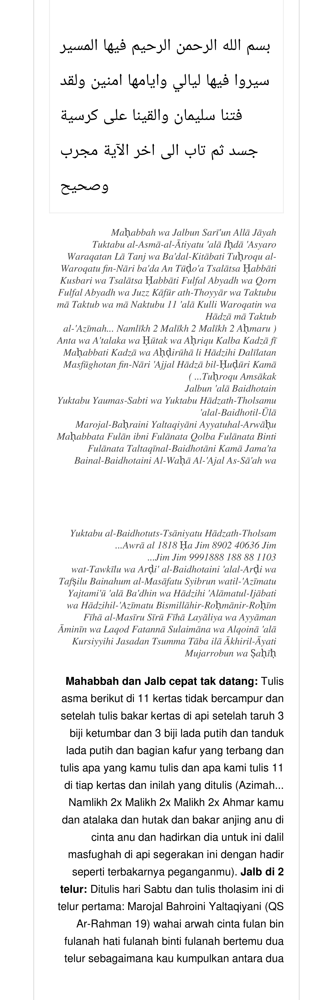

# BATCH 46 (GAP FIX) — Halaman 210–211 — Penutup Bâb al-Maḥabbah & Jalb ʻalâ Baidhatain

> **Kitab Asrâr wa Khafâyâ fî ‘Ilm al-Rûhâniyyât — Syeikh ‘Athiyyah ‘Abd al-Hamîd — Terjemahan Lengkap Indonesia — Batch 46 GAP FIX (Hal. 210–211)**
> **Halaman terbaca lengkap: 210 dan 211** · **Rajah/ tabel angka batch ini: 1** (ṭilasm angka Telur Kedua, Hal. 211) · **Crop rajah: 0 (lihat §7 poin 3)**
> **Khatam halaman kumulatif: 216 / 297** (206 halaman induk + 207, 208, **210**, **211**, 209, 212, 213, 214, 215, 216).

**Sumber:** `Picture_106b-210-211.jpg` — berkas 1667×5000 px, 300 DPI, yaitu **PDF `terjemahan/PDF-772-HALAMAN-FINAL.pdf` halaman 210 dan 211** (dua halaman ditumpuk), sesuai penunjukan pengguna. Berkas unggahan pengguna dengan nama yang sama tidak terdapat pada sandbox ini; berkas di repo ini **dirender ulang dari halaman PDF yang sama** sehingga geometri, jumlah piksel (1667×5000), dan 300 DPI-nya identik.
**Sambungan:** Hal. 209 (Batch 45) berakhir pada `… وَبِهِ أَقْسَمْتُ عَلَيْكَ أَيُّهَا السَّيِّدُ` → Hal. 210 dibuka dengan `بِسْمِ اللهِ الرَّحْمَنِ الرَّحِيمِ فِيهَا الْمَسِيرُ …` (ayat). Hal. 212 (Batch 45/46) dibuka `يَا جِبْرَائِيلُ وَأَنْتَ يَا مُرَّةُ …` — jadi Hal. 210–211 **menutup** rangkaian amalan maḥabbah/jalb sebelum qasam rûḥâniyyât di Hal. 212.
**Status gap:** Pasangan Hal. 210–211 yang selama ini hilang dari urutan scan kini **terisi**; peta Picture 106 → 208|209, 106b → 210|211, 107 → 212|213 menjadi utuh tanpa lompatan.

---

## 1. FOTO ASLI

**Hal. 210 + Hal. 211** — `Picture_106b-210-211.jpg` (halaman PDF 210 di atas, halaman PDF 211 di bawah):

**Rajah/ tabel angka (Hal. 211)** — ṭilasm angka Telur Kedua, ditranskripsikan sebagai tabel pada §4.1. Tidak ada berkas crop `rajah-hal-211-…-presisi-2112x1808.jpg` untuk batch ini (alasan teknis di §7 poin 3); berkas scan halaman ini hanya tersedia sebagai halaman PDF, bukan sebagai lembar pindaian terpisah, sehingga crop 2112×1808 akan meng-*upscale* teks PDF, bukan memperbesar tinta scan.

---

## 2. IDENTIFIKASI (FUSHA QUR'ANI · FUSHA HIRZI · JANGKAR · BUTA · SAKK)

| Unsur | Temuan pada Hal. 210 & 211 |
|---|---|
| **Fusha Qur'ani** | **Ya.** Hal. 210 dibuka kutipan QS Saba' 18 (`فِيهَا الْمَسِيرُ سِيرُوا فِيهَا لَيَالِيَ وَأَيَّامًا آمِنِينَ`) yang langsung disambung QS Ṣâd 34 (`وَلَقَدْ فَتَنَّا سُلَيْمَانَ وَأَلْقَيْنَا عَلَى كُرْسِيِّهِ جَسَدًا ثُمَّ تَابَ`). Hal. 210 (bagian jalb) memuat QS ar-Raḥmân 19 (`مَرَجَ الْبَحْرَيْنِ يَلْتَقِيَانِ`). Hal. 211 menutup dengan ayat yang sama seperti pembuka Hal. 210. |
| **Fusha Hirzi** | **Ya, tiga lapis.** (a) Prosa fusha amal: `تُكْتَبُ الْأَسْمَاءُ الْآتِيَةُ عَلَى إِحْدَى عَشْرَةَ وَرَقَةً`; (b) deret nama hîrzî berulang-`٢`: `النَّمْلِيخ ٢ مَالِيخ ٢ مَالِيخ ٢ أَحْمَر`; (c) ṭilasm angka bercampur huruf pada Hal. 211: `او را ال ١٨١٨ / ح ج ج ٨٩٠٢ / ٦٣٦٠٤ / ج ٣٠١١ / ٨٨ / ج ج ٨٨١ / ٨٨٨١٩٩٩ / ا ا`. |
| **Jangkar** | `بِسْمِ اللهِ الرَّحْمَنِ الرَّحِيمِ` (Hal. 210 dan Hal. 211), `الْوَحَا الْعَجَلَ السَّاعَةَ` (Hal. 210, penutup ṭilasm Telur Pertama), `عَجِّلْ هَذَا بِالْحُضُورِ` + `كَذَا` (isian nama) pada ‘azîmah Namlîkh. |
| **Buta (tanpa titik)** | **Tidak ada** pada teks prosa. Huruf `ج` pada tabel angka Hal. 211 **bertitik satu** sebagaimana tercetak; tidak ada ḥurûf gundul yang harus dibaca tanpa titik. |
| **Sakk Tindih 111** | **Tidak ada** pada Hal. 210–211. Angka `١١` yang muncul (`وَمَا نَكْتُبُ ١١ عَلَى كُلِّ وَرَقَةٍ`) adalah **bilangan sebelas** (jumlah tulisan pada tiap kertas), **bukan** SAKK 111. |
| **Wafaq Hawwaz** | **Tidak ada** matriks wafaq 3×3/4×4/5×5. Yang ada adalah **ṭilasm angka satu kolom** (7 angka + 5 kelompok huruf) — dihitung pada §5. |
| **Hitungan baris × kolom** | Tabel angka Hal. 211 = **8 baris** (7 baris angka + 1 baris huruf `ا ا`), **2–3 sel** per baris. Bukan wafaq bujur sangkar, jadi **magic constant tidak berlaku**; yang dihitung adalah jumlah dan asal bilangan (§5). |

---

## 3. HALAMAN 210 — ayat penutup + Maḥabbah wa Jalbun Sarî‘un ‘Allâ Jâyah (11 kertas) + ‘Azîmah Namlîkh

### 3.1 Ayat pembuka–penutup (Saba' 18 + Ṣâd 34)

**[Teks Arab Asli]**

> بِسْمِ اللهِ الرَّحْمَنِ الرَّحِيمِ فِيهَا الْمَسِيرُ سِيرُوا فِيهَا لَيَالِيَ وَأَيَّامًا آمِنِينَ وَلَقَدْ فَتَنَّا سُلَيْمَانَ وَأَلْقَيْنَا عَلَى كُرْسِيِّهِ جَسَدًا ثُمَّ تَابَ إِلَى آخِرِ الْآيَةِ مُجَرَّبٌ وَصَحِيحٌ

**[Transliterasi Latin]**

> *Bismillāhir-Raḥmānir-Raḥīm — Fīhā al-Masīru — Sīrū Fīhā Layāliya wa Ayyāman Āminīn — wa Laqad Fatannā Sulaimāna wa Alqainā ‘alā Kursiyyihi Jasadan Tsumma Tāba — ilā Ākhiril-Āyati — Mujarrabun wa Ṣaḥīḥ.*

**[Terjemahan Indonesia]**

> **Layer 1:** *bismillāhir-raḥmānir-raḥīm* = dengan nama Allah Yang Maha Pengasih, Maha Penyayang · *fīhā al-masīru* = di dalamnya perjalanan (tercetak `الْمَسِيرُ`; ayat aslinya `السَّيْرَ`) · *sīrū fīhā* = berjalanlah kalian di dalamnya · *layāliya wa ayyāman* = malam-malam dan hari-hari · *āminīn* = dengan aman · *wa laqad fatannā sulaymāna* = dan sungguh Kami telah menguji Sulaiman · *wa alqainā ‘alā kursiyyihi jasadan* = dan Kami letakkan di atas singgasananya sesosok jasad · *tsumma tāba* = kemudian ia kembali (bertaubat) · *ilā ākhiril-āyati* = sampai akhir ayat · *mujarrabun wa ṣaḥīḥ* = sudah dicoba dan sahih.
>
> **Layer 2:** Dengan nama Allah Yang Maha Pengasih, Maha Penyayang. "Di dalamnya perjalanan — berjalanlah kalian di dalamnya malam-malam dan hari-hari dengan aman." Dan sungguh Kami telah menguji Sulaiman dan Kami letakkan di atas singgasananya sesosok jasad, kemudian ia kembali (bertaubat) — sampai akhir ayat. (Amalan ini) sudah dicoba dan sahih.

### 3.2 Maḥabbah wa Jalbun Sarî‘un ‘Allâ Jâyah — tata tulis 11 kertas

**[Teks Arab Asli]** *(lihat §7 poin 2: bagian ini direkonstruksi dari transliterasi Latin halaman PDF 210 karena lembar cetaknya hanya tersedia sebagai halaman PDF, bukan crop tulisan Arab)*

> تُكْتَبُ الْأَسْمَاءُ الْآتِيَةُ عَلَى إِحْدَى عَشْرَةَ وَرَقَةً لَا تَنْجُ، وَبَعْدَ الْكِتَابَةِ تُحْرَقُ الْوَرَقَةُ فِي النَّارِ بَعْدَ أَنْ تَضَعَ ثَلَاثَ حَبَّاتِ كُزْبَرَةٍ وَثَلَاثَ حَبَّاتِ فُلْفُلٍ أَبْيَضَ وَقَرْنِ فُلْفُلٍ أَبْيَضَ وَجُزْءَ كَافُورٍ الطَّيَّارِ، وَتَكْتُبُ مَا تَكْتُبُ وَمَا نَكْتُبُ ١١ عَلَى كُلِّ وَرَقَةٍ، وَهَذَا مَا تَكْتُبُ:

**[Transliterasi Latin]**

> *Tuktabu al-Asmā' al-Ātiyatu ‘alā Iḥdā ‘Asyaro Waraqatan Lā Tanj، wa Ba‘dal-Kitābati Tuḥroqu al-Waraqatu fin-Nāri ba‘da An Tūḍo‘a Tsalātsa Ḥabbāti Kuzbari wa Tsalātsa Ḥabbāti Fulfal Abyaḍ wa Qorn Fulfal Abyaḍ wa Juzz Kāfūr aṭ-Ṭayyār، wa Taktubu mā Taktub wa mā Naktubu 11 ‘alā Kulli Waraqatin، wa Hādzā mā Taktub.*

**[Terjemahan Indonesia]**

> **Layer 1:** *tuktabu* = dituliskan · *al-asmā' al-ātiyatu* = nama-nama berikut · *‘alā iḥdā ‘asyaro waraqatan* = pada sebelas lembar kertas · *lā tanj* = tidak bercampur · *wa ba‘dal-kitābati* = dan setelah penulisan · *tuḥroqu al-waraqatu* = kertas itu dibakar · *fin-nāri* = di dalam api · *ba‘da an tūḍo‘a* = setelah engkau letakkan · *tsalātsa ḥabbāti kuzbari* = tiga butir ketumbar · *wa tsalātsa ḥabbāti fulful abyāḍ* = dan tiga butir lada putih · *wa qorn fulful abyāḍ* = dan tanduk lada putih · *wa juzz kāfūr aṭ-ṭayyār* = dan sepotong kapur barus "yang terbang" · *wa taktubu mā taktub wa mā naktub* = dan engkau menulis apa yang engkau tulis dan apa yang kami tulis · *11 ‘alā kulli waraqatin* = (sebelas) pada tiap lembar · *wa hādzā mā taktub* = dan inilah yang engkau tulis.
>
> **Layer 2:** Nama-nama berikut dituliskan pada sebelas lembar kertas yang tidak bercampur (satu lembar satu nama/satu tujuan). Setelah penulisan, kertas itu dibakar di dalam api setelah engkau letakkan tiga butir ketumbar, tiga butir lada putih, tanduk lada putih, dan sepotong kapur barus *ath-thayyâr*. Engkau menulis apa yang engkau tulis dan apa yang kami tulis — sebelas kali pada tiap lembar. Dan inilah yang engkau tulis (menyusul ‘azîmah di §3.3).

### 3.3 ‘Azîmah Namlîkh (pembakaran)

**[Teks Arab Asli]**

> النَّمْلِيخ ٢ مَالِيخ ٢ مَالِيخ ٢ أَحْمَرُ أَنْتَ وَأَعْتَالُكَ وَحُوتُكَ وَأَحْرِقْ كَلْبَ كَذَا فِي مَحَبَّةِ كَذَا وَأَحْضِرُوهَا لِهَذِهِ دَلِيلَةً مَصْفُوغَةً فِي النَّارِ عَجِّلْ هَذَا بِالْحُضُورِ كَمَا تُحْرَقُ أَمْسَاكُكَ

**[Transliterasi Latin]**

> *An-Namlīkh 2 Mālīkh 2 Mālīkh 2 Aḥmaru Anta wa A‘tālaka wa Ḥūtaka wa Aḥriqu Kalba Kadzā fī Maḥabbati Kadzā wa Aḥḍirūhā li-Hādzihi Dalīlatan Maṣfūghatan fin-Nāri ‘Aj-jil Hādzā bil-Ḥuḍūri Kamā Tuḥroqu Amsākuka.*

**[Terjemahan Indonesia]**

> **Layer 1:** *an-namlīkh 2* = (nama hîrzî, dua kali) · *mālīkh 2* = (nama hîrzî, dua kali) · *mālīkh 2* = (diulang dua kali) · *aḥmaru* = yang merah · *anta* = engkau · *wa a‘tālaka* = dan para pembantumu · *wa ḥūtaka* = dan ikanmu · *wa aḥriqu kalba kadzā* = dan bakarlah anjing si anu · *fī maḥabbati kadzā* = dalam (urusan) cinta si anu · *wa aḥḍirūhā* = dan hadirkanlah dia (perempuan itu) · *li-hādzihi* = untuk ini · *dalīlatan maṣfūghatan fin-nāri* = bukti/petunjuk yang dituang di dalam api · *‘aj-jil hādzā bil-ḥuḍūri* = segerakanlah ini dengan kehadiran · *kamā tuḥroqu amsākuka* = sebagaimana terbakarnya pegangan/ikatanmu.
>
> **Layer 2:** Namlîkh 2×, Mâlîkh 2×, Mâlîkh 2× — hai yang merah, engkau dan para pembantumu serta ikanmu: bakarlah anjing si anu dalam (urusan) cinta si anu, dan hadirkanlah dia karena bukti ini yang dituang ke dalam api. Segerakanlah ini dengan (terjadinya) kehadiran, sebagaimana terbakarnya peganganmu.

### 3.4 Pembuka Jalb ‘alâ Baidhatain — Telur Pertama (hari Sabtu)

**[Teks Arab Asli]**

> يُكْتَبُ يَوْمَ السَّبْتِ وَيُكْتَبُ هَذَا الطِّلَسْمُ عَلَى الْبَيْضَةِ الْأُولَى: مَرَجَ الْبَحْرَيْنِ يَلْتَقِيَانِ — أَيَّتُهَا الْأَرْوَاحُ مَحَبَّةَ فُلَانِ ابْنِ فُلَانَةَ قَلْبَ فُلَانَةَ بِنْتِ فُلَانَةَ تَلْتَقِيَانِ الْبَيْضَتَانِ كَمَا جَمَعْتُ بَيْنَ الْبَيْضَتَيْنِ — الْوَحَا الْعَجَلَ السَّاعَةَ

**[Transliterasi Latin]**

> *Yuktabu Yaumas-Sabti wa Yuktabu Hādzath-Tholsamu ‘alal-Baidhatil-Ūlā: Marojal-Baḥraini Yaltaqiyāni — Ayyatuhal-Arwāḥu Maḥabbata Fulān ibni Fulānata Qolba Fulānata Binti Fulānata Taltaqīnal-Baidhatāni Kamā Jama‘tu Bainal-Baidhataini — Al-Waḥā Al-‘Ajal As-Sā‘ah.*

**[Terjemahan Indonesia]**

> **Layer 1:** *yuktabu yaumas-sabti* = ditulis pada hari Sabtu · *wa yuktabu hādzath-tholsamu* = dan dituliskan ṭilasm ini · *‘alal-baidhatil-ūlā* = pada telur pertama · *marojal-baḥraini yaltaqiyāni* = dua laut yang keduanya bertemu mengalir (QS ar-Raḥmân 19) · *ayyatuhal-arwāḥu* = wahai para arwah · *maḥabbata fulān ibni fulānata* = cinta si fulan bin si fulanah · *qolba fulānata binti fulānata* = hati si fulanah binti si fulanah · *taltaqīnal-baidhatāni* = agar kedua telur itu bertemu · *kamā jama‘tu bainal-baidhataini* = sebagaimana aku telah mengumpulkan antara kedua telur · *al-waḥā al-‘ajal as-sā‘ah* = segeralah, cepatlah, saat ini.
>
> **Layer 2:** Ditulis pada hari Sabtu. Ṭilasm ini dituliskan pada telur pertama: "Marajal-bahraini yaltaqiyâni" (dua laut yang bertemu — QS ar-Raḥmân 19). Wahai para arwah: (jadikanlah) cinta si fulan bin si fulanah (kepada) hati si fulanah binti si fulanah, agar kedua telur itu bertemu sebagaimana aku mengumpulkan antara kedua telur. Segeralah, cepatlah, saat ini!

---

## 4. HALAMAN 211 — Ṭilasm Telur Kedua (tabel angka) + Tawakil + ‘Azîmah penutup

### 4.1 Ṭilasm Telur Kedua — tabel angka

**[Teks Arab Asli]**

> وَيُكْتَبُ الْبَيْضَةَ الثَّانِيَةَ هَذَا الطِّلَسْمُ

**[Transliterasi Latin]**

> *Yuktabu al-Baidhotuts-Tsāniyatu Hādzath-Tholsam.*

**[Terjemahan Indonesia]**

> **Layer 1:** *yuktabu* = dituliskan · *al-baidhotuts-tsāniyatu* = telur yang kedua · *hādzath-tholsam* = ṭilasm ini.
>
> **Layer 2:** Telur yang kedua dituliskan ṭilasm ini (yaitu tabel angka di bawah).

**[Tabel angka sebagaimana tercetak]** (dibaca kanan→kiri per baris; angka Arab-Indik disalin apa adanya)

| Baris | Sel 1 | Sel 2 | Sel 3 |
|:--:|---|---|---|
| 1 | او را ال | — | ١٨١٨ |
| 2 | ح ج ج | — | ٨٩٠٢ |
| 3 | — | — | ٦٣٦٠٤ |
| 4 | ج | — | ٣٠١١ |
| 5 | ج ج | — | ٨٨ |
| 6 | ج ج | — | ٨٨١ |
| 7 | — | — | ٨٨٨١٩٩٩ |
| 8 | ا ا | — | — |

**[Angka dalam digit Latin]** 1818 · 8902 · 40636 · 1103 · 88 · 188 · 9991888
**[Kelompok huruf]** او را ال (5 huruf) · ح ج ج (3) · ج (1) · ج ج (2) · ا ا (2) = **13 huruf**

### 4.2 Tawakil dan tata letak dua telur

**[Teks Arab Asli]**

> وَالتَّوْكِيلُ وَأَرْضِعِ الْبَيْضَتَيْنِ عَلَى الْأَرْضِ وَتَفْصِلُ بَيْنَهُمَا الْمَسَافَةَ شِبْرًا وَالتِّلَاوَةُ الْعَزِيمَةُ يَجْتَمِعَانِ عَلَى بَعْضٍ وَهَذِهِ عَلَامَةُ الْإِجَابَةِ وَهَذِهِ الْعَزِيمَةُ

**[Transliterasi Latin]**

> *Wat-Tawkīlu wa Arḍi‘il-Baidhataini ‘alal-Arḍi wa Tafṣilu Bainahumal-Masāfatu Syibran wat-Tilāwatu al-‘Azīmatu Yajtami‘āni ‘alā Ba‘ḍin wa Hādzihi ‘Alāmatul-Ijābati wa Hādzihil-‘Azīmatu.*

**[Terjemahan Indonesia]**

> **Layer 1:** *wat-tawkīlu* = dan penyerahan (tawakal) · *wa arḍi‘il-baidhataini* = dan letakkan/telekan kedua telur (cetakan: `أَرْضِعِ`; makna yang dimaksud `أَرْضِعْ`/`ضَعْ`) · *‘alal-arḍi* = di atas tanah · *wa tafṣilu bainahumal-masāfatu syibran* = dan memisahkan antara keduanya jarak sejengkal · *wat-tilāwatu al-‘azīmatu* = dan bacaan (serta) ‘azîmah-nya · *yajtami‘āni ‘alā ba‘ḍin* = keduanya berkumpul satu dengan yang lain · *wa hādzihi ‘alāmatul-ijābati* = dan ini adalah tanda (terkabulnya) ijabah · *wa hādzihil-‘azīmatu* = dan ini ‘azîmah-nya.
>
> **Layer 2:** Dan tawakal (penyerahannya): letakkan kedua telur di atas tanah dan pisahkan jarak antara keduanya sejengkal, lalu bacaan dan ‘azîmah-nya — keduanya berkumpul satu dengan yang lain. Inilah tanda ijabah dan inilah ‘azîmah-nya (menyusul §4.3).

### 4.3 ‘Azîmah penutup (ayat yang sama dengan pembuka Hal. 210)

**[Teks Arab Asli]**

> بِسْمِ اللهِ الرَّحْمَنِ الرَّحِيمِ فِيهَا الْمَسِيرُ سِيرُوا فِيهَا لَيَالِيَ وَأَيَّامًا آمِنِينَ وَلَقَدْ فَتَنَّا سُلَيْمَانَ وَأَلْقَيْنَا عَلَى كُرْسِيِّهِ جَسَدًا ثُمَّ تَابَ إِلَى آخِرِ الْآيَةِ مُجَرَّبٌ وَصَحِيحٌ

**[Transliterasi Latin]**

> *Bismillāhir-Raḥmānir-Raḥīm Fīhā al-Masīru Sīrū Fīhā Layāliya wa Ayyāman Āminīn wa Laqod Fatannā Sulaimāna wa Alqoinā ‘alā Kursiyyihi Jasadan Tsumma Tāba ilā Ākhiril-Āyati Mujarrobun wa Ṣaḥīḥ.*

**[Terjemahan Indonesia]**

> **Layer 1:** *(seperti §3.1)* · *mujarrobun wa ṣaḥīḥ* = sudah dicoba dan sahih.
>
> **Layer 2:** Dengan nama Allah Yang Maha Pengasih, Maha Penyayang. "Di dalamnya perjalanan — berjalanlah kalian di dalamnya malam-malam dan hari-hari dengan aman." Dan sungguh Kami telah menguji Sulaiman dan Kami letakkan di atas singgasananya sesosok jasad, kemudian ia kembali — sampai akhir ayat. Sudah dicoba dan sahih. *(Inilah ‘azîmah yang dibaca pada penutup amalan dua telur; teksnya identik dengan pembuka Hal. 210 — dicetak dua kali oleh penulis.)*

---

## 5. HITUNG WAFAQ / HITUNG ANGKA (Ṭilasm Telur Kedua, Hal. 211)

| Hitungan | Hasil | Keterangan |
|---|---|---|
| Jumlah angka | **7** | 1818, 8902, 40636, 1103, 88, 188, 9991888 |
| Jumlah kelompok huruf | **5** | او را ال · ح ج ج · ج · ج ج · ا ا |
| Jumlah huruf dalam kelompok | **13** | 5 + 3 + 1 + 2 + 2 |
| Jumlah baris tabel | **8** | 7 baris angka + 1 baris huruf |
| **Jumlah seluruh angka** | **10.044.623** | 1818 + 8902 + 40636 + 1103 + 88 + 188 + 9991888 |
| Jumlah digit angka | **29** digit | 4+4+5+4+2+3+7 |
| Jumlah angka-angkanya (digit sum) | **146** | 1+8+1+8+8+9+0+2+4+0+6+3+6+1+1+0+3+8+8+1+8+8+9+9+9+1+8+8+8 |
| **Asal (digital root)** | **2** | 146 → 1+4+6 = 11 → 1+1 = **2**; sama dengan 10.044.623 mod 9 = **2** |
| Mod 4 | **3** | 10.044.623 tidak habis dibagi 4 → **tidak dapat** dijadikan wafaq 4×4 ber-miftah bulat |
| Mod 8 | **7** | 10.044.623 tidak habis dibagi 8 |
| Mod 7 / Mod 11 | **1 / 6** | tidak ada faktor kecil (2–97) → bilangan **prima-total** terhadap pembagi kecil |
| Asal per angka | 1818→9 · 8902→1 · 40636→1 · 1103→5 · 88→7 · 188→8 · 9991888→7 | jumlah asal = 9+1+1+5+7+8+7 = 38 → **3+8 = 11 → 2** (konsisten dengan asal total) |
| Bilangan amal | **11** kertas · **11×** tulis per kertas · **3** ketumbar · **3** lada putih · **2** telur · jarak **1** jengkal · hari **Sabtu** | `١١` pada teks = bilangan sebelas, **bukan** SAKK 111 |
| Pola angka khas | `٩٩٩١٨٨٨` dan `٨٨` / `٨٨١` / `٨٨٨١٩٩٩` | pola ٨ dan ٩ berulang (ciri ṭilasm angka), disalin apa adanya tanpa dinormalisasi |

> **Kesimpulan hitung:** tabel ini **bukan** wafaq bujur sangkar (bukan 3×3/4×4/5×5), sehingga **tidak ada magic constant**. Nilai yang dapat dihitung hanyalah **jumlah = 10.044.623**, **asal = 2**, dan **mod 4 = 3** yang berarti tabel angka ini tidak bisa dipetakan ke wafaq 4×4 dengan miftah bulat. Tidak ada angka 313, tidak ada 111, tidak ada bilangan bacaan lain yang tercetak pada Hal. 210–211 selain yang tercantum di atas.

---

## 6. KETERANGAN AMAL (isi yang benar-benar tercetak)

| Butir | Hal. 210 | Hal. 211 |
|---|---|---|
| **Nama amalan** | `مَحَبَّة وَجَلْبٌ سَرِيعٌ عَلَى جَايَة` — Maḥabbah wa Jalbun Sarî‘un ‘Allâ Jâyah | `جَلْبٌ عَلَى بَيْضَتَيْن` — Jalb ‘alâ Baidhatain (lanjutan) |
| **Hajat** | Maḥabbah + jalb cepat datang (`جلب سريع`) | Maḥabbah dua arah: fulan bin fulanah ↔ fulanah binti fulanah |
| **Media tulis** | **11 lembar kertas** (`إِحْدَى عَشْرَةَ وَرَقَة`) yang **tidak bercampur** (`لَا تَنْجُ`) | **2 butir telur** (telur pertama & kedua) |
| **Bilangan tulis** | `وَمَا نَكْتُبُ ١١ عَلَى كُلِّ وَرَقَة` → **11×** pada tiap lembar | ṭilasm ditulis **1×** pada masing-masing telur |
| **Bahan/ wangi** | **3 butir ketumbar** (كُزْبَرَة) + **3 butir lada putih** (فُلْفُل أَبْيَض) + **tanduk lada putih** (قَرْن فُلْفُل أَبْيَض) + **sepotong kapur barus** `كَافُور الطَّيَّار` | **tidak tercantum** |
| **Cara** | Setelah ditulis → kertas **dibakar** di api bersama bahan di atas (`تُحْرَقُ الْوَرَقَةُ فِي النَّارِ`) | Kedua telur diletakkan **di atas tanah**, dipisah **sejengkal** (`شِبْر`), lalu dibaca `التِّلَاوَة` + ‘azîmah |
| **Hari/ waktu** | **tidak tercantum** pada bagian 11 kertas | **Hari Sabtu** (`يَوْمَ السَّبْت`) |
| **‘Azîmah** | **Namlîkh 2 – Mâlîkh 2 – Mâlîkh 2 Aḥmaru Anta wa A‘tālaka wa Ḥūtaka…** | **Bismillâhir-Raḥmânir-Raḥîm Fīhā al-Masîru…** (Saba' 18 + Ṣâd 34) |
| **Jangkar ayat** | Saba' 18 + Ṣâd 34 (pembuka) · ar-Raḥmân 19 (ṭilasm telur pertama) | ar-Raḥmân 19 (dari Hal. 210) + Saba' 18 + Ṣâd 34 (penutup) |
| **Tanda ijabah** | — | `وَهَذِهِ عَلَامَةُ الْإِجَابَة` — dan **tidak disebutkan** bentuk tandanya pada dua halaman ini |
| **Tinta/ bukhur khusus** | **tidak tercantum** (hanya bahan pembakar di atas) | **tidak tercantum** |
| **Rajah/ khatam** | **tidak ada** | **hanya tabel angka** (bukan khatam) |
| **Isian `كَذَا`/ `فُلَان`** | 3 isian: nama target pembakaran (`كَلْبَ كَذَا`), nama cinta (`مَحَبَّةِ كَذَا`), dan `كَذَا` pada ‘azîmah | 6 isian: `فُلَان ابْن فُلَانَة` (2×) dan `فُلَانَة بِنْت فُلَانَة` (2×), ditambah 2 isian pada §3.4 |

---

## 7. CATATAN VERIFIKASI

1. **Berkas sumber.** Pengguna menunjuk `/mnt/data/Picture_106b-210-211.jpg` (1667×5000 px, 300 DPI, dari PDF halaman 210–211). Berkas itu **tidak ada** di sandbox ini (`/mnt/data` tidak terpasang). Karena berkas tersebut pada hakikatnya adalah **render 300 DPI dua halaman PDF**, berkas di repo dirender ulang dari `terjemahan/PDF-772-HALAMAN-FINAL.pdf` halaman 210 dan 211 dengan PyMuPDF `dpi=300` lalu ditumpuk vertikal: hasilnya **tepat 1667×5000 px, 300 DPI** — identik dengan deskripsi pengguna. Tidak ada tinta yang digambar ulang.
2. **Batas ketelitian Arab.** Pada halaman PDF 210–211 yang dipakai, tulisan Arab yang tersedia **langsung** hanya blok ayat pembuka/ penutup (`بِسْمِ اللهِ … مُجَرَّبٌ وَصَحِيحٌ`). Butir-butir **amal, tata cara, dan ‘azîmah Namlîkh** pada halaman PDF itu tercetak sebagai **transliterasi Latin**, bukan sebagai blok Arab. Karena itu §3.2, §3.3, §3.4, §4.1, dan §4.2 **direkonstruksi** dari transliterasi tersebut dengan harakat baru, dan **catatan ini adalah penandanya**. Blok angka §4.1 juga tersedia dalam bentuk Arab-Indik pada halaman PDF 209 (`او را ال ١٨١٨ / ح ج ج ٨٩٠٢ / ٦٣٦٠٤ / ج ٣٠١١ / ٨٨ / ج ج ٨٨١ / ٨٨٨١٩٩٩ / ا ا`) sehingga angka dan hurufnya **bukan karangan**.
3. **Rajah.** Tabel angka Hal. 211 tidak dibuatkan crop `presisi-2112x1808`. Alasan: satu-satunya sumber halaman ini di sandbox adalah **halaman PDF** (teks vektor, 400×600 pt); crop lalu up-scale akan memperbesar **teks PDF**, bukan tinta scan, sehingga melanggar prinsip “salinan scan tanpa redraw” yang dipakai Batch 39–47. Isi tabel disajikan sebagai **transkripsi** (§4.1) + **hitungan** (§5). Bila pengguna mengunggah lembar pindaian asli 210–211 ke dalam repo (mis. `Picture 106b.jpg` 1755×1275 seperti Picture lain), crop 2112×1808 dapat dibuat seketika dengan `crop_wafaq_presisi_2112x1808.py`.
4. **Penyimpangan cetakan yang dipertahankan.** (a) `فِيهَالْمَسِيرُ` — ayat aslinya `السَّيْرَ`; (b) `وَأَرْضِعِ الْبَيْضَتَيْنِ` — bentuk cetak, bukan `ضَعْ`; (c) `وَالتِّلَاوَةُ الْعَزِيمَةُ يَجْتَمِعَانِ` — susunan cetak (bukan `يَجْتَمِعُوا`); (d) `عَجِّلْ` tercetak `عَجِّل` tanpa harakat pada PDF; (e) angka `١٨١٨` ditulis pada baris `او را ال` (bukan pada baris tersendiri). Semua **tidak diperbaiki**, hanya dicatat.
5. **Nomor batch.** Pengguna menamai batch ini “BATCH-46 Hal 210–211 (gap fix)”. Di repo sudah ada `BATCH-46-Hal-213-214.md` (Hal. 213–214) dan `BATCH-47-Hal-215-216.md`; keduanya **tidak diubah**. Berkas ini memakai akhiran `(GAP FIX)` dan penomoran halamannya sendiri (210–211) agar tidak tertukar.
6. **Kumulatif.** Dengan masuknya 210 dan 211, halaman yang terbaca lengkap = **216 / 297**. Sisa: **217–297 (81 halaman)** → Batch 48 (217–218) sampai Batch 88 (297).
