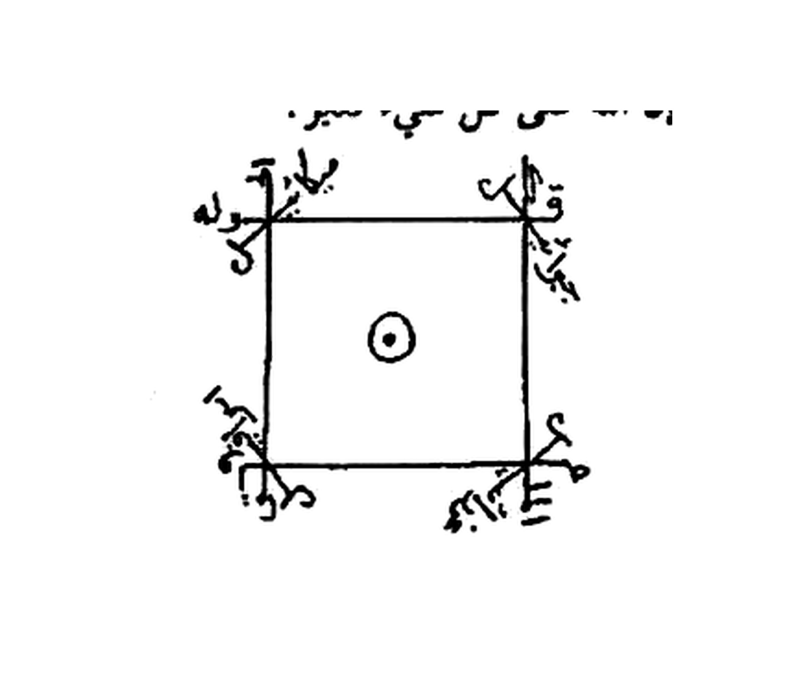
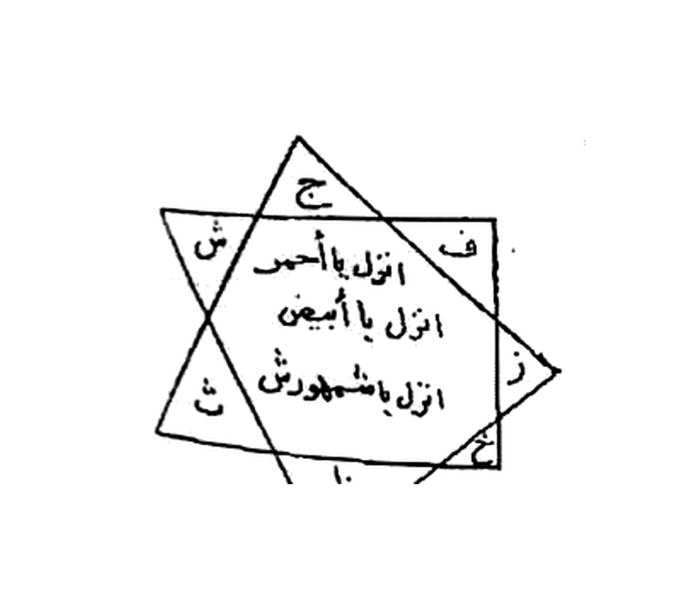

# BATCH 47 — Halaman 215–216 — Mandal yang Terbuka untuk Pembesar & Mandal Nafsi (Rajah Cermin)

> **Kitab Asrâr wa Khafâyâ fî ‘Ilm al-Rûhâniyyât — Syeikh ‘Athiyyah ‘Abd al-Hamîd — Terjemahan Lengkap Indonesia — Batch 47 (Hal. 215–216)**
> **Halaman terbaca lengkap: 215 dan 216** · **Rajah batch ini: 2** (Khatam Hal. 215 + Khatam Mandal Nafsi Hal. 216)
> **Khatam halaman kumulatif: 214 / 297**

**Sumber:** Picture 108.jpg (**Hal. 215** = belahan kiri) dan Picture 109.jpg (**Hal. 216** = belahan kanan; belahan kiri = Hal. 217, masuk Batch 48).
**Sambungan:** Hal. 215 melanjutkan Fashl V (`fawâ’id al-mandal`) dari Hal. 214. Hal. 215 ditutup dengan `… إِنَّ اللهَ عَلَى كُلِّ شَيْءٍ قَدِيرٌ` + rajah khatam → Hal. 216 membuka **Mandal Nafsi**.

---

## 1. FOTO ASLI

**Hal. 215** — Picture 108.jpg, belahan kiri (angka cetak `215`):

**Hal. 216** — Picture 109.jpg, belahan kanan (angka cetak `216`):

**Rajah 1 — Khatam Hal. 215** (`rajah-hal-215-khatam-mandal-presisi-2112x1808.jpg`):

**Rajah 2 — Khatam Mandal Nafsi Hal. 216** (`rajah-hal-216-khatam-mandal-nafsi-presisi-2112x1808.jpg`):

---

## 2. IDENTIFIKASI (FUSHA HIRZI · JANGKAR · BUTA · SAKK)

| Unsur | Temuan pada Hal. 215 & 216 |
|---|---|
| **Fusha Hirzi** | Ya, dua lapis: prosa Arab fusha (`تَأْمُرُ مَنْ يَكْتُبُ لَكَ عَلَى جَبْهَتِكَ …`) + deret nama hîrzî (`بَظَام قَرُوق مَرْدُوش وَدُود شَكُور غَمُور بِرْفَقْل عَفْقَمْل هَبْيُوش`, `بَهْرُوش هَفَا هَشْت هَرُوش`). |
| **Jangkar** | Hal. 215: `بِنُورِ وَجْهِ اللهِ الْكَرِيم` + `إِنَّهُ مِنْ سُلَيْمَانَ وَإِنَّهُ بِسْمِ اللهِ الرَّحْمَنِ الرَّحِيمِ`. Hal. 216: `أَقْسَمْتُ عَلَيْكَ بِظَام` + `لَقَدْ كُنْتَ فِي غَفْلَةٍ مِنْ هَذِهِ الْآيَةِ وَكَذَلِكَ نُرِي إِبْرَاهِيم` (al-Anbiya' 103 + al-An'am 75). |
| **Buta (tanpa titik)** | **Tulisan pada dua rajah** ditulis kursif tanpa harakat dan tanpa titik lengkap — pada khatam Hal. 215 keempat sudut bertulisan hîrzî kursif; pada khatam Hal. 216 huruf-huruf `ج ف ش(?) ز ط ش` mengisi sudut bintang. Keduanya **tidak ditranskripsikan sebagai huruf pasti**; disimpan sebagai gambar. |
| **Sakk Tindih 111** | **Tidak ada** pada kedua halaman. |
| **Wafaq Hawwaz** | **Tidak ada** matriks wafaq angka; tidak ada hitungan baris × kolom. |

---

## 3. HALAMAN 215 — Mandal yang terbuka untuk pembesar

### 3.1 Petunjuk kerja

**[Teks Arab Asli]**

> مَنْدَلٌ يَنْفَتِحُ عَلَى الْكِبَارِ
>
> تَأْمُرُ مَنْ يَكْتُبُ لَكَ عَلَى جَبْهَتِكَ. فَتَكْشِفُ عَنْكَ غِطَاءَكَ إِلَى حَدِيدٍ صَحِيحٍ وَالْخَاتَمُ فِي يَدِكَ وَتُبَخِّرُ بِالْكَسْبَرَةِ ثُمَّ تَعْزِمُ حَتَّى تَرَاهُمْ بِعَيْنِكَ.

**[Transliterasi Latin]**

> *Mandalun yanfatiḥu ‘alā al-kibāri. Ta’muru man yaktubu laka ‘alā jabhatika. Fa-taksyifu ‘anka ghiṭā’aka ilā ḥadīdin ṣaḥīḥin wa-al-khātamu fī yadika wa-tubakhkhiru bi-al-kasbarati thumma ta‘zimu ḥattā tarāhum bi-‘aynika.*

**[Terjemahan Indonesia]**

> **Layer 1:** *mandalun* = mandal · *yanfatiḥu* = yang terbuka · *‘alā al-kibāri* = untuk para pembesar · *ta’muru* = engkau menyuruh · *man yaktubu laka* = orang yang menuliskan bagimu · *‘alā jabhatika* = pada dahimu · *fa-taksyifu ‘anka ghiṭā’aka* = maka engkau menyingkap penutupmu · *ilā ḥadīdin ṣaḥīḥin* = hingga besi yang utuh · *wa-al-khātamu fī yadika* = dan khatam ada di tanganmu · *wa-tubakhkhiru* = dan engkau membakar bukhur · *bi-al-kasbarati* = dengan ketumbar (kasbarah) · *thumma ta‘zimu* = kemudian engkau membaca azimah · *ḥattā tarāhum bi-‘aynika* = sampai engkau melihat mereka dengan matamu sendiri.
>
> **Layer 2:** **Mandal yang terbuka untuk para pembesar.** Engkau menyuruh orang menuliskan (khatam ini) pada dahimu, lalu engkau menyingkap penutupmu menghadap besi yang utuh (cermin/logam) sementara khatam ada di tanganmu; engkau bakar bukhur dengan ketumbar, kemudian engkau membaca azimah sampai engkau melihat mereka dengan matamu sendiri.

### 3.2 ‘Azîmah-nya

**[Teks Arab Asli]**

> وَهَذِهِ الْعَزِيمَةُ
>
> تَقُولُ ـ أَيْنَ الَّذِينَ يَحْرِقُونَ الْأَنْهَارَ وَيَقْطَعُونَ الْقِيَافَ وَالْأَقْطَارَ أَقْسَمْتُ عَلَيْكُمْ بِنُورِ وَجْهِ اللهِ الْكَرِيمِ إِنَّهُ مِنْ سُلَيْمَانَ وَإِنَّهُ بِسْمِ اللهِ الرَّحْمَنِ الرَّحِيمِ أَنْ لَا تَعْلُوا عَلَىَّ وَأْتُونِي مُسْلِمِينَ طَائِعِينَ لِلَّهِ رَبِّ الْعَالَمِينَ الَّذِي خَلَقَكُمْ مِنْ نَارِ السَّمُومِ أَيْنَ الْمُلُوكُ أَيْنَ الْقِيَادِينَ أَيْنَ الْأَكْوَانُ أَيْنَ الَّذِينَ إِذَا نَشَرُوا أَجْنِحَتَهُمْ سَدُّوا الْآفَاقَ انْزِلُوا ٢ احْضُرُوا ٢ عَجِّلُوا وَعَجِّلُوا الْوَحَا ٢ السَّاعَةَ ٢ اِتُونِي بِخُيُولِكُمْ وَرِجَالِكُمْ صِغَارِكُمْ وَكِبَارِكُمْ ذُكُورِكُمْ وَإِنَاثِكُمْ أَحْرَارِكُمْ وَعَبِيدِكُمْ أَيْنَ مُذْهِبُ الْأَمِيرِ أَيْنَ مُرَّةُ الْأَمِيرِ أَيْنَ الْأَحْمَرُ أَيْنَ بَرْقَانُ الْأَمِيرُ أَيْنَ شَمْهُورَشُ أَيْنَ الْأَبْيَضُ أَيْنَ مَيْمُونُ الْأَمِيرُ أَيْنَ مَنْ كَانَ مِنْكُمْ فِي مَشَارِقِ الْأَرْضِ وَمَغَارِبِهَا إِنْ كَانَتْ إِلَّا صَيْحَةً وَاحِدَةً إِلَى مَحْضَرُونَ أَيْنَمَا تَكُونُوا يَأْتِ بِكُمُ اللهُ جَمِيعًا إِنَّ اللهَ عَلَى كُلِّ شَيْءٍ قَدِيرٌ.

**[Transliterasi Latin]**

> *Wa-hādhihi al-‘azīmatu taqūlu — Ayna alladhīna yaḥriqūna al-anhāra wa-yaqṭa‘ūna al-qiyāfa wa-al-aqṭāra aqsamtu ‘alaykum bi-nūri wajhi Allāhi al-karīmi innahu min Sulaymāna wa-innahu bismi Allāhi al-Raḥmāni al-Raḥīmi an lā ta‘lū ‘alayya wa’tūnī muslimīna ṭā’i‘īna li-llāhi rabbi al-‘ālamīna alladhī khalaqakum min nāri al-samūmi ayna al-mulūku ayna al-qiyādīna ayna al-akwānu ayna alladhīna idhā nasyarū ajniḥatahum saddū al-āfāqa inzilū (2×) uḥḍurū (2×) ‘ajjilū wa-‘ajjilū al-waḥā (2×) al-sā‘ata (2×) itūnī bi-khuyūlikum wa-rijālikum ṣighārikum wa-kibārikum dhukūrikum wa-ināthikum aḥrārikum wa-‘abīdikum ayna mudhhibu al-amīri ayna Murratu al-amīri ayna al-aḥmaru ayna Barqānu al-amīru ayna Syamhūrasyu ayna al-abyaḍu ayna Maymūnu al-amīru ayna man kāna minkum fī masyāriqi al-arḍi wa-maghāribihā in kānat illā ṣayḥatan wāḥidatan ilā maḥḍarūna aynamā takūnū ya’ti bikum Allāhu jamī‘an inna Allāha ‘alā kulli shay’in qadīrun.*

**[Terjemahan Indonesia]**

> **Layer 1:** *ayna alladhīna yaḥriqūna al-anhāra* = di mana mereka yang membakar sungai-sungai · *wa-yaqṭa‘ūna al-qiyāfa wa-al-aqṭāra* = dan memotong jalan-jalan serta negeri-negeri · *bi-nūri wajhi Allāhi al-karīmi* = dengan cahaya wajah Allah Yang Mahamulia · *ayna al-mulūku* = di mana para raja · *ayna al-qiyādīna* = di mana para pemimpin · *ayna al-akwānu* = di mana alam-alam · *alladhīna idhā nasyarū ajniḥatahum saddū al-āfāqa* = yang apabila mereka membentangkan sayapnya menutup cakrawala · *inzilū* = turunlah (2×) · *uḥḍurū* = hadirlah (2×) · *‘ajjilū* = bersegeralah · *al-waḥā* = segeralah (2×) · *al-sā‘ata* = saat ini (2×) · *itūnī bi-khuyūlikum wa-rijālikum* = datanglah kepadaku dengan kuda dan orang-orang kalian · *ṣighārikum wa-kibārikum* = yang kecil dan yang besar · *dhukūrikum wa-ināthikum* = yang laki-laki dan yang perempuan · *aḥrārikum wa-‘abīdikum* = yang merdeka dan yang hamba · *ayna mudhhibu al-amīri* = di mana Mudzhib sang amir · *ayna Murratu al-amīri* = di mana Murrah sang amir · *ayna al-aḥmaru* = di mana Yang Merah · *ayna Barqānu al-amīru* = di mana Barqan sang amir · *ayna Syamhūrasyu* = di mana Syamhurasy · *ayna al-abyaḍu* = di mana Yang Putih · *ayna Maymūnu al-amīru* = di mana Maimun sang amir · *ayna man kāna minkum fī masyāriqi al-arḍi wa-maghāribihā* = di mana siapa di antara kalian yang berada di timur dan barat bumi · *in kānat illā ṣayḥatan wāḥidatan* = tiada lain melainkan satu teriakan · *ilā maḥḍarūna* = (mereka) dihadirkan · *aynamā takūnū ya’ti bikum Allāhu jamī‘an* = di mana pun kalian berada, Allah akan mendatangkan kalian semua · *inna Allāha ‘alā kulli shay’in qadīrun* = sesungguhnya Allah atas segala sesuatu Mahakuasa.
>
> **Layer 2:** **Inilah azimahnya:** Engkau berkata — Di mana mereka yang membakar sungai-sungai dan memotong jalan-jalan serta negeri-negeri? Aku bersumpah atas kalian dengan cahaya wajah Allah Yang Mahamulia: sesungguhnya ia dari Sulaiman, dan sesungguhnya ia dengan nama Allah Yang Maha Pengasih, Maha Penyayang — janganlah kalian meninggikan diri terhadapku, dan datanglah kepadaku dengan berserah diri, taat kepada Allah, Tuhan semesta alam, yang menciptakan kalian dari api yang membara. Di mana para raja? Di mana para pemimpin? Di mana alam-alam? Di mana mereka yang apabila membentangkan sayapnya menutup cakrawala? Turunlah, turunlah! Hadirlah, hadirlah! Bersegeralah, bersegeralah! Segeralah, segeralah! Saat ini, saat ini! Datanglah kepadaku dengan kuda dan orang-orang kalian — yang kecil dan yang besar, laki-laki dan perempuan, merdeka dan hamba. Di mana Mudzhib sang amir? Di mana Murrah sang amir? Di mana Yang Merah? Di mana Barqan sang amir? Di mana Syamhurasy? Di mana Yang Putih? Di mana Maimun sang amir? Di mana siapa di antara kalian yang berada di timur dan barat bumi? Tiada lain melainkan satu teriakan, maka mereka pun dihadirkan. Di mana pun kalian berada, Allah akan mendatangkan kalian semua; sesungguhnya Allah atas segala sesuatu Mahakuasa.

### 3.3 Rajah: “Inilah khatamnya”

**[Teks Arab Asli]**

> وَهَذَا هُوَ الْخَاتِمُ

> **Deskripsi rajah:** bujur sangkar tebal dengan **satu titik tebal di tengahnya**; pada **keempat sudut** tumbuh tulisan kursif hîrzî yang menembus garis sudut ke luar (kanan-atas, kiri-atas, kiri-bawah, kanan-bawah). Tulisan sudut itu gundul/kursif dan **tidak dapat dipastikan hurufnya**, jadi tidak ditranskripsikan; seluruhnya disimpan sebagai gambar presisi.

---

## 4. HALAMAN 216 — Mandal Nafsi (cermin)

### 4.1 Petunjuk kerja

**[Teks Arab Asli]**

> مَنْدَلٌ نَفْسِي
>
> وَهَذَا الْمَنْدَلُ عَظِيمٌ لَيْسَ لَهُ نَظِيرٌ مُجَرَّبٌ مِرَارًا لِتَنْظُرَ فِي نَفْسِكَ مِنْ غَيْرِ نَاظُورٍ وَهُوَ أَنْ تَأْخُذَ مِرْآيَةً جَدِيدَةً وَتَكْتُبَ فِي فَقَاعِهَا هَذَا الْخَاتِمَ الْآنَ ذِكْرَهُ وَتَكُونَ طَاهِرَ الثَّوْبِ وَالْبَدَنِ وَالْمَكَانِ فِي يَوْمِ الْأَحَدِ وَأَنْتَ مُتَرَيِّضٌ عَنِ الرُّوحِ مِنْ غَيْرِ صِيَامٍ وَالْبَخُورُ كَسْبَرَةٌ وَلُبَانٌ ذَكَرٌ عِنْدَ تِلَاوَةِ الْعَزِيمَةِ وَثَبِّتْ نَفْسَكَ وَعَقْلَكَ وَتَنْظُرُ فِي الْمِرْآيَةِ تَجِدُهَا قَدِ انْخَرَقَ فِيهَا خَرْقٌ كَبِيرٌ وَتَرَى رَجُلًا تَشْطَحُ عِنْدَ الْقِرَاءَةِ فَتَسْمَعُهُمْ قِرَاءَتَكَ عِنْدَ الْعَزِيمَةِ ٣ مَرَّاتٍ فَيَأْتِيكَ الْخَادِمُ وَيَقُولُ لَكَ السَّلَامُ يَا نَسَارَةُ فَقُلْ لَهُ عَلَيْكَ وَمِنْكَ وَفِيكَ ثُمَّ قُلْ لَهُ خُذْ مِنِّي كُلَّ مَا أَمَرْتُكَ بِهِ فَيَأْتُوكَ وَاسْأَلْهُمْ عَمَّا تُرِيدُ وَسَلِّطْ عَلَيَّ مَا تُرِيدُ.

**[Transliterasi Latin]**

> *Mandalun nafsī. Wa-hādhā al-mandalu ‘aẓīmun laysa lahu naẓīrun mujarrabun mirāran li-tanẓura fī nafsika min ghayri nāẓūrin wa-huwa an ta’khudha mir’āyatan jadīdatan wa-taktuba fī faqā‘ihā hādhā al-khātama al-āna dhikrahu wa-takūna ṭāhira al-thawbi wa-al-badani wa-al-makāni fī yawmi al-aḥadi wa-anta mutarayyiḍun ‘ani al-rūḥi min ghayri ṣiyāmin wa-al-bakhūru kasbaratun wa-lubānun dhakarun ‘inda tilāwati al-‘azīmati wa-thabbit nafsaka wa-‘aqlaka wa-tanẓuru fī al-mir’āti tajiduhā qad inkharraqa fīhā kharqun kabīrun wa-tarā rajulan tasyṭaḥu ‘inda al-qirā’ati fa-tasma‘uhum qirā’ataka ‘inda al-‘azīmati 3 marrātin fa-ya’tīka al-khādinu wa-yaqūlu laka al-salāmu yā nasāratu fa-qul lahu ‘alayka wa-minka wa-fīka thumma qul lahu khudh minnī kulla mā amartuka bihi fa-ya’tūka wa-s’alhum ‘ammā turīdu wa-salliṭ ‘alayya mā turīdu.*

**[Terjemahan Indonesia]**

> **Layer 1:** *mandalun nafsī* = mandal nafsu/diri · *laysa lahu naẓīrun* = tidak ada bandingannya · *mujarrabun mirāran* = sudah dicoba berkali-kali · *li-tanẓura fī nafsika* = agar engkau melihat pada dirimu · *min ghayri nāẓūrin* = tanpa perantara · *an ta’khudha mir’āyatan jadīdatan* = engkau mengambil cermin baru · *wa-taktuba fī faqā‘ihā* = dan engkau menulis pada (bagian) atasnya · *hādhā al-khātama* = khatam ini · *al-āna dhikrahu* = yang akan disebutkan sekarang · *ṭāhira al-thawbi wa-al-badani wa-al-makāni* = suci pakaian, badan, dan tempatnya · *fī yawmi al-aḥadi* = pada hari Ahad · *wa-anta mutarayyiḍun ‘ani al-rūḥi* = dan engkau menjauhi (hubungan) ruh · *min ghayri ṣiyāmin* = tanpa puasa · *al-bakhūru kasbaratun wa-lubānun dhakarun* = bukhurnya ketumbar dan luban jantan · *‘inda tilāwati al-‘azīmati* = ketika membaca azimah · *wa-thabbit nafsaka wa-‘aqlaka* = dan mantapkan dirimu serta akalmu · *wa-tanẓuru fī al-mir’āti* = dan engkau melihat ke dalam cermin · *tajiduhā qad inkharraqa fīhā kharqun kabīrun* = engkau dapati padanya telah terbelah belahan besar · *wa-tarā rajulan tasyṭaḥu ‘inda al-qirā’ati* = dan engkau melihat seorang laki-laki bergerak-gerak saat pembacaan · *fa-tasma‘uhum qirā’ataka* = maka mereka mendengar bacaanmu · *‘inda al-‘azīmati 3 marrātin* = saat azimah, tiga kali · *fa-ya’tīka al-khādinu* = maka datang kepadamu khadam · *wa-yaqūlu laka al-salāmu* = dan ia mengucapkan salam kepadamu · *yā nasāratu* = wahai Nasarah · *fa-qul lahu ‘alayka wa-minka wa-fīka* = maka katakan kepadanya: atasmu, darimu, dan padamu · *khudh minnī kulla mā amartuka bihi* = ambillah dariku segala yang kuperintahkan kepadamu · *fa-ya’tūka* = maka mereka datang kepadamu · *wa-s’alhum ‘ammā turīdu* = dan tanyailah mereka tentang apa yang engkau inginkan · *wa-salliṭ ‘alayya mā turīdu* = dan berikanlah kekuasaan atasku untuk apa yang engkau inginkan.
>
> **Layer 2:** **Mandal Nafsi.** Mandal ini agung, tidak ada bandingannya, sudah dicoba berkali-kali, agar engkau melihat pada dirimu sendiri tanpa perantara. Yaitu: engkau mengambil sebuah cermin baru dan engkau tuliskan pada bagian atasnya khatam yang akan disebutkan sekarang; engkau harus suci pakaian, badan, dan tempatnya, pada hari **Ahad**, dan engkau menjauhi hubungan badan (dengan istri) tanpa puasa. Bukhurnya: **ketumbar dan luban jantan** ketika membaca azimah. Mantapkanlah dirimu dan akalmu, lalu engkau melihat ke dalam cermin — engkau akan dapati cermin itu telah terbelah dengan belahan yang besar, dan engkau melihat seorang laki-laki bergerak-gerak saat pembacaan. Mereka mendengar bacaanmu saat azimah — **tiga kali** — maka datang kepadamu khadam dan ia mengucapkan salam kepadamu: "Salam, wahai Nasarah." Maka katakan kepadanya: "Atasmu, darimu, dan padamu." Kemudian katakan kepadanya: "Ambillah dariku segala yang kuperintahkan kepadamu," maka mereka pun datang kepadamu. Tanyailah mereka tentang apa yang engkau inginkan, dan berikanlah kekuasaan atasku untuk apa yang engkau inginkan.

### 4.2 ‘Azîmah-nya

**[Teks Arab Asli]**

> وَهَذِهِ الْعَزِيمَةُ
>
> تَقُولُ ـ أَقْسَمْتُ عَلَيْكَ بِظَام ٢ قَرُوق ٢ مَرْدُوش ٢ وَدُود ٢ شَكُور ٢ غَمُور ٢ بِرْفَقْل ٢ عَفْقَمْل ٢ هَبْيُوش ٢ انْزِلْ يَا شَمْهُورَشْ وَاكْشِفُوا الْحِجَابَ بَيْنِي وَبَيْنَكُمْ حَتَّى أَرَاكُمْ بِعَيْنِي وَأُخَاطِبَكُمْ بِلِسَانِي وَأَسْأَلُكُمْ عَمَّا أُرِيدُ لَقَدْ كُنْتَ فِي غَفْلَةٍ مِنْ هَذِهِ الْآيَةِ وَكَذَلِكَ نُرِي إِبْرَاهِيمَ الْآيَةَ الْوَحَا السَّاعَةَ الْعَجَلَ.

**[Transliterasi Latin]**

> *Wa-hādhihi al-‘azīmatu taqūlu — aqsamtu ‘alayka bi-Ẓām (2×) Qarūq (2×) Mardūsy (2×) Wadūd (2×) Syakūr (2×) Ghamūr (2×) Birfaql (2×) ‘Afqaml (2×) Habyūsy (2×) inzil yā Syamhūrasy wa-iksyifū al-ḥijāba baynī wa-baynakum ḥattā arākum bi-‘aynī wa-ukhāṭibakum bi-lisānī wa-as’alukum ‘ammā urīdu laqad kunta fī ghaflatin min hādhihi al-āyati wa-kadhālika nurī Ibrāhīma al-āyata al-waḥā al-sā‘ata al-‘ajala.*

**[Terjemahan Indonesia]**

> **Layer 1:** *aqsamtu ‘alayka* = aku bersumpah atasmu · *bi-Ẓām, Qarūq, Mardūsy, Wadūd, Syakūr, Ghamūr, Birfaql, ‘Afqaml, Habyūsy* = deret nama hîrzî, masing-masing **dua kali** · *inzil yā Syamhūrasy* = turunlah, wahai Syamhurasy · *wa-iksyifū al-ḥijāba* = dan singkapkanlah hijab · *baynī wa-baynakum* = antara aku dan kalian · *ḥattā arākum bi-‘aynī* = sehingga aku melihat kalian dengan mataku · *wa-ukhāṭibakum bi-lisānī* = dan aku berbicara dengan kalian dengan lisanku · *wa-as’alukum ‘ammā urīdu* = dan aku bertanya kepada kalian tentang apa yang aku inginkan · *laqad kunta fī ghaflatin min hādhihi al-āyati* = sungguh engkau berada dalam kelalaian dari ayat ini · *wa-kadhālika nurī Ibrāhīma* = dan demikianlah Kami perlihatkan kepada Ibrahim · *al-waḥā al-sā‘ata al-‘ajala* = segeralah, saat ini, cepatlah.
>
> **Layer 2:** **Inilah azimahnya:** Engkau berkata — Aku bersumpah atasmu dengan Zham, Qaruq, Mardusy, Wadud, Syakur, Ghamur, Birfaql, ‘Afqaml, Habyusy (masing-masing dua kali): turunlah, wahai Syamhurasy! Singkapkanlah hijab antara aku dan kalian sehingga aku dapat melihat kalian dengan mataku, berbicara dengan kalian dengan lisanku, dan bertanya kepada kalian tentang apa yang aku inginkan. Sungguh engkau berada dalam kelalaian dari ayat ini: "Dan demikianlah Kami perlihatkan kepada Ibrahim…" — Segeralah, saat ini, cepatlah!

### 4.3 Rajah: “Inilah khatam mandal yang telah disebut”

**[Teks Arab Asli]**

> وَهَذَا خَاتَمُ الْمَنْدَلِ الْمَذْكُورِ

> **Deskripsi rajah:** **bintang enam** (dua segitiga bertumpuk, garis tebal) — pada sudut-sudutnya tertulis huruf-huruf tunggal (`ج` di puncak, `ف` kanan-atas, `ز` kanan, `ش(?)` kiri-atas, `ش` kiri-bawah, `ط` di dasar), dan di dalam bintang tertulis tiga baris perintah: **`اَنْزِلْ يَا أَحْمَر` · `اَنْزِلْ يَا أَبْيَض` · `اَنْزِلْ يَاشَمْهُورِش`**. Huruf-huruf sudut yang gundul tidak dipastikan; semuanya tersimpan dalam berkas gambar presisi.

---

## 5. KETERANGAN

| Butir | Isi yang benar-benar tercetak pada Hal. 215–216 |
|---|---|
| **Hajat** | Hal. 216: `وَسَلِّطْ عَلَيَّ مَا تُرِيدُ` dan `وَأَسْأَلُكُمْ عَمَّا أُرِيدُ` — hajat diisi sendiri, tidak dirinci. |
| **Hari / sa‘ah** | Hal. 216: **hari Ahad** (`فِي يَوْمِ الْأَحَدِ`). Tidak ada penyebutan Kamis/Musytari, tidak ada jam sa‘ah. |
| **Puasa / riyadah** | Hal. 216: **tanpa puasa**, tetapi harus suci pakaian-badan-tempat dan **menjauhi hubungan badan** (`مُتَرَيِّضٌ عَنِ الرُّوحِ`). |
| **Tinta** | **Tidak tercantum.** Tidak ada resep tinta za‘faron/misk/air mawar, tidak ada `الحبرة الفضة البيضاء`. Yang ditulis adalah **khatam pada dahi** (Hal. 215) dan **pada bagian atas cermin** (Hal. 216). |
| **Bukhur** | Hal. 215: **ketumbar (kasbarah)**. Hal. 216: **ketumbar + luban jantan**. |
| **Bilangan** | Hal. 216: azimah dibaca **3×**; setiap nama qasam **2×**; pada Hal. 215 `انْزِلُوا / احْضُرُوا / الْوَحَا / السَّاعَة` masing-masing **2×**. **313× tidak tercantum.** |
| **Washal lil-harq** | Contoh nyata: `وَأْتُونِي` → *wa’tūnī*; `انْزِلُوا ٢ احْضُرُوا` → dibaca washal berurutan tanpa berhenti (*inzilū uḥḍurū*). *Lil-ḥarq* tidak muncul. |
| **Hitungan wafaq Hawwaz** | **Tidak ada wafaq angka** — tidak dapat dihitung. |

---

## 6. CATATAN VERIFIKASI

1. **Dua rajah** pada batch ini digambar tangan pada cetakan; keduanya berisi tulisan kursif yang sebagian gundul. Yang disimpan adalah **gambarnya**, bukan tafsir huruf.
2. **Parameter crop Hal. 215** (`rajah-hal-215-khatam-mandal-presisi-2112x1808.jpg`): sumber `Picture 108.jpg`, BOX `(228, 795, 528, 1042)`, LANCZOS 5,28×, `WHITE_SNAP=235`, margin 15 %, putih terukur **92,2 %** kanvas (95,6 % non-tinta), tinta 3,58 %.
3. **Parameter crop Hal. 216** (`rajah-hal-216-khatam-mandal-nafsi-presisi-2112x1808.jpg`): sumber `Picture 109.jpg`, BOX `(912, 745, 1195, 968)`, LANCZOS 5,22×, `WHITE_SNAP=235`, margin 15 %, putih terukur **90,9 %** kanvas (94,1 % non-tinta), tinta 3,37 %. Pemeriksaan tepi: kotak tinta berada di x 475–1721 dan y 416–1485 pada kanvas 2112×1808, jadi **tidak ada bagian rajah yang terpotong**.
4. Angka putih 90,9–92,2 % ini adalah hasil pengukuran, bukan target 78,6 %; lihat penjelasan teknis di Batch 44 §6 butir 6 (menurunkan `WHITE_SNAP` justru menaikkan persentase putih, dan persentase putih ditentukan oleh kerapatan tinta di dalam kotak crop).
5. Nama khadam pada Hal. 216 terbaca **`يَا نَسَارَةُ`** (Nasarah); pembacaan ini dipertahankan apa adanya meski bisa dibaca lain.
