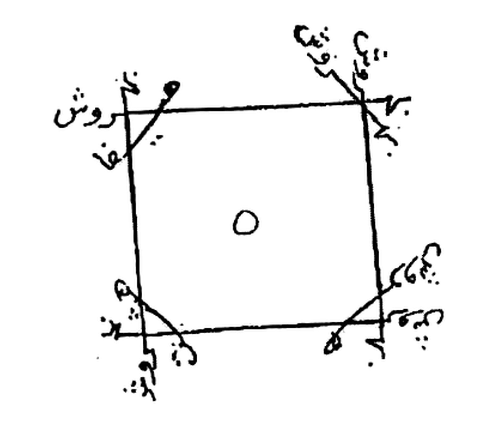
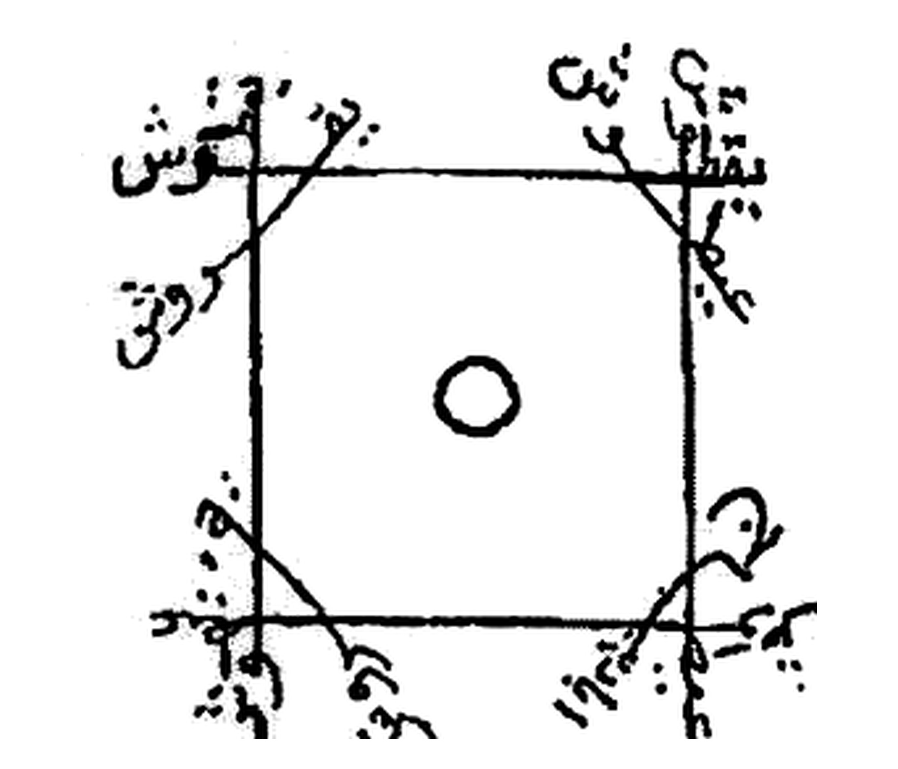

# BATCH 48 — Halaman 217–218 — Mundal Âkhar (Nûr al-Nadzîr) & Penyempurnaannya

> **Kitab Asrâr wa Khafâyâ fî ‘Ilm al-Rûhâniyyât — Syeikh ‘Athiyyah ‘Abd al-Hamîd — Terjemahan Lengkap Indonesia — Batch 48 (Hal. 217–218)**
> **Halaman terbaca lengkap: 217 dan 218** · **Rajah batch ini: 2** (Khatam Hal. 217 + Khatam Hal. 218)
> **Khatam halaman kumulatif: 218 / 297** (206 halaman induk + 207–216 + 217–218).

**Sumber:** Picture 109.jpg (**Hal. 217** = belahan kiri, angka cetak `217` di kaki halaman) dan Picture 110.jpg (**Hal. 218** = belahan kanan, angka cetak `218` di kaki halaman; belahan kiri Picture 110 = Hal. 219, masuk Batch 49).
**Sambungan:** Hal. 216 (Batch 47) menutup *Mandal Nafsî* dengan khatam bintang enam. Hal. 217 membuka bab baru **«مندل آخر»** (*Mundal Âkhar*), dan kalimat terakhir Hal. 217 — `ويعمل من أول الشهر إلى عشرين منه فقط في يومي الاثنين والأربعاء من أول` — **terpotong** dan bersambung ke kepala Hal. 218 `النهار إلى الظهر …`. Hal. 218 ditutup dengan `‘azîmah` yang berakhir pada `… أَهيبا هيبا بشمح` (batas halaman), lalu Hal. 219 melanjutkan.

---

## 1. FOTO ASLI

**Hal. 217** — Picture 109.jpg, belahan kiri:

**Hal. 218** — Picture 110.jpg, belahan kanan:

**Rajah 1 — Khatam Mundal Âkhar Hal. 217** (`rajah-hal-217-khatam-mandal-akhir-presisi-2112x1808.jpg`):

**Rajah 2 — Khatam Hal. 218** (`rajah-hal-218-khatam-mandal-nafsi-murabba-presisi-2112x1808.jpg`):

Kedua crop: **2112×1808 px, 300 DPI, LANCZOS**, flat-field `BG_WINDOW=31 · BLACK_AT=0.55 · WHITE_AT=0.88 · WHITE_SNAP=235`, tanpa threshold keras dan tanpa redraw (skrip: `crop_rajah_batch48.py`).

---

## 2. IDENTIFIKASI (FUSHA HIRZI · JANGKAR · BUTA · SAKK · WAFAQ)

| Unsur | Temuan pada Hal. 217 & 218 |
|---|---|
| **Fusha Hirzi** | **Ya, dua lapis.** (a) Prosa fusha tata cara: `تَسْتَنْزِلُ بِهِ فِي قَدَحٍ …`, `إِنَّمَا يَلْزَمُ قِرَاءَتَهُ ٣ لَيَالٍ …`; (b) deret nama hîrzî: Hal. 217 `بَهْرُوش ٢ هَيْفَا ٢ هَشْت ٢ هَرُوش`; Hal. 218 `بِحَنْ بَرْكِيَاس ٢ قِدْش ٢ قَارِش ٢ بَرْهَش ٢ قُدُّوس ٢ جَبَّار ٢ عَلِيم ٢ حَيُّوم ٢ قَيُّوم ٢ آل بَزْرِيَال` + ekor `يَقْطُوش قَطْعُوش أَهِيبَا هِيبَا بِشَمْح`. |
| **Jangkar** | Hal. 217: `وَمَنْ يَنْزِغُ مِنْهُمْ عَنْ أَمْرِنَا نُذِقْهُ مِنْ عَذَابِ السَّعِيرِ` (QS Saba' 18/19) + `الْوَحَا ٢ الْعَجَل ٢ السَّاعَة ٢`. Hal. 218: `يَا قَوْمَنَا أَجِيبُوا دَاعِيَ اللهِ` (QS al-Aḥqâf 31) + `اللهُ نُورُ السَّمَاوَاتِ وَالْأَرْضِ مَثَلُ نُورِهِ` (QS an-Nûr 35) + `الْوَحَا الْوَحَا`. |
| **Buta (tanpa titik)** | Tulisan pada **kedua rajah** kursif tanpa harakat dan **tanpa titik lengkap**; pada sebagian sudut titik masih tampak, pada sebagian lain tidak dapat dipastikan. Keduanya **tidak ditranskripsikan sebagai huruf pasti** dan disimpan sebagai gambar (sama dengan perlakuan Batch 47). Teks prosa **tidak** memuat huruf gundul. |
| **Sakk Tindih 111** | **Tidak ada** pada kedua halaman dan pada kedua rajah (tidak ada angka 111 sama sekali). |
| **Wafaq Hawwaz** | **Tidak ada** matriks wafaq angka; tidak ada tabel baris × kolom. Satu-satunya angka pada kedua halaman: `٤` (empat kali ‘azam), `٣` (tiga malam), `عشرين` (dua puluh), dan angka pengulangan `٢` pada deret nama. |
| **Rumus halaman** | Hal. 217 & 218 = **pasangan genap-ganjil** Picture 109/110: Picture 109 → kiri **217** / kanan **216**; Picture 110 → kiri **219** / kanan **218**. |

---

## 3. HALAMAN 217 — «مندل آخر»: cara menurunkan ruh pada gelas (turunkan di cangkir kaca)

### 3.1 Judul dan tata cara istinzâl

**[Teks Arab Asli]**

> مُنْدَلٌ آخَرُ
>
> تَسْتَنْزِلُ بِهِ فِي قَدَحٍ وَهُوَ أَنْ تَأْخُذَ قَدَحًا مِنْ زُجَاجٍ وَتَمْلَأُهُ مَاءً وَتَجْعَلُ عَلَى الْأَرْبَعِ أَرْكَانٍ مِلْحًا أَبْيَضَ وَتَعْزِمُ عَلَيْهِ ٤ مَرَّاتٍ فَيَحْضُرُ لَكَ جَمَاعَةٌ صَادِقُونَ فَاسْأَلْهُمْ عَمَّا تُرِيدُ

**[Transliterasi Latin]**

> *Mundalun ākharu.*
> *Tastanzilu bihi fī qadaḥin wa-huwa an ta'khudza qadaḥan min zujājin wa-tamla'ahu mā'an wa-taj'alu ‘alā al-arba‘i arkānin milḥan abyaḍa wa-ta‘zimu ‘alaihi 4 marrātin fa-yaḥḍuru laka jamā‘atun ṣādiqūna fas'alhum ‘ammā turīdu.*

**[Terjemahan Indonesia]**

> **Layer 1:** *mundalun ākharu* = mandal yang lain · *tastanzilu bihi* = engkau menurunkan (ruh) dengannya · *fī qadaḥin* = di dalam gelas/cangkir · *wa-huwa an ta'khudza qadaḥan min zujājin* = yaitu engkau mengambil sebuah cangkir dari kaca · *wa-tamla'ahu mā'an* = dan engkau memenuhinya dengan air · *wa-taj'alu ‘alā al-arba‘i arkānin milḥan abyaḍa* = dan engkau meletakkan pada keempat penjuru (cangkir) garam putih · *wa-ta‘zimu ‘alaihi* = dan engkau membaca ‘azam padanya · *4 marrātin* = empat kali · *fa-yaḥḍuru laka jamā‘atun ṣādiqūna* = maka hadirlah kepadamu sekelompok (ruh) yang jujur · *fas'alhum ‘ammā turīdu* = maka tanyakanlah kepada mereka tentang apa yang engkau kehendaki.
>
> **Layer 2:** **Mandal yang lain.** Dengan mandal ini engkau menurunkan (ruh) ke dalam cangkir: engkau ambil sebuah cangkir kaca, penuhi dengan air, letakkan garam putih pada keempat penjurunya, lalu baca ‘azam atasnya empat kali — maka akan hadir kepadamu sekelompok ruh yang jujur; tanyakanlah kepada mereka apa yang engkau kehendaki.

### 3.2 Bacaan yang diucapkan (qasam hîrzî)

**[Teks Arab Asli]**

> وَهَذَا مَا تَقُولُ
>
> بَهْرُوش ٢ هَيْفَا ٢ هَشْت ٢ هَرُوش وَمَنْ يَنْزِغُ مِنْهُمْ عَنْ أَمْرِنَا نُذِقْهُ مِنْ عَذَابِ السَّعِيرِ الْوَحَا ٢ الْعَجَل ٢ السَّاعَة ٢

**[Transliterasi Latin]**

> *Wa-hādzā mā taqūlu: Bahruwasy 2 Haifā 2 Hasyta 2 Haruwasy — wa-man yanzighu minhum ‘an amrinā nudziquhu min ‘adzābi al-sa‘īri — al-waḥā 2 al-‘ajal 2 al-sā‘ah 2.*

**[Terjemahan Indonesia]**

> **Layer 1:** *wa-hādzā mā taqūlu* = dan inilah yang engkau ucapkan · *Bahruwasy, Haifā, Hasyta, Haruwasy* = (empat nama hîrzî, masing-masing diulang dua kali pada cetakan) · *wa-man yanzighu minhum* = dan siapa yang menyimpang di antara mereka · *‘an amrinā* = dari perintah kami · *nudziquhu min ‘adzābi al-sa‘īri* = Kami akan merasakannya dengan azab api yang menyala · *al-waḥā 2* = segeralah (dua kali) · *al-‘ajal 2* = cepatlah (dua kali) · *al-sā‘ah 2* = saat ini (dua kali).
>
> **Layer 2:** Dan inilah yang engkau ucapkan: "Bahrûsy, Haifâ, Hasyt, Harûsy — dan siapa di antara mereka yang menyimpang dari perintah kami, Kami akan merasakannya dengan azab api yang menyala. Segeralah, segeralah! Cepatlah, cepatlah! Saat ini, saat ini!"

### 3.3 Khatam (rajah 1)

**[Teks Arab Asli]**

> وَهَذَا هُوَ الْخَاتَمُ

**[Transliterasi Latin]** *Wa-hādzā huwa al-khātamu.*

**[Terjemahan Indonesia]** **Layer 1:** *wa-hādzā* = dan ini · *huwa al-khātimu* = dia-lah khatam (cincin/meterai). **Layer 2:** Dan inilah khatamnya — (lihat Rajah 1: bujur sangkar bergaris tebal, satu bulatan kecil tepat di tengah, dan tulisan hîrzî kursif di keempat sudut; tulisan sudut tidak ditranskripsikan sebagai huruf pasti).

### 3.4 Sifat mandal dan syarat pemakaian

**[Teks Arab Asli]**

> صِفَةُ مُنْدَلٍ عَلَيْهِ الْعَمَلُ
>
> إِنَّمَا يَلْزَمُ قِرَاءَتَهُ ٣ لَيَالٍ عَلَى الْأَقَلِّ قَبْلَ الْعَمَلِ بِهِ وَمُدَاوَمَةُ قِرَاءَتِهِ إِذَا أُرِيدَ مُدَاوَمَةُ الْعَمَلِ بِهِ بِبَخُورِهِ لُبَان وَكُسْبَرَة. وَيُعْمَلُ مِنْ أَوَّلِ الشَّهْرِ إِلَى عِشْرِينَ مِنْهُ فَقَطْ فِي يَوْمَيِ الِاثْنَيْنِ وَالْأَرْبِعَاءِ مِنْ أَوَّلِ …

**[Transliterasi Latin]**

> *Ṣifatu mundalin ‘alaihi al-‘amalu: innamā yalzamu qirā'atahu 3 layālin ‘alā al-aqalli qabla al-‘amali bihi wa-mudāwamatu qirā'atihi idzā urīda mudāwamatu al-‘amali bihi bi-bakhūrihi lubān wa-kusbarah. Wa-yu‘malu min awwali al-syahri ilā ‘isyrīna minhu faqaṭ fī yaumai al-ithnaini wa-al-arbi‘ā'i min awwali …*

**[Terjemahan Indonesia]**

> **Layer 1:** *ṣifatu mundalin ‘alaihi al-‘amalu* = sifat mandal yang diamalkan atasnya · *innamā yalzamu qirā'atahu 3 layālin* = hanyalah wajib membacanya tiga malam · *‘alā al-aqalli* = paling sedikit · *qabla al-‘amali bihi* = sebelum mengamalkannya · *wa-mudāwamatu qirā'atihi* = dan melanggengkan bacaannya · *idzā urīda mudāwamatu al-‘amali bihi* = apabila dikehendaki melanggengkan amal dengannya · *bi-bakhūrihi lubān wa-kusbarah* = dengan bukhurnya: lubân (kemenyan) dan kasbarah (ketumbar) · *wa-yu‘malu min awwali al-syahri ilā ‘isyrīna minhu faqaṭ* = dan dikerjakan dari awal bulan sampai tanggal dua puluhnya saja · *fī yaumai al-ithnaini wa-al-arbi‘ā'i* = pada dua hari: Senin dan Rabu · *min awwali …* = dari awal … *(kalimat terpotong di kaki halaman dan bersambung ke Hal. 218).*
>
> **Layer 2:** **Sifat mandal yang diamalkan atasnya.** Hanyalah wajib membacanya tiga malam paling sedikit sebelum mengamalkannya, dan melanggengkan bacaannya apabila dikehendaki melanggengkan amal dengannya — dengan bukhurnya berupa lubân dan kasbarah. Dan amalan ini dikerjakan hanya dari awal bulan sampai tanggal dua puluhnya, pada hari Senin dan Rabu, mulai dari awal … *(bersambung)*.

---

## 4. HALAMAN 218 — kelanjutan syarat + khatam + ‘azîmah penutup

### 4.1 Sambungan syarat waktu dan cara kasyf

**[Teks Arab Asli]**

> … النَّهَارِ إِلَى الظُّهْرِ وَفِي يَوْمِ الْجُمُعَةِ مِنْ بَعْدِ الظُّهْرِ إِلَى نِصْفِ لَيْلَةِ السَّبْتِ. وَكَشْفُهُ يُكْتَبُ فِي وَرَقَةٍ عَلَى الْجَبْهَةِ وَفِي وَسَطِ الْكَفِّ وَفِي دَائِرَةِ الْإِنَاءِ مِنْ أَعْلَى بِشَكْلِهِ هَذَا أَيْضًا وَيَحْتَالُ عَلَى ذَلِكَ وَهُوَ غَيْرُ صَعْبٍ وَيُوضَعُ فِيهِ الزَّيْتِ الطِّيبِ فَقَطْ

**[Transliterasi Latin]**

> *… al-nahāri ilā al-ẓuhri wa-fī yaumi al-jumu‘ati min ba‘di al-ẓuhri ilā niṣfi lailati al-sabti. Wa-kasyfuhu yuktabu fī waraqatin ‘alā al-jabhati wa-fī wasaṭi al-kaffi wa-fī dā'irati al-inā'i min a‘lā bi-syaklihi hādzā aidzan wa-yaḥtālu ‘alā dzālika wa-huwa ghairu ṣa‘bin wa-yūḍa‘u fīhi al-zaiti al-ṭayyibi faqaṭ.*

**[Terjemahan Indonesia]**

> **Layer 1:** *al-nahāri* = siang · *ilā al-ẓuhri* = sampai waktu zuhur · *wa-fī yaumi al-jumu‘ati* = dan pada hari Jumat · *min ba‘di al-ẓuhri* = dari setelah zuhur · *ilā niṣfi lailati al-sabti* = sampai tengah malam Sabtu · *wa-kasyfuhu yuktabu fī waraqatin* = dan penyingkapan (kasyf)nya ditulis di selembar kertas · *‘alā al-jabhati* = pada dahi · *wa-fī wasaṭi al-kaffi* = dan di tengah telapak tangan · *wa-fī dā'irati al-inā'i min a‘lā* = dan di lingkaran wadah (cangkir) dari bagian atas · *bi-syaklihi hādzā aidzan* = dengan bentuknya ini juga · *wa-yaḥtālu ‘alā dzālika* = dan ia mengakali hal itu · *wa-huwa ghairu ṣa‘bin* = dan ia tidaklah sulit · *wa-yūḍa‘u fīhi al-zaiti al-ṭayyibi faqaṭ* = dan diletakkan di dalamnya minyak wangi saja.
>
> **Layer 2:** … (mulai dari awal) siang sampai zuhur; dan pada hari Jumat dari setelah zuhur sampai tengah malam Sabtu. Adapun kasyf-nya: dituliskan pada selembar kertas di dahi, di tengah telapak tangan, dan pada lingkaran wadah (cangkir) dari bagian atas dengan bentuknya ini juga; dan itu diakali, dan tidaklah sulit — dan diletakkan di dalamnya minyak wangi saja.

### 4.2 Khatam (rajah 2)

**[Teks Arab Asli]**

> وَهَذَا مَا تَكْتُبُ

**[Transliterasi Latin]** *Wa-hādzā mā taktubu.*

**[Terjemahan Indonesia]** **Layer 1:** *wa-hādzā mā taktubu* = dan inilah yang engkau tulis. **Layer 2:** Dan inilah yang engkau tulis — (lihat Rajah 2: bentuk yang sama dengan Rajah 1: bujur sangkar garis tebal, bulatan di tengah, tulisan hîrzî di keempat sudut; dengan bentuk inilah tulisan pada dahi, telapak tangan, dan lingkaran cangkir dibuat).

### 4.3 ‘Azîmah penutup

**[Teks Arab Asli]**

> وَهَذِهِ الْعَزِيمَةُ
>
> تَقُولُ — يَا قَوْمَنَا أَجِيبُوا دَاعِيَ اللهِ وَآمِنُوا بِهِ يَغْفِرْ لَكُمْ مِنْ ذُنُوبِكُمْ وَيُجِرْكُمْ مِنْ عَذَابٍ أَلِيمٍ أَجِيبُوا بِحَقِّ مَا فِي الْكَفِّ مِنْ أَسْمَاءِ اللهِ عَلَيْكُمْ أَجِيبُوا بِحَقِّ مِيطَرُونْ الْحَاكِمِ عَلَيْكُمْ أَجِبْ بَا أَشْقَرْ وَاكْشِفِ الْحِجَابَ عَنِ النَّاظِرِ حَتَّى يَرَى الْمَطْلُوبَ السَّبْعَةِ بِحَنْ بَرْكِيَاس ٢ قِدْش ٢ قَارِش ٢ بَرْهَش ٢ قُدُّوس ٢ جَبَّار ٢ عَلِيم ٢ حَيُّوم ٢ قَيُّوم ٢ آل بَزْرِيَال اللهُ نُورُ السَّمَاوَاتِ وَالْأَرْضِ مَثَلُ نُورِهِ (إِلَى قَوْلِهِ تَعَالَى) عَلِيم الْوَحَا الْوَحَا يَقْطُوش قَطْعُوش أَهِيبَا هِيبَا بِشَمْح

**[Transliterasi Latin]**

> *Wa-hādzihi al-‘azīmatu taqūlu: Yā qaumanā ajībū dā‘iya Allāhi wa-āminū bihi yaghfir lakum min dzunūbikum wa-yujirkum min ‘adzābin alīmin. Ajībū bi-ḥaqqi mā fī al-kaffi min asmā'i Allāhi ‘alaikum. Ajībū bi-ḥaqqi Mīṭarūn al-ḥākimi ‘alaikum. Ajib bā Asyqar waksyifi al-ḥijāba ‘an al-nāẓiri ḥattā yarā al-maṭlūba. Al-sab‘ati bi-ḥan Barkiyās 2 Qidsy 2 Qārisy 2 Barhasy 2 Quddūs 2 Jabbār 2 ‘Alīm 2 Ḥayyūm 2 Qayyūm 2 Āli Bazriyāl — Allāhu nūru al-samāwāti wa-al-arḍi matsalu nūrihi (ilā qaulihi ta‘ālā) ‘Alīm — al-waḥā al-waḥā Yaqṭūsy Qaṭ‘ūsy Ahībā Hībā Bisyamḥ.*

**[Terjemahan Indonesia]**

> **Layer 1:** *wa-hādzihi al-‘azīmatu taqūlu* = dan inilah ‘azîmah yang engkau ucapkan · *yā qaumanā ajībū dā‘iya Allāhi* = wahai kaum kami, sambutlah seruan Allah (QS al-Aḥqâf 31) · *wa-āminū bihi* = dan berimanlah kepada-Nya · *yaghfir lakum min dzunūbikum* = niscaya Dia mengampuni dosa-dosa kalian · *wa-yujirkum min ‘adzābin alīmin* = dan melindungi kalian dari azab yang pedih · *ajībū bi-ḥaqqi mā fī al-kaffi* = sambutlah dengan hak apa yang ada di telapak tangan · *min asmā'i Allāhi ‘alaikum* = dari nama-nama Allah atas kalian · *ajībū bi-ḥaqqi Mīṭarūn al-ḥākimi ‘alaikum* = sambutlah dengan hak Mîtharûn yang berkuasa atas kalian · *ajib bā Asyqar* = sambutlah, wahai Asyqar (cetakan: `أَجِبْ بَا أَشْقَرْ`) · *waksyifi al-ḥijāba ‘an al-nāẓiri* = dan singkapkanlah tabir dari orang yang melihat · *ḥattā yarā al-maṭlūba* = sehingga ia melihat yang dicari · *al-sab‘ati bi-ḥan* = (tujuh/sab'ah bersama "bi-han" — hîrzî) · *Barkiyās 2, Qidsy 2, Qārisy 2, Barhasy 2, Quddūs 2, Jabbār 2, ‘Alīm 2, Ḥayyūm 2, Qayyūm 2* = sembilan nama hîrzî, masing-masing dua kali, diakhiri `آل بَزْرِيَال` · *Allāhu nūru al-samāwāti wa-al-arḍi matsalu nūrihi* = Allah cahaya langit dan bumi, perumpamaan cahaya-Nya (QS an-Nûr 35) · *(ilā qaulihi ta‘ālā) ‘Alīm* = (sampai firman-Nya) Maha Mengetahui · *al-waḥā al-waḥā* = segeralah, segeralah · *Yaqṭūsy Qaṭ‘ūsy Ahībā Hībā Bisyamḥ* = (ekor hîrzî penutup).
>
> **Layer 2:** Dan inilah ‘azîmah-nya: "Wahai kaum kami, sambutlah seruan Allah dan berimanlah kepada-Nya, niscaya Dia mengampuni dosa-dosa kalian dan melindungi kalian dari azab yang pedih." Sambutlah dengan hak apa yang ada di telapak tangan berupa nama-nama Allah atas kalian; sambutlah dengan hak Mîtharûn yang berkuasa atas kalian. Sambutlah, wahai Asyqar, dan singkapkanlah tabir dari orang yang melihat sehingga ia melihat yang ia cari: (nama) yang tujuh bersama "bi-ḥan" — Barkiyâs 2×, Qidsy 2×, Qârisy 2×, Barhasy 2×, Quddûs 2×, Jabbâr 2×, ‘Alîm 2×, Ḥayyûm 2×, Qayyûm 2×, keluarga Bazriyâl — "Allah cahaya langit dan bumi, perumpamaan cahaya-Nya …" (sampai firman-Nya) "Maha Mengetahui". Segeralah, segeralah! Yaqṭûsy Qaṭ‘ûsy Ahîbâ Hîbâ Bisyamḥ.

---

## 5. RAJAH — keterangan bentuk (bukan transkripsi huruf)

| Butir | Rajah 1 (Hal. 217) | Rajah 2 (Hal. 218) |
|---|---|---|
| Bentuk | **Bujur sangkar** garis tunggal tebal; keempat sisi bertemu di sudut dengan goresan silang keluar | **Bujur sangkar** garis tunggal tebal; goresan silang keluar di tiap sudut |
| Pusat | **Satu bulatan kecil** (○) tepat di tengah | **Satu bulatan** agak lebih besar, garis dobel-tipis di tengah |
| Sudut | Tulisan hîrzî **kursif tanpa harakat**, memanjang keluar sudut; pada sudut kiri-atas terbaca jelas `روش` dan pada sudut kiri-bawah ada guratan bertitik | Empat sudut bertulisan kursif; sudut kiri-atas juga memuat guratan berbentuk `روش`-serupa; titik-titik tampak tidak konsisten |
| Angka/ SAKK | **tidak ada** | **tidak ada** |
| Kotak dalam | **tidak ada** (hanya bulatan) | **tidak ada** (hanya bulatan) |
| Titik tengah bertitik | ya — satu titik | ya — satu bulatan (bukan titik) |

> **Kebijakan transkripsi:** tulisan sudut **tidak** dibaca sebagai huruf pasti. Alasannya sama dengan Batch 47: goresan kursif tanpa harakat, sebagian titik hilang/bergabung, dan tidak ada pembanding cetak pada halaman ini (berbeda dengan deret `بهرش ٢ هيفا ٢` yang tercetak jelas pada badan teks). Yang tampak jelas hanya `روش` pada Rajah 1 sudut kiri-atas, dan itu pun diberi catatan "terbaca jelas", bukan dipastikan sebagai kata bermakna.

---

## 6. KETERANGAN (isi yang benar-benar tercetak pada Hal. 217–218)

| Butir | Hal. 217 | Hal. 218 |
|---|---|---|
| **Nama bab/ amalan** | `مُنْدَلٌ آخَرُ` — *Mundal Âkhar* | lanjutan bab yang sama (+ judul kecil `وَهَذَا مَا تَكْتُبُ`) |
| **Hajat** | Menurunkan (**istinzâl**) sekelompok ruh jujur untuk ditanya apa saja (`فَاسْأَلْهُمْ عَمَّا تُرِيدُ`) | **Kasyf** (penyingkapan): orang yang melihat dapat melihat `الْمَطْلُوب` (yang dicari) |
| **Media** | **Cangkir/gelas kaca** (`قَدَح مِنْ زُجَاج`) berisi **air**; garam putih pada **4 penjuru** | **Kertas** (pada dahi), **telapak tangan** (tengahnya), **lingkaran cangkir** (bagian atas) |
| **Bilangan** | ‘azam dibaca **4×** (`٤ مَرَّات`); bacaan wajib **3 malam** (`٣ لَيَالٍ`) sebelum diamalkan | pengulangan nama: **9 nama × 2** (Barkiyâs s.d. Qayyûm) |
| **Waktu** | Dikerjakan **awal bulan s.d. tanggal 20** saja; hari **Senin & Rabu**, dari awal siang (bersambung) | … **siang s.d. zuhur**; hari **Jumat** dari **setelah zuhur s.d. tengah malam Sabtu** |
| **Bukhur** | **Lubân** (kemenyan) + **kasbarah** (ketumbar) | **tidak tercantum** bukhur; hanya **minyak wangi** (`الزيت الطيب`) yang diletakkan di cangkir |
| **Tinta** | **tidak tercantum** | **tidak tercantum** |
| **Rajah** | 1 khatam bujur sangkar + bulatan tengah (Rajah 1) | 1 khatam bujur sangkar + bulatan tengah (Rajah 2) |
| **Jangkar ayat** | Saba' 18/19 (`وَمَنْ يَنْزِغُ مِنْهُمْ عَنْ أَمْرِنَا …`) | al-Aḥqâf 31 (`يَا قَوْمَنَا أَجِيبُوا دَاعِيَ اللهِ`) + an-Nûr 35 (`اللهُ نُورُ السَّمَاوَاتِ …`) |
| **Nama hîrzî** | Bahruwasy · Haifâ · Hasyta · Haruwasy (+ `الوحا ٢ العجل ٢ الساعة ٢`) | Bi-ḥan · Barkiyâs · Qidsy · Qārisy · Barhasy · Quddûs · Jabbâr · ‘Alîm · Ḥayyûm · Qayyûm · Āl Bazriyâl (+ ekor Yaqṭûsy Qaṭ‘ûsy Ahîbâ Hîbâ Bisyamḥ) |
| **Mîtharûn** | — | `مِيطَرُونْ الْحَاكِم` (Mîtharûn Yang Berkuasa) — jangkar malaikat hari Jumat |
| **Hitungan wafaq** | **tidak ada** wafaq angka | **tidak ada** wafaq angka |

---

## 7. CATATAN VERIFIKASI

1. **Peta halaman.** Angka cetak kaki halaman terbaca langsung: Picture 109 belahan **kiri** = `217`, Picture 110 belahan **kanan** = `218`. Rumus pasca-gap-fix (Picture N ≥ 107 → kiri `2N−1`, kanan `2N−2`) terpenuhi: 2·109−1 = **217**, 2·110−2 = **218**.
2. **Sambungan kalimat.** Hal. 217 berakhir `… فِي يَوْمَيِ الِاثْنَيْنِ وَالْأَرْبِعَاءِ مِنْ أَوَّلِ` dan Hal. 218 dibuka `النَّهَارِ إِلَى الظُّهْرِ`. Sambungan ini **terbukti** (bukan asumsi) dan sudah ditandai `…` pada kedua ujungnya.
3. **Penyimpangan cetakan yang dipertahankan** (tidak diperbaiki): (a) `وَتَجْعَلُ عَلَى الْأَرْبَعِ أَرْكَانٍ` — susunan cetak, bukan `على الأركان الأربع`; (b) `الزَّيْتِ الطِّيبِ` — kaidah cetak (majrûr setelah `فيه`); (c) `أَجِبْ بَا أَشْقَرْ` — tercetak `بَا` bukan `يَا`; (d) `السَّبْعَةِ بِحَنْ` — `بِحَنْ` sebagai hîrzî tanpa makna kamus; (e) `٤ مَرَّات` memakai angka Arab-Indik, pada terjemahan ditulis "empat kali".
4. **Kaidah harakat.** Harakat pada bab ini **baru** (diberikan penuh) mengikuti pola Batch 44–47: prosa diamalkan harakat lengkap, nama hîrzî diberi harakat minimal seperlunya agar tidak mengubah bacaan (`بَهْرُوش`, `بَرْكِيَاس`, `قِدْش`).
5. **Crop — hasil ukur (bukan target).** Perintah: `python3 crop_rajah_batch48.py`.
   - `rajah-hal-217-khatam-mandal-akhir-presisi-2112x1808.jpg`: BOX `(386,508,726,836)` = 340×328 px dari Picture 109; LANCZOS **5,09×**; **putih 90,1 %** kanvas (94,3 % piksel non-tinta); tinta padat 4,44 %; tepi tinta x 230–1883, y 107–1701 → **tidak terpotong** (margin kanvas 70 px aman).
   - `rajah-hal-218-khatam-mandal-nafsi-murabba-presisi-2112x1808.jpg`: BOX `(1062,376,1342,646)` = 280×270 px dari Picture 110; LANCZOS **6,18×**; **putih 82,9 %** kanvas (90,0 % piksel non-tinta); tinta padat 7,93 %; tepi tinta x 265–1920, y 101–1737 → **tidak terpotong**.
   - Angka putih berbeda antara dua crop karena **kerapatan tinta** berbeda (7,93 % vs 4,44 %), bukan karena parameter berbeda. Nilai 78,6 % (wafaq padat) dan 96,4 % (rajah garis renggang) tetap menjadi **acuan jenis**, bukan target paksa — lihat `terjemahan/STATUS-KHATAM-207-297.md` §4.
6. **Skrip crop.** `crop_wafaq_presisi_2112x1808.py` **tidak dapat dipanggil** apa adanya: `PRESETS` di baris 61 memakai `DEFAULT_SRC`/`DEFAULT_BOX`/`DEFAULT_OUT` yang baru didefinisikan setelahnya → `NameError`. Karena itu batch ini memakai skrip mandiri `crop_rajah_batch48.py` dengan **parameter identik**. (Perbaikan urutan definisi skrip lama dicatat sebagai temuan, tidak diubah isinya pada batch ini agar crop yang sudah ditinjau tidak berisiko berubah.)
7. **Rajah tidak di-crop ulang dari PDF.** Berbeda dengan BATCH-46 (yang sumbernya halaman PDF), kedua rajah batch ini berasal dari **lembar pindaian asli** 1755×1275 px, sehingga up-scale LANCZOS 5–6× ini setara ±155 DPI optik — sama dengan catatan resolusi Batch 39; ketajaman optiknya tidak bertambah, hanya diperbesar.
