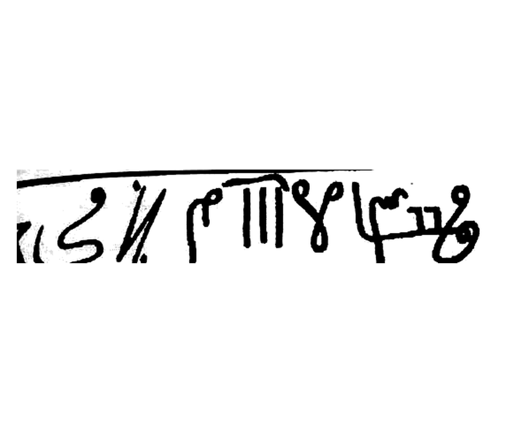
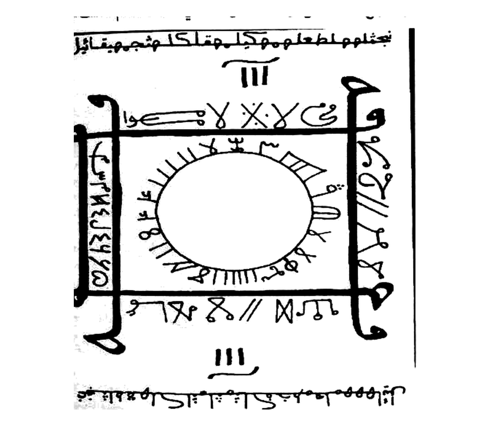

# BATCH 50 — Halaman 221–222 — Mandal ‘Aqârît al-Haikal & Tholasm al-Kasyf (Sakk 111)

> **Kitab Asrâr wa Khafâyâ fî ‘Ilm al-Rûhâniyyât — Syeikh ‘Athiyyah ‘Abd al-Hamîd — Terjemahan Lengkap Indonesia — Batch 50 (Hal. 221–222)**
> **Halaman terbaca lengkap: 221 dan 222** · **Rajah batch ini: 2** (kaligrafi tholasm Hal. 222 atas + mandal hijab lingkaran arkun Hal. 222 bawah) · **Kedua rajah di-crop 2112×1808**
> **Khatam halaman kumulatif: 222 / 297**.

**Sumber:** Picture 111.jpg (**Hal. 221** = belahan kiri) dan Picture 112.jpg (**Hal. 222** = belahan kanan; belahan kiri Picture 112 = Hal. 223, masuk Batch 51).
**Sambungan:** Hal. 220 (Batch 49) menutup dengan `وَالْمُنْدَلُ تَكُونُ صَائِمًا يَوْمَ الْعَمَلِ نَفْسِهِ فِي الِاسْتِنْزَالِ`. Hal. 221 membuka **bab baru** `مُنْدَل عَقَارِيت الْهَيْكَل` (judul tebal). Hal. 221 berakhir pada `… يُطَوِّلُ اشْتِعَالَهُ الشَّرَاب` dan Hal. 222 dibuka `يَجِبُ أَنْ تُحْضِرَ لَبَنَ الْعَنْزِ …` — jadi Hal. 222 melanjutkan **syarat perlengkapan**, lalu memuat ṭilasm dan syarat ṭilasm kasyf.
**Catatan tepi scan:** Hal. 221 **ekor baris (kiri) terpotong** bingkai/lipatan; Hal. 222 **kepala baris (kanan) tidak terpotong**, tetapi **tepi kiri masuk gutter** sehingga 1–2 goresan awal kaligrafi ṭilasm hilang. Semua ditandai `…` dan tidak direkonstruksi.

---

## 1. FOTO ASLI

**Hal. 221** — Picture 111.jpg, belahan kiri (angka cetak `221`):

**Hal. 222** — Picture 112.jpg, belahan kanan (angka cetak `222`):

**Rajah 1 — Kaligrafi ṭilasm kasyf (Hal. 222 atas)** `rajah-hal-222-tholasm-kasyf-kaligrafi-presisi-2112x1808.jpg`:

**Rajah 2 — Mandal hijab lingkaran arkun (Hal. 222 bawah)** `rajah-hal-222-mandal-hijab-lingkaran-arkun-presisi-2112x1808.jpg`:

Kedua crop: **2112×1808 px, 300 DPI, LANCZOS**, flat-field `BG_WINDOW=31 · BLACK_AT=0.55 · WHITE_AT=0.88 · WHITE_SNAP=235`, tanpa threshold keras, tanpa redraw — memakai `crop_wafaq_presisi_2112x1808.py` (**versi FIXED**, lihat BATCH-46 §7.4).

---

## 2. IDENTIFIKASI (FUSHA HIRZI · JANGKAR · BUTA · SAKK 111 · WAFAQ)

| Unsur | Temuan pada Hal. 221 & 222 |
|---|---|
| **Fusha Hirzi** | **Ya, tiga lapis.** (a) Prosa fusha bab: `عَلِمَ أَخِي وَفَّقَكَ اللهُ …`; (b) **tiga nama ‘aqârît** dalam kurung kurawal cetak `{ }`: `{ طَبَارِيس }` · `{ يَهْيَالِيس }` · `{ جَنْهَابْرِيش }`; (c) **kaligrafi ṭilasm** satu baris (Rajah 1) dan tulisan jurai mengelilingi bulatan + empat kurung sudut pada mandal (Rajah 2) — keduanya **tidak ditranskripsikan sebagai huruf pasti**. |
| **Jangkar** | Hal. 221: `{ السَّلَامُ عَلَى عَبْدِ اللهِ الْحَيِّ }` (salam yang diucapkan khadim) dan `{ وَعَلَيْكُمُ السَّلَامُ يَا مَأْمُورِينَ مِنَ اللهِ الْحَيِّ }` (jawaban), `مِنَ اللهِ لَا إِلَهَ —` sebagai pembuka **ayat Kursi**. Hal. 222: `بِسْمِ اللهِ الْحَيِّ يَا مَنْ …` (awal baris penutup) + `الْفَاتِحَة` sebagai pembuka **tahshîn**. |
| **Buta (tanpa titik)** | Teks prosa **tidak** memuat huruf gundul. Tulisan pada **kedua rajah** kursif tanpa harakat; sebagian titik tampak, sebagian tidak → disimpan sebagai gambar, **tidak** dibaca sebagai huruf pasti. |
| **SAKK Tindih 111** | **ADA — dua kali** pada Rajah 2: tanda **`|||` (tiga garis)** tepat **di atas** dan **di bawah** mandal (posisi sama dengan kolom Sakk pada Batch 43 Hal. 206). Angka `111` **tidak** ditulis sebagai angka; yang tercetak adalah goresan tiga garis. |
| **Wafaq Hawwaz** | **Tidak ada** matriks wafaq angka 3×3/4×4/5×5. Rajah 2 adalah **mandal** (bujur sangkar + bulatan berjurai), bukan wafaq angka. |
| **Bilangan tercetak** | Hal. 222: **tujuh kali** untuk tiap bacaan tahshîn (`7` pada `الفاتحة 7 اية الكرسي 7 لم نشرح 7 النصر 7 الاخلاص 7 المعوذتين 7`); **empat** untuk jumlah naskah ṭilasm (`تعل arabic: تَعْمَلُ أَرْبَعَ نُسَخ`) dan **empat** dinding ruangan. |

---

## 3. HALAMAN 221 — «مندل عقاريت الهيكل»

### 3.1 Judul dan muqaddimah

**[Teks Arab Asli]**

> مُنْدَلُ عَقَارِيتِ الْهَيْكَلِ
>
> عَلِمَ أَخِي وَفَّقَكَ اللهُ أَنَّ هَذَا الْمَنْدَلَ مِنَ النَّفَائِسِ الَّتِي لَمْ تُذْكَرْ فِي بُطُونِ أُمَّهَاتِ الْكُتُبِ فَهِيَ مِنَ الْأَسْرَارِ النَّادِرَةِ الْوُجُودِ نَقَلْتُهَا نَمَاءً لَكُمْ بِدُونِ زِيَادَةٍ وَلَا نُقْصَانٍ وَقَدْ جَرَّبْتُهَا فِيمَا مَضَى كِرَارًا وَمِرَارًا وَكَانَتْ عَوْنًا لِي بَعْدَ اللهِ فِي حَلِّ مُشْكِلَاتٍ وَقَضَاءِ حَاجَاتٍ وَمَعْرِفَةِ أَسْرَارٍ خَافِيَاتٍ

**[Transliterasi Latin]**

> *Mundalu ‘aqārīti al-haikali. ‘Alima akhī waffaqaka Allāhu anna hādzā al-mandala mina al-nafā'isi allatī lam tudzkar fī buṭūni ummahāti al-kutubi fa-hiya mina al-asrāri al-nādirati al-wujūdi naqaltuhā namā'an lakum bi-dūni ziyādatin wa-lā nuqṣānin wa-qad jarrabtuhā fīmā maḍā kirāran wa-mirāran wa-kānat ‘aunan lī ba‘da Allāhi fī ḥalli musykilātin wa-qaḍā'i ḥājātin wa-ma‘rifati asrārin khāfiyātin.*

**[Terjemahan Indonesia]**

> **Layer 1:** *mundalu ‘aqārīti al-haikali* = mandal para ‘aqârît (ifrit) Bait Suci · *‘alima akhī* = ketahuilah, saudaraku · *waffaqaka Allāhu* = semoga Allah memberimu taufik · *anna hādzā al-mandala* = bahwa mandal ini · *mina al-nafā'isi* = termasuk permata-permata (ilmu) · *allatī lam tudzkar fī buṭūni ummahāti al-kutubi* = yang tidak disebutkan di dalam perut kitab-kitab induk · *fa-hiya mina al-asrāri al-nādirati al-wujūdi* = maka ia termasuk rahasia-rahasia yang jarang keberadaannya · *naqaltuhā namā'an lakum* = aku menukilkannya sebagai pertumbuhan (kebaikan) bagi kalian *(cetakan: `نَمَاءً`; ada kemungkinan salah cetak dari `لَكُمْ`)* · *bi-dūni ziyādatin wa-lā nuqṣānin* = tanpa tambahan dan tanpa pengurangan · *wa-qad jarrabtuhā fīmā maḍā* = dan sungguh aku telah mencobanya di masa lalu · *kirāran wa-mirāran* = berulang kali · *wa-kānat ‘aunan lī ba‘da Allāhi* = dan ia menjadi penolongku setelah Allah · *fī ḥalli musykilātin* = dalam memecahkan masalah-masalah · *wa-qaḍā'i ḥājātin* = dan menunaikan hajat-hajat · *wa-ma‘rifati asrārin khāfiyātin* = dan mengetahui rahasia-rahasia yang tersembunyi.
>
> **Layer 2:** **Mandal para ‘aqârît Bait Suci.** Ketahuilah, saudaraku — semoga Allah memberi taufik kepadamu — bahwa mandal ini termasuk permata ilmu yang tidak disebutkan di dalam kitab-kitab induk; ia termasuk rahasia yang jarang ada. Aku menukilkannya untuk kalian tanpa tambahan dan tanpa pengurangan, dan sungguh aku telah mencobanya berulang kali di masa lalu: ia menjadi penolongku setelah Allah dalam memecahkan masalah, menunaikan hajat, dan mengetahui rahasia-rahasia yang tersembunyi.

### 3.2 Tiga ‘aqârît penjaga Bâb al-Haikal

**[Teks Arab Asli]**

> ثُمَّ ثَلَاثُ عَقَارِيتَ يَأْمُرُونَ بِالطَّاعَةِ لِلْحُضُورِ فِي هَذَا الْمَنْدَلِ وَهُمْ مِنَ الْعَقَارِيتِ الْمُتَوَكِّلُونَ بِحِرَاسَةِ بَابِ الْهَيْكَلِ السُّلَيْمَانِيِّ وَلَهُمْ إِجَابَةٌ عَظِيمَةٌ سَرِيعَةٌ وَحُضُورٌ قَوِيٌّ ذُو رَهْبَةٍ وَهُمُ الْعِفْرِيتُ { طَبَارِيس } وَالْعِفْرِيتُ { يَهْيَالِيس } وَالْعِفْرِيتُ { جَنْهَابْرِيش }

**[Transliterasi Latin]**

> *Tsumma tsalātsu ‘aqārīta ya'murūna bil-ṭā‘ati lil-ḥuḍūri fī hādzā al-mandali wa-hum mina al-‘aqārīti al-mutawakkilūna bi-ḥirāsati bābi al-haikali al-sulaimāniyyi wa-lahum ijābatun ‘aẓīmatun sarī‘atun wa-ḥuḍūrun qawiyyun dzū rahbatin wa-humu al-‘ifrītu { Ṭabārīs } wa-al-‘ifrītu { Yahyālīs } wa-al-‘ifrītu { Janhābrīsy }.*

**[Terjemahan Indonesia]**

> **Layer 1:** *tsumma tsalātsu ‘aqārīta* = kemudian tiga ‘aqârît · *ya'murūna bil-ṭā‘ati* = mereka memerintahkan (untuk) ketaatan · *lil-ḥuḍūri fī hādzā al-mandali* = untuk hadir dalam mandal ini · *wa-hum mina al-‘aqārīti al-mutawakkilūna* = dan mereka termasuk ‘aqârît yang ditugasi · *bi-ḥirāsati bābi al-haikali al-sulaimāniyyi* = menjaga pintu Bait Suci Sulaimani · *wa-lahum ijābatun ‘aẓīmatun sarī‘atun* = dan mereka memiliki ijabah besar lagi cepat · *wa-ḥuḍūrun qawiyyun dzū rahbatin* = dan kehadiran kuat yang menimbulkan rasa takut · *wa-humu al-‘ifrītu { Ṭabārîs }* = yaitu ifrit { Thabârîs } · *wa-al-‘ifrītu { Yahyâlîs }* = dan ifrit { Yahyâlîs } · *wa-al-‘ifrītu { Janhâbrîsy }* = dan ifrit { Janhâbrîsy }.
>
> **Layer 2:** Kemudian (ada) tiga ‘aqârît yang memerintahkan ketaatan untuk hadir dalam mandal ini; mereka termasuk ‘aqârît yang ditugasi menjaga pintu Bait Suci Sulaimani. Mereka memiliki ijabah yang besar dan cepat, serta kehadiran yang kuat dan menakutkan. Mereka adalah ifrit **Thabârîs**, ifrit **Yahyâlîs**, dan ifrit **Janhâbrîsy**.

### 3.3 Adab menghadapi mereka dan tanda-tanda kehadiran

**[Teks Arab Asli]**

> فَتَأَدَّبْ فِي حَضْرَتِهِمْ وَلَا تَتَكَلَّمْ مَعَهُمْ بِالْأَمْرِ وَالنَّهْيِ وَالزَّجْرِ وَاخْفِضْ مِنْ صَوْتِكَ فِي التَّكَلُّمِ مَعَهُمْ وَلَا تَنْظُرْ إِلَى وُجُوهِهِمْ وَعَلَامَاتُ حُضُورِهِمْ هُبُوبُ رِيحٍ بَارِدَةٍ وَانْفِلَاقُ أَنْوَارٍ كَالشُّهْبِ وَرُبَّمَا تَحُسُّ بِأَنَّ الْأَرْضَ بِكَ تَمِيلُ كَأَنَّكَ جَالِسٌ عَلَى الْمَاءِ وَيُصِيبُكَ دَوَرَانٌ وَغَيْثَانٌ فَثَبِّتْ نَفْسَكَ وَلَا تَتَهَاوَ وَلَا تَخَفْ وَتَجَلَّدْ فَإِنَّكَ فِي أَمَانِ اللهِ وَحِفْظِهِ ثُمَّ بَعْدَ ذَلِكَ سَتَرَى مِنْ حَوْلِكَ وَقَدْ أُنْزِلَتِ الْحِيطَانُ وَتُرَى أَرْضٌ مُمْتَدَّةٌ

**[Transliterasi Latin]**

> *Fa-ta'addab fī ḥaḍratihim wa-lā tatakallam ma‘ahum bil-amri wa-al-nahyi wa-al-zajri wakhfiḍ min ṣautika fī al-takallumi ma‘ahum wa-lā tanẓur ilā wujūhihim. Wa-‘alāmātu ḥuḍūrihim hubūbu rīḥin bāridatin wa-infilāqu anwārin kal-syuhubi wa-rubbamā taḥussu bi-anna al-arḍa bika tamīlu ka-annaka jālisun ‘alā al-mā'i wa-yuṣībuka dawārānun wa-ghaitsānun fa-tsabbit nafsaka wa-lā tatahāwa wa-lā takhaf wa-tajallad fa-innaka fī amāni Allāhi wa-ḥifẓihi tsumma ba‘da dzālika satarā min ḥaulika wa-qad unzilati al-ḥīṭānu wa-turā arḍun mumtaddatun.*

**[Terjemahan Indonesia]**

> **Layer 1:** *fa-ta'addab fī ḥaḍratihim* = maka beradablah di hadapan mereka · *wa-lā tatakallam ma‘ahum* = dan jangan berbicara dengan mereka · *bil-amri wa-al-nahyi wa-al-zajri* = dengan perintah, larangan, dan bentakan · *wakhfiḍ min ṣautika* = dan rendahkan suaramu · *fī al-takallumi ma‘ahum* = ketika berbicara dengan mereka · *wa-lā tanẓur ilā wujūhihim* = dan jangan menatap wajah-wajah mereka · *wa-‘alāmātu ḥuḍūrihim* = dan tanda-tanda kehadiran mereka · *hubūbu rīḥin bāridatin* = bertiupnya angin dingin · *wa-infilāqu anwārin kal-syuhubi* = dan terbelahnya cahaya-cahaya seperti meteor · *wa-rubbamā taḥussu* = dan terkadang engkau merasakan · *bi-anna al-arḍa bika tamīlu* = bahwa bumi bergoyang bersamamu · *ka-annaka jālisun ‘alā al-mā'i* = seakan engkau duduk di atas air · *wa-yuṣībuka dawārānun wa-ghaitsānun* = dan engkau dilanda pusing serta mual *(cetakan: `غَيْثَان`)* · *fa-tsabbit nafsaka* = maka teguhkanlah dirimu · *wa-lā tatahāwa* = dan jangan jatuh terpelanting · *wa-lā takhaf* = dan jangan takut · *wa-tajallad* = dan bersabarlah/keraskan hatimu · *fa-innaka fī amāni Allāhi wa-ḥifẓihi* = sesungguhnya engkau dalam keamanan dan penjagaan Allah · *tsumma ba‘da dzālika* = kemudian setelah itu · *satarā min ḥaulika* = engkau akan melihat di sekelilingmu · *wa-qad unzilati al-ḥīṭānu* = dan telah diturunkan dinding-dinding · *wa-turā arḍun mumtaddatun* = dan tampaklah bumi yang terbentang.
>
> **Layer 2:** Maka beradablah di hadapan mereka: jangan berbicara dengan mereka memakai perintah, larangan, atau bentakan; rendahkan suaramu ketika berbicara dengan mereka; dan jangan menatap wajah mereka. Tanda-tanda kehadiran mereka: bertiupnya angin dingin dan terbelahnya cahaya-cahaya seperti meteor. Terkadang engkau merasa bumi bergoyang bersamamu seakan engkau duduk di atas air, dan engkau dilanda pusing serta mual — maka teguhkanlah dirimu, jangan terpelanting, jangan takut, dan keraskan hatimu, karena engkau berada dalam keamanan dan penjagaan Allah. Setelah itu engkau akan melihat di sekelilingmu: dinding-dinding telah diturunkan dan tampaklah bumi yang terbentang.

### 3.4 Pasukan berkuda dan salam mereka

**[Teks Arab Asli]**

> وَبَعْدَهَا تَرَى خَيْلًا قَادِمَةً لَكَ مِنْ بَعِيدٍ أَمَامَكَ وَتَرَى عَجَاجَةَ الْغُبَارِ مِنْ رَكْضِ خُيُولِهِمْ وَكُلَّمَا اقْتَرَبُوا مِنْكَ تَحُسُّ بِأَنَّ الْأَرْضَ تَتَزَلْزَلُ وَتَرْتَجُّ مِنْ تَحْتِكَ. إِنَّ رُؤُوسَ خُيُولِهِمْ لَيْسَتْ كَخُيُولِ الْبَشَرِ بَلْ هِيَ ذَاتُ أَعْنَاقٍ طَوِيلَةٍ وَلَهَا رُؤُوسٌ مِثْلُ رُؤُوسِ الْقِرَدَةِ سُودٌ بِسِتَّةِ أَرْجُلٍ. إِنَّمَا يَنْزِلُونَ عَلَيْكَ السَّلَامَ هَكَذَا { السَّلَامُ عَلَى عَبْدِ اللهِ الْحَيِّ } فَتَرُدُّ عَلَيْهِمُ السَّلَامَ هَكَذَا { وَعَلَيْكُمُ السَّلَامُ يَا مَأْمُورِينَ مِنَ اللهِ الْحَيِّ } فَيَجْلِسُونَ أَمَامَكَ وَأَنْتَ جَالِسٌ كَجُلُوسِكَ فِي الصَّلَاةِ

**[Transliterasi Latin]**

> *Wa-ba‘dahā tarā khailan qādimatan laka min ba‘īdin amāmaka wa-tarā ‘ajājata al-ghubāri min rakḍi khuyūlihim wa-kullamā iqtarabū minka taḥussu bi-anna al-arḍa tatazalzalu wa-tartajju min taḥtika. Inna ru'ūsa khuyūlihim laisat ka-khuyūli al-basyari bal hiya dzātu a‘nāqin ṭawīlatin wa-lahā ru'ūsun mitslu ru'ūsi al-qiradati sūdun bi-sittati arjulin. Innamā yanzilūna ‘alaika al-salāma hākadzā { al-salāmu ‘alā ‘abdi Allāhi al-ḥayyi } fa-taruddu ‘alaihimu al-salāma hākadzā { wa-‘alaikumu al-salāmu yā ma'mūrīna mina Allāhi al-ḥayyi } fa-yajlisūna amāmaka wa-anta jālisun ka-julūsika fī al-ṣalāti.*

**[Terjemahan Indonesia]**

> **Layer 1:** *wa-ba‘dahā tarā khailan qādimatan laka mine ba‘īdin* = dan setelah itu engkau melihat kuda-kuda datang kepadamu dari jauh · *min ba‘īdin amāmaka* = dari kejauhan di hadapanmu · *wa-tarā ‘ajājata al-ghubāri* = dan engkau melihat kepulan debu · *min rakḍi khuyūlihim* = dari larian kuda-kuda mereka · *wa-kullamā iqtarabū minka* = dan setiap kali mereka mendekatimu · *taḥussu bi-anna al-arḍa tatazalzalu* = engkau merasa bumi berguncang · *wa-tartajju min taḥtika* = dan bergetar di bawahmu · *inna ru'ūsa khuyūlihim laisat ka-khuyūli al-basyari* = sesungguhnya kepala kuda-kuda mereka bukan seperti kuda manusia · *bal hiya dzātu a’nāqin ṭawīlatin* = melainkan berleher panjang · *wa-lahā ru'ūsun mitslu ru'ūsi al-qiradati* = dan berkepala seperti kepala kera · *sūdun bi-sittati arjulin* = hitam, dengan enam kaki · *innamā yanzilūna ‘alaika al-salāma hākadzā* = mereka hanya mengucapkan salam kepadamu begini · *{ al-salāmu ‘alā ‘abdi Allāhi al-ḥayyi }* = { Salam atas hamba Allah Yang Mahahidup } · *fa-taruddu ‘alaihimu al-salāma hākadzā* = maka engkau jawab salam mereka begini · *{ wa-‘alaikumu al-salāmu yā ma'mūrīna mina Allāhi al-ḥayyi }* = { Dan atas kalian salam, wahai yang diperintahkan oleh Allah Yang Mahahidup } · *fa-yajlisūna amāmaka* = lalu mereka duduk di hadapanmu · *wa-anta jālisun ka-julūsika fī al-ṣalāti* = sedangkan engkau duduk seperti dudukmu dalam shalat.
>
> **Layer 2:** Setelah itu engkau akan melihat kuda-kuda datang dari kejauhan di hadapanmu, dan engkau melihat kepulan debu dari larian mereka; setiap kali mereka mendekat, engkau merasa bumi berguncang dan bergetar di bawahmu. Kepala kuda-kuda mereka bukan seperti kuda manusia, melainkan berleher panjang dan berkepala seperti kepala kera, hitam, dengan enam kaki. Mereka mengucapkan salam kepadamu begini: **"Salam atas hamba Allah Yang Mahahidup"**; maka engkau jawab salam mereka begini: **"Dan atas kalian salam, wahai yang diperintahkan oleh Allah Yang Mahahidup."** Lalu mereka duduk di hadapanmu sedangkan engkau duduk sebagaimana dudukmu dalam shalat.

### 3.5 Cara kerja: pasir, api, dan lingkaran

**[Teks Arab Asli]**

> الطَّرِيقَةُ تَأْتِي بِرَمْلٍ وَنَارٍ وَتَفْرُشُهُ عَلَى أَرْضِ الْغُرْفَةِ ثُمَّ تَقِفُ وَتُخَطِّطُ دَائِرَةً مِنْ حَوْلِكَ مُبْتَدِئًا بِقِرَاءَةِ آيَةِ الْكُرْسِيِّ مِنَ اللهِ لَا إِلَهَ — سَخ — تَنْتَقِلُ الدَّائِرَةُ ب — نِهَايَةِ الْآيَةِ وَالتَّصْدِيقِ

**[Transliterasi Latin]**

> *Al-ṭarīqatu ta'tī bi-ramslin wa-nārin wa-tafrusyuhu ‘alā arḍi al-ghurfati tsumma taqifu wa-tukhaṭṭiṭu dā'iratan min ḥaulika mubtadi'an bi-qirā'ati āyati al-kursiyyi min Allāhi lā ilāha — sakh — tantaqilu al-dā'iratu b — nihāyati al-āyati wa-al-taṣdīqi.*

**[Terjemahan Indonesia]**

> **Layer 1:** *al-ṭarīqatu* = caranya · *ta'tī bi-ramslin wa-nārin* = engkau mendatangkan pasir dan api · *wa-tafrusyuhu ‘alā arḍi al-ghurfati* = lalu engkau menghamparkannya di lantai ruangan · *tsumma taqifu* = kemudian engkau berdiri · *wa-tukhaṭṭiṭu dā'iratan min ḥaulika* = dan engkau menggaris lingkaran di sekelilingmu · *mubtadi'an bi-qirā'ati āyati al-kursiyyi* = dimulai dengan membaca ayat Kursi · *min Allāhi lā ilāha* = "…dari Allah, tiada tuhan…" · *sakh* = (lafal pemutus pada cetakan) · *tantaqilu al-dā'iratu* = lingkaran itu berpindah · *b — nihāyati al-āyati* = (mulai) sampai akhir ayat · *wa-al-taṣdīqi* = dan pembenarannya.
>
> **Layer 2:** Caranya: engkau sediakan pasir dan api lalu hamparkan di lantai ruangan, kemudian engkau berdiri dan menggaris sebuah lingkaran di sekelilingmu, dimulai dengan membaca **ayat Kursi** — "…dari Allah, tiada tuhan…" — *(cetakan: `سَخ`)*; lingkaran itu berpindah (selesai) sampai akhir ayat dan pembenarannya.

### 3.6 Syarat ruangan

**[Teks Arab Asli]**

> شُرُوطُ الْغُرْفَةِ: يَجِبُ أَنْ تَكُونَ الْغُرْفَةُ خَالِيَةً مِنَ الْأَثَاثِ تَمَامًا وَفِي مَكَانٍ هَادِئَةٍ بِدُونِ ضَوْضَاءٍ وَلَا شُمُوشٍ وَحَبَّذَا لَوْ خَارِجَ الْمَدِينَةِ. الْبَخُورُ: مَقْلِ أَزْرَق — صَمْغٌ عَرَبِي — وَرَقُ التُّوتِ — خَرْدَلٌ — جَاوِي. اللِّبَاسُ: يَجِبُ أَنْ يَكُونَ لِبَاسُكَ أَبْيَضَ اللَّوْنِ وَتَلْبَسُ عَلَى رَأْسِكَ عِمَامَةً فَلَا يَجُوزُ أَنْ تُقُومَ بِالْعَمَلِ … لَيْلَةَ عَصَابَةٍ. الشَّمْعُ: يَجِبُ أَنْ تُحْضِرَ شَمْعًا إِسْكَنْدَرَانِيًّا أَيِ الشَّمْعَ الْعَسَلَ وَهُوَ ضَرُورِيٌّ لِأَنَّهُ يُطَوِّلُ اشْتِعَالَهُ الشَّرَاب

**[Transliterasi Latin]**

> *Syurūṭu al-ghurfati: yajibu an takūna al-ghurfatu khāliyatan mina al-atsātsi tamāman wa-fī makānin hādi'atin bi-dūni ḍauḍā'in wa-lā syumūsyin wa-ḥabbadzā lau khārija al-madīnati. Al-bakhūru: maqlun azraq — ṣamghun ‘arabiyyun — waraqu al-tūti — khardalun — jāwī. Al-libāsu: yajibu an yakūna libāsuka abyaḍa al-launi wa-talbasu ‘alā ra'sika ‘imāmatan fa-lā yajūzu an taqūma bil-‘amali … lailata ‘aṣābatin. Al-syam‘u: yajibu an tuḥḍira syam‘an iskandarāniyyan ayi al-syam‘a al-‘asala wa-huwa ḍarūriyyun li-annahu yuṭawwilu isyti‘ālahu al-syarābu.*

**[Terjemahan Indonesia]**

> **Layer 1:** *syurūṭu al-ghurfati* = syarat-syarat ruangan · *yajibu an takūna al-ghurfatu khāliyatan mina al-atsātsi tamāman* = ruangan harus kosong dari perabot sama sekali · *wa-fī makānin hādi'atin* = dan di tempat yang tenang · *bi-dūni ḍauḍā'in* = tanpa kebisingan · *wa-lā syumūsyin* = dan tanpa kesombongan *(cetakan: `شُمُوش`; kemungkinan `شُمُوخ`)* · *wa-ḥabbadzā lau khārija al-madīnati* = dan alangkah baiknya jika di luar kota · *al-bakhūru* = bukhurnya · *maqlun azraq* = miql (damar) biru · *ṣamghun ‘arabiyyun* = getah Arab · *waraqu al-tūti* = daun murbei · *khardalun* = sawi (biji sawi) · *jāwī* = jâwî · *al-libāsu* = pakaiannya · *yajibu an yakūna libāsuka abyaḍa al-launi* = pakaianmu harus berwarna putih · *wa-talbasu ‘alā ra'sika ‘imāmatan* = dan engkau memakai sorban di kepalamu · *fa-lā yajūzu an taqūma bil-‘amali* = maka tidak boleh engkau melakukan amalan … *(kata terpotong di tepi scan)* · *lailata ‘aṣābatin* = pada malam ikatan (sorban) · *al-syam‘u* = lilinnya · *yajibu an tuḥḍira syam‘an iskandarāniyyan* = engkau harus menghadirkan lilin Iskandari · *ayi al-syam‘a al-‘asala* = yaitu lilin madu · *wa-huwa ḍarūriyyun* = dan itu wajib · *li-annahu yuṭawwilu isyti‘ālahu* = karena ia memperpanjang nyalanya · *al-syarābu* = minuman *(kata terakhir di kaki halaman)*.
>
> **Layer 2:** **Syarat ruangan:** ruangan harus sama sekali kosong dari perabot, berada di tempat yang tenang tanpa kebisingan dan tanpa kesombongan *(cetakan `شُمُوش`)* — dan alangkah baiknya jika di luar kota. **Bukhurnya:** miql biru, getah Arab, daun murbei, biji sawi, dan jâwî. **Pakaiannya:** pakaianmu harus putih dan engkau memakai sorban di kepalamu; maka tidak boleh engkau mengerjakan amalan … *(terpotong)* pada malam (memakai) ikatan sorban. **Lilinnya:** engkau harus menyediakan lilin Iskandari — yaitu lilin madu — dan itu wajib, karena ia memperpanjang nyala … *(bersambung ke Hal. 222)*.

---

## 4. HALAMAN 222 — Lâban al-‘Anz, kaligrafi ṭilasm, syarat ṭilasm kasyf, dan mandal hijab

### 4.1 Perlengkapan: susu kambing dalam tas nuhâs

**[Teks Arab Asli]**

> يَجِبُ أَنْ تُحْضِرَ لَبَنَ الْعَنْزِ وَتَضَعُهُ فِي طَاسَةٍ مِنْ نُحَاسٍ وَتَضَعُهَا أَمَامَكَ مُقَابِلَ الْحُجْزَةِ فَهِيَ لِلْعَقَارِيتِ وَتُغَطِّيهِ بِقِطْعَةِ قُمَاشٍ طَاهِرَةٍ بَيْضَاءَ طِلَسْمُ الْكَشْفِ وَهُوَ يُرْبَطُ عَلَى جَبِينِ النَّاظِرِ تَحْتَ الْعِمَامَةِ

**[Transliterasi Latin]**

> *Yajibu an tuḥḍira labana al-‘anzi wa-taḍa‘ahu fī ṭāsatin min nuḥāsin wa-taḍa‘uhā amāmaka muqābila al-ḥujzati fa-hiya lil-‘aqārīti wa-tughaṭṭīhi bi-qiṭ‘ati qumāsyyin ṭāhiratin baiḍā'a — ṭilsmu al-kasyfi wa-huwa yurbiṭu ‘alā jabīni al-nāẓiri taḥta al-‘imāmati.*

**[Terjemahan Indonesia]**

> **Layer 1:** *yajibu an tuḥḍira labana al-‘anzi* = engkau harus menghadirkan susu kambing · *wa-taḍa‘ahu fī ṭāsatin min nuḥāsin* = dan meletakkannya dalam mangkuk dari tembaga · *wa-taḍa‘uhā amāmaka* = lalu meletakkannya di hadapanmu · *muqābila al-ḥujzati* = berhadapan dengan (tempat) ikatan/pinggang *(cetakan: `الحُجْزَة`)* · *fa-hiya lil-‘aqārīti* = karena ia untuk para ‘aqârît · *wa-tughaṭṭīhi bi-qiṭ‘ati qumāsyyin ṭāhiratin baiḍā'a* = dan engkau menutupinya dengan sepotong kain putih yang suci · *ṭilsmu al-kasyfi* = (yaitu) ṭilasm kasyf · *wa-huwa yurbiṭu ‘alā jabīni al-nāẓiri* = dan ia diikatkan pada dahi orang yang melihat · *taḥta al-‘imāmati* = di bawah sorban.
>
> **Layer 2:** Engkau harus menghadirkan **susu kambing**, meletakkannya dalam mangkuk tembaga, dan meletakkannya di hadapanmu berhadapan dengan (posisi) ikatan — karena itu untuk para ‘aqârît — lalu engkau menutupinya dengan sepotong kain putih yang suci: itulah **ṭilasm kasyf**, dan ia diikatkan pada dahi si penyaksi **di bawah sorban**.

### 4.2 Rajah 1 — kaligrafi ṭilasm kasyf

**[Teks Arab Asli]** *(baris kaligrafi; disimpan sebagai gambar)*

> (kaligrafi) — lihat Rajah 1

**[Transliterasi Latin]** *Tidak ditransliterasikan: goresan kursif tanpa harakat, berisi satu tanda bintang di ujung kiri dan tiga goresan tegak di tengah.*

**[Terjemahan Indonesia]** **Layer 1:** — · **Layer 2:** Baris ini adalah **ṭilasm kasyf** itu sendiri dalam bentuk goresan (bukan teks terbaca); menurut §4.1 ia dituliskan pada kain penutup mangkuk dan diikatkan pada dahi si penyaksi. *(Bentuk pasti hurufnya tidak diklaim; hanya bentuk yang di-crop.)*

### 4.3 Syarat ṭilasm kasyf — empat naskah, empat dinding

**[Teks Arab Asli]**

> شُرُوطُ طِلَسْمِ الْكَشْفِ: تَعْمَلُ أَرْبَعَ نُسَخٍ مِنَ الطِّلَسْمِ مَكْتُوبَةً بِالْحِبْرِ الرُّوحَانِيِّ وَلَصْقُ كُلِّ نُسْخَةٍ بِاتِّجَاهٍ أَيْ أَنْ تُوضَعَ فِي الْغُرْفَةِ أَرْبَعُ حِيطَانٍ فَعَلَى كُلِّ حَائِطٍ تُلْصَقُ نُسْخَةٌ فِي مُنْتَصَفِهِ — طِلَسْمُ الْكَشْفِ الْمُبَارَكُ

**[Transliterasi Latin]**

> *Syurūṭu ṭilsmi al-kasyfi: ta‘malu arba‘a nusakhin mina al-ṭilsmi maktūbatan bil-ḥibri al-rūḥāniyyi wa-laṣqu kulli nuskhatin bi-ittijāhin ay an tūḍa‘a fī al-ghurfati arba‘u ḥīṭānin fa-‘alā kulli ḥā'iṭin tulṣaqu nuskhatun fī muntaṣafihi — ṭilsmu al-kasyfi al-mubāraku.*

**[Terjemahan Indonesia]**

> **Layer 1:** *syurūṭu ṭilsmi al-kasyfi* = syarat ṭilasm kasyf · *ta‘malu arba‘a nusakhin mina al-ṭilsmi* = engkau membuat empat naskah dari ṭilasm itu · *maktūbatan bil-ḥibri al-rūḥāniyyi* = ditulis dengan tinta ruhani · *wa-laṣqu kulli nuskhatin bi-ittijāhin* = dan menempelkan tiap naskah pada satu arah · *ay an tūḍa‘a fī al-ghurfati arba‘u ḥīṭānin* = yaitu bahwa di ruangan itu ada empat dinding · *fa-‘alā kulli ḥā'iṭin tulṣaqu nuskhatun fī muntaṣafihi* = maka pada setiap dinding ditempelkan satu naskah di tengahnya · *ṭilsmu al-kasyfi al-mubāraku* = ṭilasm kasyf yang diberkahi.
>
> **Layer 2:** **Syarat ṭilasm kasyf:** engkau membuat **empat naskah** ṭilasm yang ditulis dengan **tinta ruhani**, lalu menempelkan tiap naskah pada satu arah — maksudnya, karena di ruangan itu ada **empat dinding**, maka pada setiap dinding ditempelkan satu naskah di tengahnya: inilah **ṭilasm kasyf yang diberkahi**.

### 4.4 Rajah 2 — mandal hijab lingkaran arkun (SAKK 111 dua kali)

**Bentuk (bukan transkripsi huruf):**

| Butir | Isi rajah |
|---|---|
| Bingkai | Bujur sangkar garis tebal ganda; **empat kurung sudut** berbentuk kait besar di tiap penjuru, masing-masing bertulisan kursif |
| Isi | **Satu bulatan besar** (lingkaran) di tengah, dikelilingi **jurai pendek** (garis-garis kecil) dan di antaranya huruf-huruf/angka-angka kecil kursif |
| Kolom atas & bawah bingkai | Dua pita berisi deret huruf-huruf kursif |
| **SAKK 111** | **`|||` — tiga garis tegak — di atas** bingkai dan **lagi di bawah** bingkai (dua tempat) |
| Angka | **tidak ada** angka Arab-Indik; semua angka pada jurai berbentuk goresan kursif, tidak dibaca sebagai angka pasti |
| Titik | titik-titik pada huruf jurai dipertahankan apa adanya; tidak ada yang ditambah/dibuang |

**[Terjemahan Indonesia]** **Layer 1:** — · **Layer 2:** Inilah **mandal hijab** (penutup/pemisah) dengan **lingkaran arkun**: bentuk inilah yang ditulis pada empat naskah menurut §4.3, dan **tanda `111`** (tiga garis) di atas dan di bawahnya adalah ciri **Sakk Tindih 111** yang sama dengan khâtam Hal. 206 pada Batch 43.

### 4.5 Tahshîn (benteng) penutup — tujuh bacaan

**[Teks Arab Asli]**

> التَّحْصِينُ: الْفَاتِحَة 7 — آيَةُ الْكُرْسِيِّ 7 — لَمْ نَشْرَحْ 7 — النَّصْر 7 — الْإِخْلَاص 7 — الْمُعَوِّذَتَيْن 7 — بِسْمِ اللهِ الْحَيِّ يَا مَنْ …

**[Transliterasi Latin]**

> *Al-taḥṣīnu: al-Fātiḥatu 7 — Āyatu al-Kursiyyi 7 — Lam Nasyraḥ 7 — al-Naṣru 7 — al-Ikhlāṣu 7 — al-Mu‘awwidzataini 7 — Bismillāhi al-ḥayyi yā man …*

**[Terjemahan Indonesia]**

> **Layer 1:** *al-taḥṣīnu* = benteng (penguatan diri) · *al-fātiḥatu 7* = al-Fatihah tujuh kali · *āyatu al-kursiyyi 7* = ayat Kursi tujuh kali · *lam nasyraḥ 7* = (surah) Alam Nasyrah tujuh kali · *al-naṣru 7* = (surah) an-Nashr tujuh kali · *al-ikhlāṣu 7* = (surah) al-Ikhlas tujuh kali · *al-mu‘awwidzataini 7* = dua surah perlindungan (al-Falaq & an-Nâs) tujuh kali · *bismillāhi al-ḥayyi yā man …* = dengan nama Allah Yang Mahahidup, wahai Yang … *(baris terpotong di kaki halaman dan berlanjut di Hal. 223)*.
>
> **Layer 2:** **Tahshîn-nya:** al-Fatihah **7×**, ayat Kursi **7×**, Alam Nasyrah **7×**, an-Nashr **7×**, al-Ikhlas **7×**, al-Mu‘awwidzatain **7×**, lalu "Bismillâhi al-ḥayyi yâ man …" *(bersambung)*.

---

## 5. KETERANGAN (isi yang benar-benar tercetak pada Hal. 221–222)

| Butir | Hal. 221 | Hal. 222 |
|---|---|---|
| **Nama amalan** | `مُنْدَل عَقَارِيت الْهَيْكَل` — Mandal ‘Aqârît al-Haikal | lanjutan (perlengkapan + `طِلَسْم الْكَشْف`) |
| **Hajat** | `حَلّ مُشْكِلَات وَقَضَاء حَاجَات وَمَعْرِفَة أَسْرَار خَافِيَات` — memecah masalah, menunaikan hajat, mengetahui rahasia | Kasyf: melihat yang dicari lewat ṭilasm di dahi si penyaksi |
| **Khadim** | **3 ‘aqârît**: Thabârîs · Yahyâlîs · Janhâbrîsy (penjaga **bâb al-haikal as-Sulaimânî**) | **‘aqârît** (tanpa nama; disebut `لِلْعَقَارِيت`) |
| **Media** | Pasir + api (dihamparkan di lantai), garis **lingkaran** di sekeliling pengamal | **Susu kambing** dalam **mangkuk tembaga**, ditutup **kain putih suci**; **4 naskah ṭilasm** pada **4 dinding**; ṭilasm diikat di dahi di bawah sorban |
| **Pakaian** | **Putih** + **sorban** (`عمامة`); tidak boleh beramal pada "malam ikatan" | — |
| **Bukhur** | **miql biru · getah Arab · daun murbei · biji sawi · jâwî** | **tidak tercantum** |
| **Lilin** | **Lilin Iskandari (lilin madu)** — wajib, memperpanjang nyala | — |
| **Ruangan** | Kosong dari perabot, tenang, **tanpa kebisingan**, sebaiknya **di luar kota** | Butuh **4 dinding** untuk 4 naskah |
| **Tinta** | **tidak tercantum** | **tinta ruhani** (`الحبر الروحاني`) untuk 4 naskah |
| **Bilangan** | — | bacaan tahshîn masing-masing **7×**; naskah **4** |
| **SAKK 111** | **tidak ada** | **ADA, 2×** (`|||` atas & bawah mandal) |
| **Rajah** | **tidak ada** (halaman murni teks) | **2**: kaligrafi ṭilasm + mandal hijab lingkaran arkun |
| **Hitungan wafaq** | tidak ada | tidak ada wafaq angka; hanya Sakk 111 |

---

## 6. CATATAN VERIFIKASI

1. **Peta halaman.** Picture 111 belahan kiri = `221`, Picture 112 belahan kanan = `222` (angka cetak di kaki halaman terbaca). Rumus Picture N ≥ 107 → kiri `2N−1`, kanan `2N−2` terpenuhi: 2·111−1 = 221; 2·112−2 = 222.
2. **Sambungan.** Hal. 221 berakhir `… لِأَنَّهُ يُطَوِّلُ اشْتِعَالَهُ الشَّرَاب` → Hal. 222 dibuka `يَجِبُ أَنْ تُحْضِرَ لَبَنَ الْعَنْزِ` (masih dalam rangkaian "syarat-syarat"). Hal. 222 berakhir `بِسْمِ اللهِ الْحَيِّ يَا مَنْ …` → berlanjut ke Hal. 223.
3. **Tepi scan.** Pada Hal. 221 **ekor baris (sisi kiri) terpotong** bingkai cetakan/lipatan; yang hilang ditandai `…` (mis. `… لَيْلَةَ عَصَابَةٍ`). Pada Hal. 222, **tepi kiri masuk gutter** sehingga **1–2 goresan awal kaligrafi ṭilasm** (Rajah 1) dan **kolom huruf kiri mandal** (Rajah 2) berada di batas bayangan gutter. Keduanya **tidak direkonstruksi**.
4. **Penyimpangan cetakan yang dipertahankan.** (a) `نَقَلْتُهَا نَمَاءً لَكُمْ` — cetakan `نما`; (b) `عَجَاجَة` tercetak `عججة`; (c) `اقْتَرَبُوا` tercetak `اقتربو`; (d) `رُؤُوس` tercetak `رؤس`; (e) `سَتَرَى` tercetak `ستري`; (f) `غَيْثَان` (mual) — bukan `غَثَيَان`; (g) `شُمُوش` — kemungkinan `شُمُوخ`; (h) `بِسِتَّةِ أَرْجُلٍ` — enam kaki, dipertahankan; (i) `الْحُجْزَة` pada §4.1 sulit dibaca, diberi catatan.
5. **Crop — hasil ukur.** Perintah & parameter (skrip **FIXED**):
   - `rajah-hal-222-tholasm-kasyf-kaligrafi-presisi-2112x1808.jpg` — `--src "Picture 112.jpg" --box 956 228 1490 334`; crop 534×106 px; LANCZOS **3,69×**; **putih 91,9 %** kanvas (96,8 % non-tinta); tinta 5,08 %.
   - `rajah-hal-222-mandal-hijab-lingkaran-arkun-presisi-2112x1808.jpg` — `--box 964 470 1445 1010`; crop 481×540 px; LANCZOS **3,09×**; **putih 80,3 %** kanvas (89,9 % non-tinta); tinta 10,71 %.
   - Keduanya 2112×1808 px, 300 DPI, `BG_WINDOW=31 · BLACK_AT=0.55 · WHITE_AT=0.88 · WHITE_SNAP=235`, **tanpa threshold keras / tanpa redraw**. Angka putih 80,3 % **mendekati** acuan "wafaq padat 78,6 %" karena isi mandal memang padat tinta (bukan pengejaran target); kaligrafi yang renggang menghasilkan 91,9 %.
6. **SAKK 111.** Tanda `111` pada Rajah 2 **bukan** angka yang dicetak, melainkan tiga goresan tegak; pada terjemahan ditulis "tiga garis (111)" agar tidak disalahpahami sebagai bilangan bacaan.
7. **Kumulatif.** 217–220 (Batch 48–49) + 221–222 (Batch 50) → **222 / 297**. Sisa **75 halaman** = Batch 51 (223–224) s.d. Batch 88 (297).
