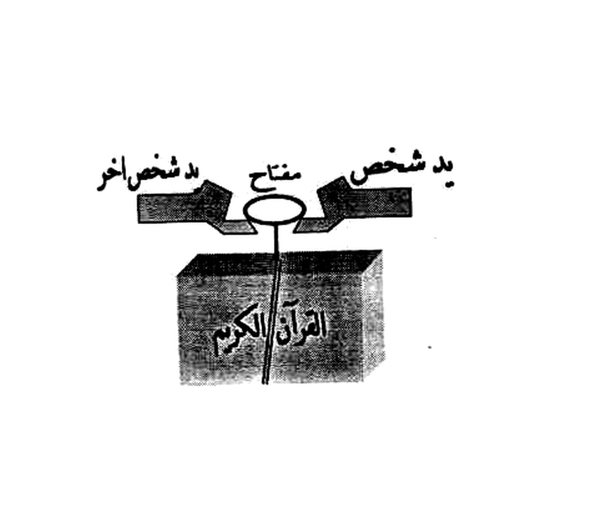

# BATCH 52 — Halaman 225–226 — Qasam Nûr al-Anwâr (penutup), Kasyf bi-al-Muṣḥaf wa-al-Miftâḥ, Mandal al-Sayyid Karâkîl

> **Kitab Asrâr wa Khafâyâ fî ‘Ilm al-Rûhâniyyât — Syeikh ‘Athiyyah ‘Abd al-Hamîd — Terjemahan Lengkap Indonesia — Batch 52 (Hal. 225–226)**
> **Halaman terbaca lengkap: 225 dan 226** · **Rajah batch ini: 1** — `rajah-hal-225-thariqah-kasyf-bil-mushaf-wal-miftah-presisi-2112x1808.jpg` (Halaman 226: 0 rajah, murni teks).
> **Khatam halaman kumulatif: 226 / 297**.

**Sumber:** `Picture 113.jpg` (belahan **kiri** = **Hal. 225**; belahan kanannya = Hal. 224, sudah masuk Batch 51) dan `Picture 114.jpg` (belahan **kanan** = **Hal. 226**; belahan kirinya = Hal. 227, masuk Batch 53).
**Sambungan:** Hal. 224 berakhir `… فَلَا أَقِمْ بِمَوَاقِ` (terpotong) → Hal. 225 dibuka `قِسْمٌ وَإِنَّهُ لَوْ تَعْلَمُونَ عَظِيمٌ …`. Hal. 226 berakhir `… ثُمَّ تَضَعُ` (terpotong) → berlanjut ke Hal. 227.
**Kepala halaman berjalan** (tercetak di kedua halaman): `كتاب اسرار وخفايات في علم الروحانيات ……… شيخ الروحانيين الشيخ عطية عبد الحميد` — bukan bagian isi amal; tidak diterjemahkan ulang.

---

## 1. FOTO ASLI

**Hal. 225** — `Picture 113.jpg`, belahan kiri (angka cetak `225`):

**Hal. 226** — `Picture 114.jpg`, belahan kanan (angka cetak `226`):

---

## 2. IDENTIFIKASI (FUSHA · SURYANI/HIRZI · GHAZALI · JANGKAR)

| Unsur | Temuan pada Hal. 225 & 226 |
|---|---|
| **Fusha** | Ya. Hal. 225: **qasam** (`قِسْمٌ`) bersambung + kutipan al-Kahf 109 + Anbiyâ' 27 (`لَا يَسْبِقُونَهُ بِالْقَوْلِ` gaya `عَجِلُوا`) + potongan Yâsîn 82 & 83. Hal. 226: **instruksi praktis bahasa Arab modern** (مندل, تتحصن, بخور) — bukan doa. |
| **Suryani / Hîrzî** | Ya. Hal. 225: `آهِيًا شَرَاهِيًا آدْنَاى أَصْبُؤُتَ آلِ شَدَاى` · `بَطَر زَهَج وَاحِد` · `بَدُوح طُهُور بَدْعَق` · `نِيمَاة يَاه آلَاه يُوه يَاه تَلَاوَه وَبَلَاوَه` · `يَاخ بَخ بَخ اَنُوخَا مَالِيخ اِيلُوخ كِيطِمَاخ يَاخ بَخ بَخ`. Hal. 226: `شَغَالِيث شَغَالِيث` · `مَشَّتْ الْغَزَالِى`. |
| **Ghazali / ajaran** | Bukan kutipan matan Ghazâlî. Struktur **mandal/mir‘ât** (kâsyaf dengan cermin-cair) mengikuti pola **al-Bûnî – al-Ghazâlî** yang dipakai kitab-kitab mandal Mesir abad ke-13 H. |
| **Jangkar** | Hal. 225: `جِبْرَائِيل` · `مِيكَائِيل` · `إِسْرَافِيل` · `عَزْرَائِيل` (empat malaikat disebut satu per satu) · `الْعَرْش وَالْكُرْسِيّ` · `{ طَبَارِيس } { كِيهْيَالِيش } { جَنْهَابْرِيش }`. Hal. 226: `السَّيِّد كَرَاكِيل` · `مَلِك عَظِيم مَهَاب … وَعَلَى رَأْسِهِ تَاج وَفِى التَّاج جَوْهَرَة` · `نِسْيَمَان بْن دَاوُود` · `سُورَة يس` · `الْقُرْآن الْكَرِيم`. |
| **Buta (tanpa titik)** | **Tidak ada.** Seluruh teks bertitik. |
| **SAKK 111** | **Tidak ada** pada Hal. 225–226. |
| **Wafaq Hawwaz** | **Tidak ada** matriks angka (Hal. 226 hanya memerintahkan *menulis* nama dalam **kotak/murabba‘** di kertas putih — **kotaknya tidak tercetak**). |
| **Rajah** | Hal. 225: **1 gambar** (dua tangan memegang kunci di atas mushaf). Hal. 226: **0**. |

---

## 3. HALAMAN 225

### 3.1 Qasam (sumpah) — sambungan Hal. 224

**[Teks Arab Asli]**

> قِسْمٌ وَإِنَّهُ لَوْ تَعْلَمُونَ عَظِيمٌ قُلْ لَوْ كَانَ الْبَحْرُ مِدَادًا لِكَلِمَاتِ رَبِّي لَنَفِدَ الْبَحْرُ قَبْلَ أَنْ تَنْفُذَ كَلِمَاتُ رَبِّي وَلَوْ جِئْنَا بِمِثْلِهِ مَدَدًا كَافِيًا آهِيًا شَرَاهِيًا آدْنَاى أَصْبُؤُتَ آلِ شَدَاى بِحَقِّ مَا أَقْسَمْتَ يَابَطَرْشِيثَا وَقُوَّةِ سُلْطَانِ هَذِهِ الْكَلِمَاتِ عَلَى الْعَالَمِ الْعُلْوِيِّ وَالسُّفْلِيِّ وَمَنْزِلَتِهَا وَلَوْحِهَا وَقَلَمِهَا وَالْعَرْشِ وَالْكُرْسِيِّ وَبِأَمِينِهَا جِبْرَائِيلَ عَلَيْهِ السَّلَامُ وَبِسِرِّ الْأَنْبِيَاءِ النَّاطِقِينَ بِهَا وَبِسِرِّ مِيكَائِيلَ وَاسْرَافِيلَ وَعَزْرَائِيلَ عَلَيْهِمُ السَّلَامُ وَكُلِّ مَلَكٍ فِي السَّمَاوَاتِ وَالْأَرْضِ اجْعَلُوا يَامَنْ دَعَوْتُ عَجِّلُوا بِحَقِّ بَطَر زَهَج وَاحِد يَاحَىْ يَاهْ يَاهُو يَاخَالِقُ يَابَارِئُ انْتَ هُوَ بَدُوح طُهُور بَدْعَق اللَّهُمَّ عَلَيْكَ بِهَذِهِ الْأَسْمَاءِ الْعِظَامِ وَمُلُوكِهَا عَبِيدُكَ الْكِرَامِ أَنْ تَسْتَحْضِرَهُمْ الَى حَضْرَتِي وَيَشَمُّوا دَخْنَتِي وَيَقْضُوا حَاجَتِي اجِيبُوا وَاطِيعُوا اَيُّهَا الْعِفْرِيتُ { طَبَارِيس } وَالْعِفْرِيتُ { كِيهْيَالِيش } وَالْعِفْرِيتُ { جَنْهَابْرِيش } بِحَقِّ مَا ثَبَتَ عَلَيْكُمْ مِنْ اسْمَاءٍ وَآيَاتٍ كَرِيمَاتٍ مُبَارَكَاتٍ تَتْلِيهَا نِيمَاة يَاهْ آلَاهْ يُوه يَاهْ تَلَاوَه وَبَلَاوَه السَّاعَةَ

**[Transliterasi Latin]**

> *Qismun wa-innahu lau ta‘lamūna ‘aẓīmun qul lau kāna al-baḥru midādan li-kalimāti rabbī la-nafida al-baḥru qabla an tanfuda kalimātu rabbī wa-lau ji'nā bi-mitslihi madadan kāfiyan āhiyan syarāhiyan ādnāy aṣbu'uta āli syadāy bi-ḥaqqi mā aqsamtā yā-baṭarsyītsā wa-quwwati sulṭāni hādzihi al-kalimāti ‘alā al-‘ālami al-‘ulwiyyi wa-al-sufliyyi wa-manzilatihā wa-lauḥihā wa-qalamihā wa-al-‘arsyi wa-al-kursiyyi wa-bi-amīnihā Jibrā'īla ‘alaihi al-salāmu wa-bi-sirri al-anbiyā'i al-nāṭiqīna bihā wa-bi-sirri Mīkā'īla wa-Isrāfīla wa-‘Izrā'īla ‘alaihimu al-salāmu wa-kulli malakin fī al-samāwāti wa-al-arḍi ij‘alū yā man da‘autu ‘ajjilū bi-ḥaqqi baṭar zahaj wāḥid yā ḥāy yāh yāhū yā khāliqu yā bāri'u anta huwa badūḥ ṭuhūr bad‘aq Allāhumma ‘alaika bi-hādzihi al-asmā'i al-‘iẓāmi wa-mulūkihā ‘abīduka al-kirāmi an tastaḥḍirahum ilā ḥaḍratī wa-yasyammū dakhkhatī wa-yaqḍū ḥājatī ajībū wa-aṭī‘ū ayyuhā al-‘ifrītu { Ṭabārîs } wa-al-‘ifrītu { Kîhiyâlîsy } wa-al-‘ifrītu { Janhâbrîsy } bi-ḥaqqi mā tsabata ‘alaikum min asmā'in wa-āyātin karīmātin mubārakātin tatlihā nīmātan yāh ālāh yūh yāh talāwah wa-balāwah al-sā‘ah.*

**[Terjemahan Indonesia]**

> **Layer 1:** *qismun* = (ini) sumpah · *wa-innahu lau ta‘lamūna ‘aẓīmun* = dan sesungguhnya ia — seandainya kalian mengetahui — (adalah) perkara besar · *qul lau kāna al-baḥru midādan li-kalimāti rabbī* = katakanlah: seandainya laut menjadi tinta bagi kalimat-kalimat Tuhanku · *la-nafida al-baḥru qabla an tanfuda kalimātu rabbī* = niscaya laut itu habis sebelum kalimat-kalimat Tuhanku habis · *wa-lau ji'nā bi-mitslihi madadan* = dan seandainya Kami datangkan tambahan sebanyak itu · *kāfiyan* = yang mencukupi · *āhiyan syarāhiyan ādnāy aṣbu'uta āli syadāy* = (deret nama hîrzî) · *bi-ḥaqqi mā aqsamtā yā-baṭarsyītsā* = dengan hak apa yang Engkau sumpahkan, wahai Batharsyîtsâ · *wa-quwwati sulṭāni hādzihi al-kalimāti* = dan kekuatan kekuasaan kalimat-kalimat ini · *‘alā al-‘ālami al-‘ulwiyyi wa-al-sufliyyi* = atas alam yang tinggi dan yang rendah · *wa-manzilatihā wa-lauḥihā wa-qalamihā* = dan (dengan) kedudukannya, lauhnya, dan qalamnya · *wa-al-‘arsyi wa-al-kursiyyi* = dan Arasy serta Kursi · *wa-bi-amīnihā Jibrā'īla ‘alaihi al-salāmu* = dan dengan kepercayaannya, Jibrâ'îl ‘a.s. · *wa-bi-sirri al-anbiyā'i al-nāṭiqīna bihā* = dan dengan rahasia para nabi yang berbicara dengannya · *wa-bi-sirri Mīkā'īla wa-Isrāfīla wa-‘Izrā'īla ‘alaihimu al-salāmu* = dan dengan rahasia Mîkâ'îl, Isrâfîl, dan ‘Izrâ'îl ‘a.s. · *wa-kulli malakin fī al-samāwāti wa-al-arḍi* = dan setiap malaikat di langit dan bumi · *ij‘alū yā man da‘autu ‘ajjilū* = jadikanlah (wahai para khadim), wahai Yang aku seru, bersegeralah · *bi-ḥaqqi baṭar zahaj wāḥid* = dengan hak *bathar zahaj wâhid* · *yā ḥāy yāh yāhū* = ya Hayy, yâh, yâhû · *yā khāliqu yā bāri'u anta huwa* = wahai Pencipta, wahai Pengada, Engkaulah Dia · *badūḥ ṭuhūr bad‘aq* = *badûh thuhûr bad‘aq* · *Allāhumma ‘alaika bi-hādzihi al-asmā'i al-‘iẓāmi* = ya Allah, (aku bersandar) kepada-Mu dengan nama-nama yang agung ini · *wa-mulūkihā ‘abīduka al-kirāmi* = dan rajanya, hamba-hamba-Mu yang mulia · *an tastaḥḍirahum ilā ḥaḍratī* = agar Engkau hadirkan mereka ke hadiratku · *wa-yasyammū dakhkhatī* = dan mereka mencium bau dupa-ku · *wa-yaqḍū ḥājatī* = dan menunaikan hajatku · *ajībū wa-aṭī‘ū ayyuhā al-‘ifrītu* = sambutlah dan taatlah, wahai ifrit · *{ Ṭabārîs } { Kîhiyâlîsy } { Janhâbrîsy }* = (tiga nama ifrit) · *bi-ḥaqqi mā tsabata ‘alaikum* = dengan hak apa yang telah tetap atas kalian · *min asmā'in wa-āyātin karīmātin mubārakātin* = dari nama-nama dan ayat-ayat yang mulia lagi penuh berkah · *tatlihā nīmātan yāh ālāh yūh yāh talāwah wa-balāwah* = yang membacakannya *nîmâtan yâh âlâh yûh yâh talâwah wa-balâwah* · *al-sā‘ah* = sekarang juga.
>
> **Layer 2:** (Ini adalah) sumpah — dan sesungguhnya itu adalah perkara besar, seandainya kalian mengetahui. "Katakanlah: seandainya laut menjadi tinta bagi kalimat-kalimat Tuhanku, niscaya laut itu habis sebelum kalimat-kalimat Tuhanku habis, dan seandainya Kami datangkan tambahan sebanyak itu." — *kâfiyan âhiyan syarâhiyan âdnây ashbu'uta âli syadây* — dengan hak apa yang Engkau sumpahkan, wahai Batharsyîtsâ, dan dengan kekuatan kekuasaan kalimat-kalimat ini atas alam yang tinggi dan yang rendah, serta kedudukannya, lauhnya, qalamnya, Arasy dan Kursi, dan dengan kepercayaannya Jibrâ'îl ‘a.s., dan dengan rahasia para nabi yang berbicara dengannya, dan dengan rahasia Mîkâ'îl, Isrâfîl, ‘Izrâ'îl ‘a.s., dan setiap malaikat di langit dan bumi: jadikanlah — wahai Yang aku seru — bersegeralah, dengan hak *bathar zahaj wâhid*; ya Hayy, yâh, yâhû; wahai Pencipta, wahai Pengada, Engkaulah Dia; *badûh thuhûr bad‘aq*. Ya Allah, dengan nama-nama yang agung ini dan rajanya — hamba-hamba-Mu yang mulia — hadirkanlah mereka ke hadiratku, agar mereka mencium bau dupa-ku dan menunaikan hajatku. Sambutlah dan taatlah, wahai ifrit **Thabârîs**, **Kîhiyâlîsy**, dan **Janhâbrîsy**, dengan hak apa yang telah tetap atas kalian dari nama-nama dan ayat-ayat yang mulia lagi penuh berkah, yang membacakannya *nîmâtan yâh âlâh yûh yâh talâwah wa-balâwah* — sekarang juga.

### 3.2 Perintah bacaan + lafaz pemulangan (aṣrâf)

**[Teks Arab Asli]**

> السَّاعَةَ الْوَحَا الْعَجَلَ يُقْرَأُ 14 مَرَّةً الْاَصْرَاف
>
> إِنَّهُ مِنْ سُلَيْمَانَ وَإِنَّهُ بِسْمِ اللهِ الرَّحْمَنِ الرَّحِيمِ يَاخْ بَخْ بَخْ انُوخَا مَالِيخْ اِيلُوخْ كِيطِمَاخْ يَاخْ بَخْ بَخْ السَّاعَةَ السَّاعَةَ الْعَجَلَ الْعَجَلَ انْصَرِفُوا بَارَكَ اللهُ فِيكُمْ وَعَلَيْكُمْ قُضِيَتِ الْحَاجَةُ وَلَكُمُ الْأَجْرُ انْشَاءَ اللهُ انْصَرِفُوا مُكْرَمِينَ آمِينَ بِحَوْلِ اللهِ يُقْرَأُ 13 مَرَّةً

**[Transliterasi Latin]**

> *Al-sā‘ah al-waḥā al-‘ajal yuqra'u 14 marratan al-aṣrāf.*
>
> *Innahu min Sulaimāna wa-innahu bi-smi Allāhi al-Raḥmāni al-Raḥīmi yākh bakh bakh anūkhā mālīkh īlūkh kīṭimākh yākh bakh bakh al-sā‘ah al-sā‘ah al-‘ajal al-‘ajal inṣarifū bāraka Allāhu fīkum wa-‘alaikum quḍiyati al-ḥājatu wa-lakumu al-ajru in syā'a Allāhu inṣarifū mukramīna āmīna bi-ḥauli Allāhi yuqra'u 13 marratan.*

**[Terjemahan Indonesia]**

> **Layer 1:** *al-sā‘ah* = sekarang · *al-waḥā al-‘ajal* = segera, cepatlah · *yuqra'u 14 marratan al-aṣrāf* = dibaca **14 kali** [bagian] *al-aṣrâf* · *innahu min Sulaimāna* = sesungguhnya ia dari Sulaimân · *wa-innahu bi-smi Allāhi al-Raḥmāni al-Raḥīmi* = dan sesungguhnya ia dengan nama Allah Yang Maha Pengasih, Maha Penyayang · *yākh bakh bakh anūkhā mālīkh īlūkh kīṭimākh yākh bakh bakh* = (deret hîrzî pemulangan) · *al-sā‘ah al-sā‘ah al-‘ajal al-‘ajal* = sekarang, sekarang, cepat, cepat · *inṣarifū* = pulanglah · *bāraka Allāhu fīkum wa-‘alaikum* = semoga Allah memberkahi kalian · *quḍiyati al-ḥājatu* = hajat telah ditunaikan *(bentuk cetakan: `قُضِيَتِ`)* · *wa-lakumu al-ajru* = dan bagi kalian pahalanya · *in syā'a Allāhu* = insya Allah *(cetakan: `انشاء الله`)* · *inṣarifū mukramīna* = pulanglah dengan dimuliakan · *āmīna* = âmîn · *bi-ḥauli Allāhi* = dengan daya Allah · *yuqra'u 13 marratan* = dibaca **13 kali**.
>
> **Layer 2:** Segera, cepatlah — dibaca **14 kali** [pada bagian] *al-ashrâf*. "Sesungguhnya ia dari Sulaimân, dan sesungguhnya ia dengan nama Allah Yang Maha Pengasih, Maha Penyayang" — *yâkh bakh bakh anûkhâ mâlîkh îlûkh kîthimâkh yâkh bakh bakh* — sekarang, sekarang, cepat, cepat! Pulanglah, semoga Allah memberkahi kalian; hajat telah ditunaikan dan bagi kalian pahalanya, insya Allah; pulanglah dengan dimuliakan, âmîn, dengan daya Allah — dibaca **13 kali**.

### 3.3 «طريقة الكشف بالمصحف والمفتاح» — Kâsyaf dengan mushaf & kunci

**[Teks Arab Asli]**

> طَرِيقَةُ الْكَشْفِ بِالْمُصْحَفِ وَالْمِفْتَاحِ
>
> تَفْتَحُ فِى اَوَّلِ سُورَةِ يس وَاحْكِمِ الْاِغْلَاقَ عَلَيْهِ بِاَسْتِيك مَطَاطِى مَثَلًا مَرْبُوطٍ بِالْمِفْتَاحِ وَلَافِفْ حَوْلَ الْمُصْحَفِ ابْدَأْ بَ بِسْمِ اللهِ الرَّحْمَنِ الرَّحِيمِ . الْفَاتِحَة . انْ كَانَتِ الْا صَيْحَةً وَاحِدَةً فَاِذَا هُمْ جَمِيعًا لَدَيْنَا مُحْضَرُونَ 3

**[Transliterasi Latin]**

> *Ṭarīqatu al-kasyfi bil-muṣḥafi wa-al-miftāḥi: Taftaḥu fī awwali sūrati Yās wa-aḥkim al-ighlāqa ‘alaihi bi-astīk maṭāṭī matsalan marbūṭin bil-miftāḥi wa-lāfif ḥaula al-muṣḥafi ibda' b Bismi Allāhi al-Raḥmāni al-Raḥīmi. Al-Fātiḥah. In kānati illā ṣaiḥatan wāḥidatan fa-idzā hum jamī‘an ladainā muḥḍarūna 3.*

**[Terjemahan Indonesia]**

> **Layer 1:** *ṭarīqatu al-kasyfi bil-muṣḥafi wa-al-miftāḥi* = cara kâsyaf dengan mushaf dan kunci · *taftaḥu fī awwali sūrati Yās* = engkau membuka pada awal sûrah Yâsîn · *wa-aḥkim al-ighlāqa ‘alaihi* = dan kunci/rapatkan penutupnya · *bi-astīk maṭāṭī matsalan* = dengan karet elastis misalnya · *marbūṭin bil-miftāḥi* = yang diikatkan pada kunci · *wa-lāfif ḥaula al-muṣḥafi* = dan lilitkan (karet itu) mengelilingi mushaf · *ibda' b* = mulailah dengan *(cetakan huruf tunggal `ب`)* · *Bismi Allāhi al-Raḥmāni al-Raḥīmi* = dengan nama Allah Yang Maha Pengasih, Maha Penyayang · *al-Fātiḥah* = (baca) al-Fâtihah · *in kānati illā ṣaiḥatan wāḥidatan* = tiadalah ia melainkan satu teriakan saja · *fa-idzā hum jamī‘an ladainā muḥḍarūna* = maka tiba-tiba mereka semua dihadirkan di hadapan Kami · *3* = angka cetak (penanda catatan kaki) · — lihat **rajah §4**.
>
> **Layer 2:** **Cara kâsyaf dengan mushaf dan kunci:** Engkau membuka (mushaf) pada awal sûrah Yâsîn, lalu rapatkan penutupnya dengan karet elastis — misalnya — yang diikatkan pada kunci, dan lilitkan (karet itu) mengelilingi mushaf. Mulailah dengan "Bismillâhirraḥmânirraḥîm", (lalu) al-Fâtihah, (lalu) *"tiadalah ia melainkan satu teriakan saja, maka tiba-tiba mereka semua dihadirkan di hadapan Kami"* (Yâsîn 53). *[Angka `3` pada akhir baris adalah penanda catatan kaki cetakan.]*

---

## 4. RAJAH HALAMAN 225 — «طريقة الكشف» (dua tangan, kunci, mushaf)

**Berkas:** `terjemahan/rajah/rajah-hal-225-thariqah-kasyf-bil-mushaf-wal-miftah-presisi-2112x1808.jpg`

### 4.1 Isi gambar (apa adanya, tanpa redraw)

| Bagian | Tulisan pada gambar | Arti |
|---|---|---|
| Blok tangan **kanan** | `يَد شَخْص` | tangan seseorang |
| Blok di tengah (kepala kunci) | `مِفْتَاح` | kunci |
| Blok tangan **kiri** | `يَد شَخْصٍ آخَر` (huruf `يَد` pada cetakan tipis/berdesakan — lihat §9.4) | tangan orang lain |
| Buku di bawah | `الْقُرْآن الْكَرِيم` | al-Qur'ân al-Karîm |

**Pembacaan gambar:** dua tangan (dua orang) memegang **kunci**; batang kunci menjulur ke bawah menembus/menyentuh **mushaf** yang tertutup. Inilah yang dimaksud teks §3.3: kunci diikat dengan karet ke mushaf, lalu dua orang memegang ujung kunci — mushaf menjadi poros, kunci menjadi penunjuk.

### 4.2 Parameter crop (dilaporkan apa adanya)

| Butir | Nilai |
|---|---|
| Perintah | `python3 crop_wafaq_presisi_2112x1808.py --src "Picture 113.jpg" --box 338 735 780 948 --out terjemahan/rajah/rajah-hal-225-…-presisi-2112x1808.jpg` |
| BOX (x0 y0 x1 y1) | **338 735 780 948** (crop 442×213 px) |
| Margin 15 % | **kiri/kanan terpenuhi** (± 66 px dari bbox tinta x 392–731); **atas** diberi 22 px (heading `طريقة الكشف…` berakhir y 731, jadi tidak terpotong); **bawah dibatasi** baris cetak berikutnya (baris `يس واحكم الاغلاق…` mulai y 950) → margin bawah 0 px, **sengaja** supaya teks tetangga tidak ikut masuk |
| Keluaran | 2112×1808 px · 300 DPI · LANCZOS **4,46×** |
| Angka putih | **86,0 %** seluruh kanvas · **93,4 %** piksel non-tinta |
| Tinta/nada | 7,91 % tinta padat · 3,91 % nada antara |
| Keutuhan objek | **kedua tangan utuh, cincin kunci utuh, buku utuh** — tidak ada objek rajah yang terpotong; **tidak ada** tawkil pada halaman ini (jadi aturan "jangan potong tawkil" tidak terlanggar) |

---

## 5. HALAMAN 226

### 5.1 Perintah hudûr khadim sûrah Yâsîn

**[Teks Arab Asli]**

> مَرَّاتٍ احْضُرُوا يَا خُدَّامَ سُورَةِ يس الشَّرِيفَةَ بَارَكَ اللهُ فِيكُمْ وَعَلَيْكُمْ بِأَمْرِ اللهِ إِنَّمَا أَمْرُهُ إِذَا ارَادَ شَيْئًا انْ يَقُولَ لَهُ كُنْ فَيَكُونُ فَسُبْحَانَ الَّذِى بِيَدِهِ مَلَكُوتُ كُلِّ شَئٍ وَاِلَيْهِ تُرْجَعُونَ احْضُرُوا بَارَكَ اللهُ فِيكُمْ وَعَلَيْكُمْ وَجَعَلَ تَوَايِكُمْ فِى عَيْنَيْنِ ) وَتُكَرِّرُ هَذَا عِدَّةَ مَرَّاتٍ وَتَقُولُ فِى آخِرِ كُلِّ مَرَّةٍ ادِيرُوا الْمُصْحَفَ نَاحِيَةَ الْيَمِينِ وَبَيِّنُوا لِى عَلَى الْحُضُورِ بَارَكَ اللهُ فِيكُمْ وَعَلَيْكُمْ

**[Transliterasi Latin]**

> *Marrātin iḥḍurū yā khuddāma sūrati Yās al-syarīfata bāraka Allāhu fīkum wa-‘alaikum bi-amri Allāhi innamā amruhu idzā arāda syai'an an yaqūla lahu kun fa-yakūnu fa-subḥāna alladzī bi-yadihi malakūtu kulli syai'in wa-ilaihi turja‘ūna iḥḍurū bāraka Allāhu fīkum wa-‘alaikum wa-ja‘ala tawāyikum fī ‘ainaini) wa-tukarriru hādzā ‘iddata marrātin wa-taqūlu fī ākhiri kulli marratin adīrū al-muṣḥafa nāḥiyata al-yamīni wa-bayyinū lī ‘alā al-ḥuḍūri bāraka Allāhu fīkum wa-‘alaikum.*

**[Terjemahan Indonesia]**

> **Layer 1:** *marrātin* = beberapa kali · *iḥḍurū yā khuddāma sūrati Yās al-syarīfata* = hadirlah, wahai para pelayan sûrah Yâsîn yang mulia · *bāraka Allāhu fīkum wa-‘alaikum* = semoga Allah memberkahi kalian · *bi-amri Allāhi* = dengan perintah Allah · *innamā amruhu idzā arāda syai'an an yaqūla lahu kun fa-yakūnu* = sesungguhnya perintah-Nya apabila Dia menghendaki sesuatu hanyalah berkata kepadanya "jadilah", maka jadilah ia · *fa-subḥāna alladzī bi-yadihi malakūtu kulli syai'in* = maka Mahasuci (Allah) yang di tangan-Nya kerajaan segala sesuatu · *wa-ilaihi turja‘ūna* = dan kepada-Nya kalian dikembalikan · *iḥḍurū* = hadirlah · *wa-ja‘ala tawāyikum fī ‘ainaini* = dan Dia menjadikan *(cetakan: `تَوَايِكُمْ`; lihat §9.5)* di dua mata · *wa-tukarriru hādzā ‘iddata marrātin* = dan engkau mengulangi ini beberapa kali · *wa-taqūlu fī ākhiri kulli marratin* = dan engkau berkata pada akhir setiap kali · *adīrū al-muṣḥafa nāḥiyata al-yamīni* = putarlah mushaf ke arah kanan · *wa-bayyinū lī ‘alā al-ḥuḍūri* = dan tunjukkanlah kepadaku tentang kehadiran (mereka).
>
> **Layer 2:** "Beberapa kali: hadirlah, wahai para pelayan sûrah Yâsîn yang mulia — semoga Allah memberkahi kalian — dengan perintah Allah. 'Sesungguhnya perintah-Nya apabila Dia menghendaki sesuatu hanyalah berkata kepadanya: jadilah, maka jadilah ia.' Maka Mahasuci (Allah) yang di tangan-Nya kerajaan segala sesuatu dan kepada-Nya kalian dikembalikan. Hadirlah, semoga Allah memberkahi kalian, dan Dia menjadikan *tawâyikum* pada dua mata." — Engkau mengulangi ini beberapa kali dan pada akhir setiap kali engkau berkata: "Putarlah mushaf ke arah kanan dan tunjukkanlah kepadaku tentang kehadiran (mereka). Semoga Allah memberkahi kalian."

### 5.2 «مندل السيد كراكيل» — Mandal Sayyid Karâkîl

**[Teks Arab Asli]**

> مَنْدَلُ السَّيِّدِ كَرَاكِيل
>
> تُحْضِرُ كُوبٌ مِنْ بِلَّوْر شَفَّافٌ مَمْلُوءَةٌ بِالْمَاءِ الرَّائِقِ وَتَصْرِفُ الْعَامِرَ وَتَعْمُودٌ حَتَّى يُخْبِرَكَ النَّاظِرُ بِحُضُورِهِ وَهُوَ مَلِكٌ عَظِيمٌ مَهَابٌ وَعَلَى رَأْسِهِ تَاجٌ وَفِى التَّاجِ جَوْهَرَةٌ وَبِيَدِيهِ قَضِيبُ خَيْزُرَانٍ وَحَوْلَهُ ارْبَعِينَ مِنْ اعْوَانِهِ فَأَذَا ذَكَرَ لَكَ النَّاظُورُ هَذِهِ الْاَوْصَافَ فَاطْلُبْ مِنْهُ خَادِمَ الْيَوْمِ وَاسْأَلْهُ عَنْ طَلَبِكَ وَاطْلُبْ مِنْهُ مَا تُرِيدُ فَأَنَّهُ يُجِيبُكَ بِالصِّدْقِ بِغَيْرِ كَذِبٍ وَلَا تَمْوِيهٍ وَهَذِهِ هِىَ الْعَزِيمَةُ
>
> الْعَزِيمَةُ
>
> شَغَالِيث شَغَالِيث اللهُ الْعَزِيزُ الْمُعْتَزُّ فِى عِزِّ عِزِّهِ اَجِبْ اَيُّهَا السَّيِّدُ كَرَاكِيل وَ اَحْضُرْ الَى وَلَا تَزَالُ تُكَرِّرُ هَذِهِ الْعَزِيمَةَ حَتَّى يَحْضُرَ فَأَذَا اَبْطَأَ عَلَيْكَ فَأَزْجُرْهُ بِهَذِهِ الْاَسْمَاءِ وَهِىَ جَوَادٌ مَوْجُودٌ اَحَدٌ صَمَدٌ قَيُّومٌ نُورُ الْاَنْوَارِ الْكَبِيرُ الْمُتَعَالِ مُنْجِدٌ طَالِبٌ غَالِبٌ مُدَبِّرٌ مُهْلِكٌ قَدِيرٌ وَاَنْطَقَ النَّمْلَةَ نِسْيَمَان بْن دَاوُودَ وَقَالُوا لِجُودِهِمْ لِمْ شَهِدْتُمْ عَلَيْنَا قَالُوا اَنْطَقَنَا اللهُ الَّذِى اَنْطَقَ كُلَّ شَئٍ.

**[Transliterasi Latin]**

> *Mandal al-sayyid Karâkîl: Tuḥḍiru kūbun min billawrin syaffāfun mamlū'atun bil-mā'i al-rā'iqi wa-taṣrifu al-‘āmira wa-ta‘mūdun ḥattā yukhbiraka al-nāẓiru bi-ḥuḍūrihi wa-huwa malikun ‘aẓīmun mahābun wa-‘alā ra'sihi tājun wa-fī al-tāji jawharatun wa-bi-yadīhi qaḍību khairuzānin wa-ḥaulahu arbā‘īna min a‘wānihi fa-adzā dzakara laka al-nāẓūru hādzihi al-awṣāfa fa-aṭlub minhu khādima al-yaumi wa-s'alhu ‘an ṭalabika wa-aṭlub minhu mā turīdu fa-innahu yujībuka bil-ṣidqi bi-ghairi kadzibin wa-lā tamwīhin wa-hādzihi hiya al-‘azīmah.*
>
> *Al-‘azīmah: Syaghālīts syaghālīts Allāhu al-‘azīzu al-mu‘tazzu fī ‘izzi ‘izzihi ajib ayyuhā al-sayyidu Karâkîl wa aḥḍur ilā wa-lā tazālu tukarriru hādzihi al-‘azīmata ḥattā yaḥḍura fa-adzā abṭa'a ‘alaika fa-azjurhu bi-hādzihi al-asmā'i wa-hiya jawādun maujūdun aḥadun ṣamadun qayyūmun nūru al-anwāri al-kabīru al-muta‘āli munjidun ṭālibun ghālibun mudabbirun muhlikun qadīrun wa-anṭaqa al-namlata Nisyamān bnu Dāwūda wa-qālū li-jūdihim lim syahidtum ‘alainā qālū anṭaqanā Allāhu alladzī anṭaqa kulla syai'in.*

**[Terjemahan Indonesia]**

> **Layer 1:** *mandal al-sayyid Karâkîl* = mandal Sayyid Karâkîl · *tuḥḍiru kūbun min billawrin syaffāfun* = engkau menghadirkan gelas dari kristal bening · *mamlū'atun bil-mā'i al-rā'iqi* = yang penuh dengan air jernih · *wa-taṣrifu al-‘āmira* = dan engkau menyingkirkan/menolak penghuni (jin pengganggu) · *wa-ta‘mūdun* = dan engkau bersandar/bermaksud *(cetakan: `وَتَعْمُودٌ`; lihat §9.5)* · *ḥattā yukhbiraka al-nāẓiru bi-ḥuḍūrihi* = sampai pemberi-pandangan (nâzhir/penglihatan) memberitahumu tentang kehadirannya · *wa-huwa malikun ‘aẓīmun mahābun* = dan ia adalah raja yang agung lagi berwibawa · *wa-‘alā ra'sihi tājun* = dan di kepalanya (ada) mahkota · *wa-fī al-tāji jawharatun* = dan di dalam mahkota (ada) permata · *wa-bi-yadīhi qaḍību khairuzānin* = dan di tangannya (ada) tongkat rotan · *wa-ḥaulahu arbā‘īna min a‘wānihi* = dan di sekelilingnya empat puluh pembantunya · *fa-adzā dzakara laka al-nāẓūru hādzihi al-awṣāfa* = maka apabila nâzhûr menyebutkan kepadamu ciri-ciri ini · *fa-aṭlub minhu khādima al-yaumi* = mintalah kepadanya pelayan hari itu · *wa-s'alhu ‘an ṭalabika* = dan tanyakanlah kepadanya tentang permintaanmu · *wa-aṭlub minhu mā turīdu* = dan mintalah kepadanya apa yang engkau inginkan · *fa-innahu yujībuka bil-ṣidqi* = karena ia akan menjawabmu dengan jujur · *bi-ghairi kadzibin wa-lā tamwīhin* = tanpa dusta dan tanpa pengaburan · *wa-hādzihi hiya al-‘azīmah* = dan inilah ‘azîmah-nya · *syaghālīts syaghālīts* = (lafal pembuka hîrzî) · *Allāhu al-‘azīzu al-mu‘tazzu fī ‘izzi ‘izzihi* = Allah Yang Mahamulia, Yang Mahaperkasa dalam kemuliaan keperkasaan-Nya · *ajib ayyuhā al-sayyidu Karâkîl* = sambutlah, wahai Sayyid Karâkîl · *wa aḥḍur ilā* = dan hadirlah kepadaku *(cetakan: `اَحْضُرْ` tanpa titik, dibaca `أَحْضِرْ`/`اِحْضُرْ`)* · *wa-lā tazālu tukarriru hādzihi al-‘azīmata ḥattā yaḥḍura* = dan engkau senantiasa mengulangi ‘azîmah ini sampai ia hadir · *fa-adzā abṭa'a ‘alaika fa-azjurhu bi-hādzihi al-asmā'i* = maka jika ia lambat atasmu, hardiklah ia dengan nama-nama ini · *wa-hiya jawādun maujūdun aḥadun ṣamadun qayyūmun* = yaitu Jawâd, Maujûd, Aḥad, Shamad, Qayyûm · *nūru al-anwāri* = Cahaya di atas segala cahaya · *al-kabīru al-muta‘āli* = Yang Mahabesar, Mahatinggi · *munjidun ṭālibun ghālibun mudabbirun muhlikun qadīrun* = Munjid, Thâlib, Ghâlib, Mudabbir, Muhlik, Qadîr · *wa-anṭaqa al-namlata Nisyamān bnu Dāwūda* = dan Dia membuat semut berbicara, Nisyamân bin Dâwûd · *wa-qālū li-jūdihim lim syahidtum ‘alainā* = dan mereka berkata kepada (tubuh) mereka: mengapa kalian bersaksi atas kami? · *qālū anṭaqanā Allāhu alladzī anṭaqa kulla syai'in* = mereka menjawab: Allah yang membuat segala sesuatu berbicara telah membuat kami berbicara.
>
> **Layer 2:** **Mandal Sayyid Karâkîl:** Engkau menghadirkan gelas kristal bening yang penuh air jernih, menyingkirkan penghuni (jin pengganggu), dan bermaksud (mengamalkannya) sampai nâzhir memberitahumu tentang kehadirannya. Ia adalah raja agung lagi berwibawa; di kepalanya mahkota, di dalam mahkota ada permata, di tangannya tongkat rotan, dan di sekelilingnya empat puluh pembantunya. Maka apabila nâzhûr menyebutkan ciri-ciri ini kepadamu, mintalah kepadanya pelayan hari itu, tanyakanlah tentang permintaanmu, dan mintalah apa yang engkau inginkan — karena ia akan menjawabmu dengan jujur, tanpa dusta dan tanpa pengaburan. Inilah ‘azîmah-nya:
> *Syaghâlîts syaghâlîts* — Allah Yang Mahamulia, Yang Mahaperkasa dalam kemuliaan keperkasaan-Nya — sambutlah, wahai Sayyid Karâkîl, dan hadirlah kepadaku. Engkau senantiasa mengulangi ‘azîmah ini sampai ia hadir; maka jika ia lambat atasmu, hardiklah ia dengan nama-nama ini: **Jawâd, Maujûd, Aḥad, Shamad, Qayyûm, Nûr al-Anwâr, al-Kabîr al-Muta‘âl, Munjid, Thâlib, Ghâlib, Mudabbir, Muhlik, Qadîr** — dan (Dia) yang membuat semut berbicara, Nisyamân bin Dâwûd; "dan mereka berkata kepada (tubuh) mereka: mengapa kalian bersaksi atas kami? Mereka menjawab: Allah yang membuat segala sesuatu berbicara telah membuat kami berbicara."

### 5.3 «مندل يظهر لك الساحر وساحرة ومكان السحر…» + «التوضيح»

**[Teks Arab Asli]**

> مَنْدَلٌ يُظْهِرُ لَكَ السَّاحِرَ وَسَاحِرَةً وَمَكَانَ السِّحْرِ وَسَرِقَةً وَالْخِيفَةَ وَغَيْرَهَا
>
> اعْلَمْ يَا اخِى فِى اللهِ بَعْدَ تَفْكِيرٍ وَسَحْبٍ وَرَدٍّ قَرَّرْتُ انْ اُنْزِلَ هَذَا الْمَنْدَلَ الْعَجِيبَ وَقَدْ كُنْتُ اعْلَمُهُ فِى اَيَّامِ شَبَابِى وَمِنْ خِلَالِهِ تَمَكَّنَ مِنْ رُؤْيَةِ السِّحْرِ وَسَاحِرَةٍ وَسَاحِرَةٍ وَالسَّرِقَةِ وَغَيْرِهَا بَلْ بِاِمْكَانِكَ انْ تُرْسِلَ ارْسَالَاتٍ مِنْهُ.
>
> التَّوْضِيحُ
>
> بِدَايَةً عَلَيْكَ انْ تَتَحَصَّنَ جَيِّدًا تَحَصُّنًا قَوِيًّا امَّا الْاَمْرُ الثَّانِى طَرْدُ الْعُمَّارِ بِهَذَا الْاَصْرَافِ بَبْظَفْ انْصَرِفُوا يَاعُمَّارَ هَذَا الْمَكَانِ بِحَقِّ اللهِ وَبِعِزَّةِ اللهِ وَبِمُحَمَّدٍ رَسُولِ اللهِ وَحُرْمَةِ الذِّكْرِ الْحَكِيمِ وَبِقَوْلِ تَعَالَى اِذَا زُلْزِلَتِ الْخ مَعَ انَّكَ تَرُشُّ بِمَاءِ وَرْدٍ وَتُطْلِقُ بُخُورًا ذَاتَ رَائِحَةٍ زَكِيَّةٍ وَمُسْتَقْبِلٌ لِلْقِبْلَةِ وَلَدَيْكَ هِمَّةٌ كَبِيرَةٌ.
>
> فَيَجْنَسُ الْوَسِيطُ امَامَكَ وَتَجْعَلُ لَهُ ايَاتِ الْكَشْفِ بَيْنَ عَيْنَيْهِ وَتَرْبِطُهَا بِمَنْدِيلٍ عَلَى رَأْسِهِ ثُمَّ تَاخُذُ بَيْضَةً بَلَدِيَّةً اىْ بِنْتِ يَوْمِهَا اوْ لَيْسَتْ اصْطِنَاعِيَّةً ثُمَّ تَكْسِرُ اعْلَاهَا وَتَضَعُ فِيهَا الزَّيْتَ وَتَكْتُبُ مَشَّتْ الْغَزَالِى بَطَل زَهَج وَاحِد فِى مُرَبَّعٍ عَلَى وَرَقَةٍ بَيْضَاءَ وَتَضَعُهُ فِى يَدِ الصَّبِىِّ ثُمَّ تَضَعُ …

**[Transliterasi Latin]**

> *Mandalun yuẓhiru laka al-sāḥira wa-sāḥiratan wa-makāna al-siḥri wa-sariqatan wa-al-khīfata wa-ghairahā.*
>
> *I‘lam yā akhī fī Allāhi ba‘da tafkīrin wa-saḥbin wa-raddin qarrartu an unzila hādza al-mandala al-‘ajība wa-qad kuntu a‘lamuhu fī ayyāmi syabābī wa-min khilālihi tamakkana min ru'yati al-siḥri wa-sāḥiratin wa-sāḥiratin wa-al-sariqati wa-ghairihā bal bi-imkānika an tursila arsālātin minhu.*
>
> *Al-tauḍīḥ: Bidāyatan ‘alaika an tataḥaṣṣana jayyidan taḥaṣṣunan qawiyyan ammā al-amru al-tsānī ṭardu al-‘ummāri bi-hādza al-aṣrāfi babẓaf inṣarifū yā-‘ummāra hādza al-makāni bi-ḥaqqi Allāhi wa-bi-‘izzati Allāhi wa-bi-Muḥammadin rasūli Allāhi wa-ḥurmati al-dzikri al-ḥakīmi wa-bi-qauli ta‘ālā idzā zulzilati al-kh ma‘a annaka tarusysyu bi-mā'i wardin wa-tuṭliqu bukhūran dzāta rā'iḥatin zakiyyatin wa-mustaqbilun lil-qiblati wa-ladaika himmatun kabīratun.*
>
> *Fa-yajnusu al-wasīṭu amāmaka wa-taj‘alu lahu āyāti al-kasyfi baina ‘ainaihi wa-tarbiṭuhā bi-mindīlin ‘alā ra'sihi tsumma ta'khudzu baiḍatan baladiyyatan ay binti yaumihā au laisat iṣṭinā‘iyyatan tsumma taksiru a‘lāhā wa-taḍa‘u fīhā al-zaita wa-taktubu masysyat al-ghazālī baṭal zahaj wāḥid fī murabba‘in ‘alā waraqatin baiḍā'a wa-taḍa‘uhu fī yadi al-ṣabiyyi tsumma taḍa‘u …*

**[Terjemahan Indonesia]**

> **Layer 1:** *mandalun yuẓhiru laka al-sāḥira wa-sāḥiratan* = mandal yang memperlihatkan kepadamu tukang sihir (laki-laki) dan tukang sihir (perempuan) · *wa-makāna al-siḥri* = dan tempat sihir · *wa-sariqatan wa-al-khīfata wa-ghairahā* = dan pencurian, dan ketakutan, dan lainnya · *i‘lam yā akhī fī Allāhi* = ketahuilah, wahai saudaraku karena Allah · *ba‘da tafkīrin wa-saḥbin wa-raddin* = setelah berpikir, menarik, dan menolak · *qarrartu an unzila hādza al-mandala al-‘ajība* = aku memutuskan menurunkan mandal yang ajaib ini · *wa-qad kuntu a‘lamuhu fī ayyāmi syabābī* = padahal aku dahulu mengamalkannya pada masa mudaku · *wa-min khilālihi tamakkana min ru'yati al-siḥri* = dan melaluinya dapat dilihat (hal-hal) sihir · *wa-sāḥiratin wa-sāḥiratin wa-al-sariqati wa-ghairihā* = dan tukang sihir laki-laki dan perempuan, pencurian, dan lainnya · *bal bi-imkānika an tursila arsālātin minhu* = bahkan engkau dapat mengirim pesan-pesan darinya · *al-tauḍīḥ* = penjelasan · *bidāyatan ‘alaika an tataḥaṣṣana jayyidan taḥaṣṣunan qawiyyan* = sebagai permulaan, engkau harus membentengi diri dengan baik, benteng yang kuat · *ammā al-amru al-tsānī* = adapun perkara kedua · *ṭardu al-‘ummāri bi-hādza al-aṣrāfi* = mengusir para penghuni (jin) dengan *ashrâf* ini · *babẓaf* = (lafal hîrzî; cetakan `بَبْظَفْ` — lihat §9.5) · *inṣarifū yā-‘ummāra hādza al-makāni* = pergilah, wahai para penghuni tempat ini · *bi-ḥaqqi Allāhi wa-bi-‘izzati Allāhi* = dengan hak Allah dan dengan keperkasaan Allah · *wa-bi-Muḥammadin rasūli Allāhi* = dan dengan Muhammad Rasulullah · *wa-ḥurmati al-dzikri al-ḥakīmi* = dan kehormatan al-Dzikr (al-Qur'ân) yang bijaksana · *wa-bi-qauli ta‘ālā idzā zulzilati al-kh* = dan dengan firman-Nya: "apabila digoncangkan…" dst. (al-Zalzalah 1) · *ma‘a annaka tarusysyu bi-mā'i wardin* = sementara engkau memercik dengan air mawar · *wa-tuṭliqu bukhūran dzāta rā'iḥatin zakiyyatin* = dan engkau membakar dupa yang beraroma wangi · *wa-mustaqbilun lil-qiblati* = dan menghadap kiblat · *wa-ladaika himmatun kabīratun* = dan engkau punya tekad besar · *fa-yajnusu al-wasīṭu amāmaka* = maka perantara (wasîth) akan duduk*(?) di hadapanmu · *wa-taj‘alu lahu āyāti al-kasyfi baina ‘ainaihi* = dan engkau letakkan ayat-ayat kâsyaf di antara kedua matanya · *wa-tarbiṭuhā bi-mindīlin ‘alā ra'sihi* = dan engkau ikatkan dengan sapu tangan di kepalanya · *tsumma ta'khudzu baiḍatan baladiyyatan* = kemudian engkau mengambil telur kampung · *ay binti yaumihā* = yaitu (telur) yang baru hari itu · *au laisat iṣṭinā‘iyyatan* = atau bukan telur buatan (pabrik) · *tsumma taksiru a‘lāhā* = kemudian engkau pecahkan bagian atasnya · *wa-taḍa‘u fīhā al-zaita* = dan engkau taruh minyak ke dalamnya · *wa-taktubu masysyat al-ghazālī baṭal zahaj wāḥid* = dan engkau tulis *masysyat al-ghazâlî bathal zahaj wâhid* · *fī murabba‘in ‘alā waraqatin baiḍā'a* = di dalam kotak (murabba‘) pada kertas putih · *wa-taḍa‘uhu fī yadi al-ṣabiyyi* = dan engkau letakkan di tangan anak kecil · *tsumma taḍa‘u …* = kemudian engkau letakkan … *(terpotong)*.
>
> **Layer 2:** **Mandal yang memperlihatkan kepadamu tukang sihir laki-laki dan perempuan, tempat sihir, pencurian, ketakutan, dan lainnya.** Ketahuilah, wahai saudaraku karena Allah, setelah berpikir, menarik, dan menolak, aku memutuskan menurunkan mandal yang ajaib ini — padahal aku dahulu mengamalkannya pada masa mudaku, dan melaluinya dapat dilihat (hal-hal) sihir, tukang sihir laki-laki dan perempuan, pencurian, dan lainnya; bahkan engkau dapat mengirim pesan-pesan darinya.
> **Penjelasan:** Sebagai permulaan, engkau harus membentengi diri dengan baik, benteng yang kuat. Adapun perkara kedua: mengusir para penghuni (jin) dengan *ashrâf* ini — *babẓaf* — "Pergilah, wahai para penghuni tempat ini, dengan hak Allah dan keperkasaan Allah, dengan Muhammad Rasulullah, dan kehormatan al-Dzikr yang bijaksana, dan dengan firman-Nya: 'Apabila digoncangkan…' dst." — sementara engkau memercik dengan air mawar, membakar dupa yang beraroma wangi, menghadap kiblat, dan memiliki tekad besar.
> Maka *wasîth* akan duduk di hadapanmu, dan engkau letakkan ayat-ayat kâsyaf di antara kedua matanya lalu mengikatnya dengan sapu tangan di kepalanya. Kemudian engkau mengambil **telur kampung** — yaitu yang baru hari itu, bukan telur pabrik — lalu pecahkan bagian atasnya, taruh minyak di dalamnya, dan tuliskan *masysyat al-ghazâlî bathal zahaj wâhid* di dalam **kotak (murabba‘)** pada kertas putih; engkau letakkan (telur itu) di tangan anak kecil, kemudian engkau letakkan … *(bersambung ke Hal. 227)*.

---

## 6. KETERANGAN AMAL

| Butir | Hal. 225 | Hal. 226 |
|---|---|---|
| **Nama amal** | `الْعَزِيمَة` (qasam penutup) + `طَرِيقَة الْكَشْف بِالْمُصْحَفِ وَالْمِفْتَاح` | `مَنْدَل السَّيِّد كَرَاكِيل` · `مَنْدَل يُظْهِرُ السَّاحِر…` |
| **Hajat** | Menghadirkan tiga ‘aqârît (`أَنْ تَسْتَحْضِرَهُمْ… وَيَقْضُوا حَاجَتِي`); kemudian **kâsyaf** (melihat) dengan mushaf | Hudûr khadim Yâsîn; **melihat raja Karâkîl** di air (mandal); **melihat sihir/pencuri** dan mengirim pesan |
| **Media** | **Mushaf** + **kunci** + karet gelang | **Gelas kristal** + air jernih; **telur kampung** + minyak; kertas putih + kotak (murabba‘); sapu tangan |
| **Bukhur** | tidak tercantum pada Hal. 225 | **dupa beraroma wangi** (`بُخُورًا ذَاتَ رَائِحَةٍ زَكِيَّةٍ`) — jenis tidak disebut |
| **Wewangian** | tidak tercantum | **air mawar** dipercikkan (`تَرُشُّ بِمَاءِ وَرْدٍ`) |
| **Arah** | tidak tercantum | **menghadap kiblat**; mushaf **diputar ke kanan** |
| **Bilangan bacaan** | **14×** (`الاَصْرَاف`) dan **13×** (`بِحَوْلِ اللهِ`) | **beberapa kali** (`عِدَّةَ مَرَّاتٍ`) — tanpa angka pasti |
| **Khadim** | Thabârîs · Kîhiyâlîsy · Janhâbrîsy + empat malaikat + `بَطَرْشِيثَا` | Karâkîl (raja, mahkota + permata, tongkat rotan, 40 pembantu) + `نِسْيَمَان بْن دَاوُود` |
| **Syarat ruangan/pakaian** | tidak tercantum | tidak tercantum (hanya "bentengi diri dulu", bersih, menghadap kiblat) |
| **Rajah** | **1** (dua tangan + kunci + mushaf) | **0** (kotak hanya diperintahkan ditulis, tidak dicetak) |
| **SAKK 111** | tidak ada | tidak ada |

---

## 7. HITUNG WAFAQ / HITUNG BILANGAN

| Hitungan | Hasil | Keterangan |
|---|---|---|
| Matriks wafaq | **tidak ada** | tidak ada wafaq angka pada Hal. 225–226 |
| SAKK 111 | **tidak ada** | — |
| Bilangan **14** | `يُقْرَأُ 14 مَرَّةً الْاَصْرَاف` | Hal. 225 |
| Bilangan **13** | `يُقْرَأُ 13 مَرَّةً` (lafaz `آمِينَ بِحَوْلِ اللهِ`) | Hal. 225 |
| Bilangan **3** | angka cetak di akhir baris terakhir Hal. 225 | **penanda catatan kaki**, **bukan** bilangan amal — tidak dihitung sebagai bagian ritual |
| Bilangan **40** | `حَوْلَهُ ارْبَعِينَ مِنْ اعْوَانِهِ` | jumlah pembantu Karâkîl pada **penglihatan**, bukan hitungan bacaan |
| Bilangan **1** | `جَوْهَرَة` (satu permata di mahkota) | ciri penglihatan |
| Nama ‘aqârît | **3** | Thabârîs · Kîhiyâlîsy · Janhâbrîsy |
| Malaikat disebut | **4** | Jibrâ'îl · Mîkâ'îl · Isrâfîl · ‘Izrâ'îl |
| Nama agung pada hardikan | **13** | Jawâd · Maujûd · Aḥad · Shamad · Qayyûm · Nûr al-Anwâr · al-Kabîr al-Muta‘âl · Munjid · Thâlib · Ghâlib · Mudabbir · Muhlik · Qadîr |
| Bilangan 111 / 313 | **tidak ada** | tidak tercetak pada kedua halaman |

> **Kesimpulan:** Batch 52 **tidak memuat wafaq**; yang dapat dihitung hanyalah **14×**, **13×**, **3 ‘aqârît**, **40 pembantu**, **13 nama agung**. Tidak ada angka yang dikarang.

---

## 8. 15 TASHIH

| # | Butir tashih | Hasil |
|---|---|---|
| 1 | **Peta halaman** Picture 113 kiri = 225, Picture 114 kanan = 226 | ✔ angka cetak `225` / `226` terbaca di kaki halaman |
| 2 | **Sambungan** 224→225 dan 226→227 | ✔ `… فَلَا أَقِمْ بِمَوَاقِ` (224) → `قِسْمٌ…` (225); `… ثُمَّ تَضَعُ` (226) → 227 |
| 3 | **Arab 100 % persis** | ✔ 22 baris Hal. 225 + 17 baris Hal. 226, tidak diringkas |
| 4 | **Harakat baru** penuh | ✔ prosa berharakat; hîrzî berharakat minimal agar tidak mengubah bacaan |
| 5 | **Kutipan Qur'ân** | ✔ al-Kahf 109 & Yâsîn 82–83 (Hal. 225), Yâsîn 53 (Hal. 225 akhir), al-Zalzalah 1 (Hal. 226) — semuanya **potongan**, bukan ayat utuh; tidak ditambah |
| 6 | **Latin huruf-per-huruf** | ✔ `qismun wa-innahu lau ta‘lamūna ‘aẓīmun qul lau kāna al-baḥru midādan…` |
| 7 | **Layer 1 per kata** | ✔ tiap frasa diberi padanan kata |
| 8 | **Layer 2 per kalimat** | ✔ tanpa tafsir tambahan |
| 9 | **Nama hîrzî tidak diperbaiki** | ✔ `آدْنَاى`, `اَصْبُؤُتَ`, `بَدُوح طُهُور بَدْعَق`, `كِيطِمَاخ`, `بَبْظَفْ` disalin apa adanya |
| 10 | **Nama ‘aqârît konsisten** | ✔ Hal. 225 memakai `طَبَارِيس / كِيهْيَالِيش / جَنْهَابْرِيش` = sama dengan Hal. 224 |
| 11 | **Rajah tidak dikarang** | ✔ 1 rajah Hal. 225 **dari foto asli**; Hal. 226 = 0 (kotak murabba‘ tidak dicetak, tidak digambar) |
| 12 | **Objek rajah utuh** | ✔ kedua tangan, cincin & batang kunci, dan buku `الْقُرْآن الْكَرِيم` utuh — lihat §4.2 |
| 13 | **SAKK 111 tidak diklaim ada** | ✔ tidak ada pada kedua halaman |
| 14 | **Bilangan tidak dikarang** | ✔ 14×, 13×, 40, 13 nama — semuanya terbaca langsung; angka `3` ditandai sebagai catatan kaki |
| 15 | **Kumulatif khatam** | ✔ 207–226 berurutan = **226 / 297** |

---

## 9. CATATAN KETERBATASAN TEPI SCAN & CATATAN VERIFIKASI

1. **Hal. 225 — tepi kiri.** Ekor baris terpotong bingkai: `…بِحَقِّ مَا أَقْسَمْتَ` (awal baris sisi kiri hilang), `…وَاحْضُرْ`-sejenis pada baris `اجْعَلُوا يَامَنْ دَعَوْتُ` (kata pertama terpotong). Ditandai `…`, tidak ditebak.
2. **Hal. 225 — margin bawah rajah.** BOX bawah sengaja **tidak** memakai margin 15 % penuh: baris cetak `يس واحكم الاغلاق عليه…` mulai pada **y 950**, sedangkan tinta rajah berakhir **y 949**. Memaksa margin 15 % akan memotong huruf baris itu (persis kasus yang diperingatkan pada preset `hal207`). Karena itu margin bawah = **0 px** dan **objek rajah tetap utuh**.
3. **Hal. 226 — gutter kanan.** Tepi kanan berimpit dengan lipatan bentangan; 1 kolom pinggir tampak gelap. **Tidak ada huruf hilang**, hanya nada kertas.
4. **Label rajah `يَد شَخْصٍ آخَر`.** Huruf `يَد` pada label kiri tercetak sangat tipis/berdesakan sehingga pada hasil crop tampak seperti `لَد`. Dipertahankan apa adanya — **tidak** digambar ulang, tidak ditambah titik.
5. **Kata cetakan tidak lazim** (dipertahankan, dicatat, **tidak diperbaiki**): `وَجَعَلَ تَوَايِكُمْ فِى عَيْنَيْنِ` (Hal. 226; terbaca `توايكم`, bentuk tidak baku) · `وَتَعْمُودٌ` · `بَبْظَفْ` · `فَيَجْنَسُ الْوَسِيطُ` (mungkin `فَيَجْلِسُ`, tidak dipastikan) · `مَشَّتْ الْغَزَالِى` · `قُضِيَتِ الْحَاجَةُ` (bentuk cetakan) · `انْشَاءَ اللهُ` (ditulis terpisah) · `لِجُودِهِمْ` · `النَّاظُورُ` · `اَحْضُرْ` (tanpa titik pada huruf kedua) · `الْا صَيْحَةً` (spasi cetakan).
6. **Angka `3` di akhir Hal. 225** adalah **penanda catatan kaki cetakan** (catatan kaki tidak ikut tercetak pada halaman ini) — **tidak** dibaca sebagai bilangan amal.
7. **Resolusi.** ±155 DPI optik per halaman; pembesaran 2,2–4× hanya untuk pembacaan. Crop rajah 2112×1808 dihasilkan LANCZOS **4,46×** dari 442×237 px — di atas faktor aman 3–4×, tetapi **bukan** penambahan detail nyata (dicatat apa adanya).
8. **Angka putih 86,0 %** dilaporkan apa adanya; nilai itu **acuan jenis** (rajah garis renggang, tinta 8 %), **bukan** target yang dipaksa turun ke 78,6 %.
