# Revisi crop presisi — PDF 772 halaman

## Metode dan pemetaan

Nomor yang dipakai adalah **indeks halaman di `PDF-772-HALAMAN-FINAL.pdf`**, bukan nomor halaman cetak kitab. Tiap rajah diproses sebagai salinan scan (tanpa redraw) dengan skrip `crop_wafaq_presisi_2112x1808.py`: flat-field `BG_WINDOW=31`, `BLACK_AT=0.55`, `WHITE_AT=0.88`, `WHITE_SNAP=235`, tanpa threshold keras; keluaran 2112×1808 px, 300 DPI, LANCZOS.

> Catatan reproduksibilitas: berkas keluaran ini dibuat dan ditinjau sebelum rebase menggunakan `WHITE_SNAP=235`. Setelah rebase ke cabang induk, nilai helper saat ini adalah `WHITE_SNAP=250`; berkas crop yang sudah ditinjau sengaja tidak dibuat ulang agar titik/tinta samar tetap sesuai hasil pemeriksaan visual.

> PDF halaman 10 memiliki gambar dengan teks keterangan yang menyebut “Halaman 3”, tetapi bentuk rajahnya cocok dengan wafaq di halaman cetak 5 pada `Picture 002.jpg` dan dengan bagian Halaman 05 di BATCH 01. Crop merujuk ke rajah sumber, bukan label gambar yang tidak konsisten.

## Halaman PDF 10

Sumber: `Picture 002.jpg`, BOX `(245,230,815,535)` px. Memuat empat baris tabel, tiang/simbol sisi kiri, dan tulisan/titik di bawah tabel; prosa di bawah rajah dikeluarkan.

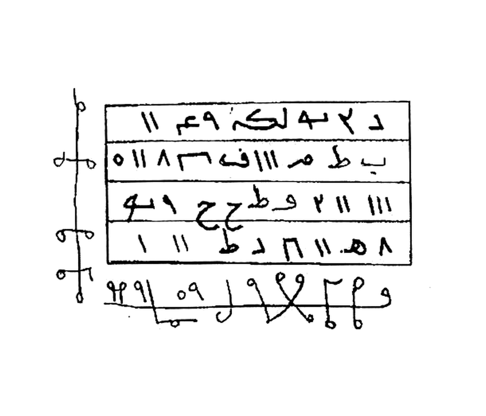

Hasil: 2112×1808 px, 300 DPI, LANCZOS 3.46×. Putih murni 88.2% seluruh kanvas (92.9% piksel non-tinta); tidak ada threshold keras atau redraw.

---

## Halaman PDF 16

Sumber: `Picture 003.jpg`, BOX `(390,475,690,735)` px. Isi cocok dengan Khatam/Wafaq 3×3 pada halaman cetak 07; label gambar di PDF menyebut halaman 04, tetapi indeks PDF dipakai sebagai acuan. Crop mempertahankan tabel, tiang, label sisi, dan titik ekor.

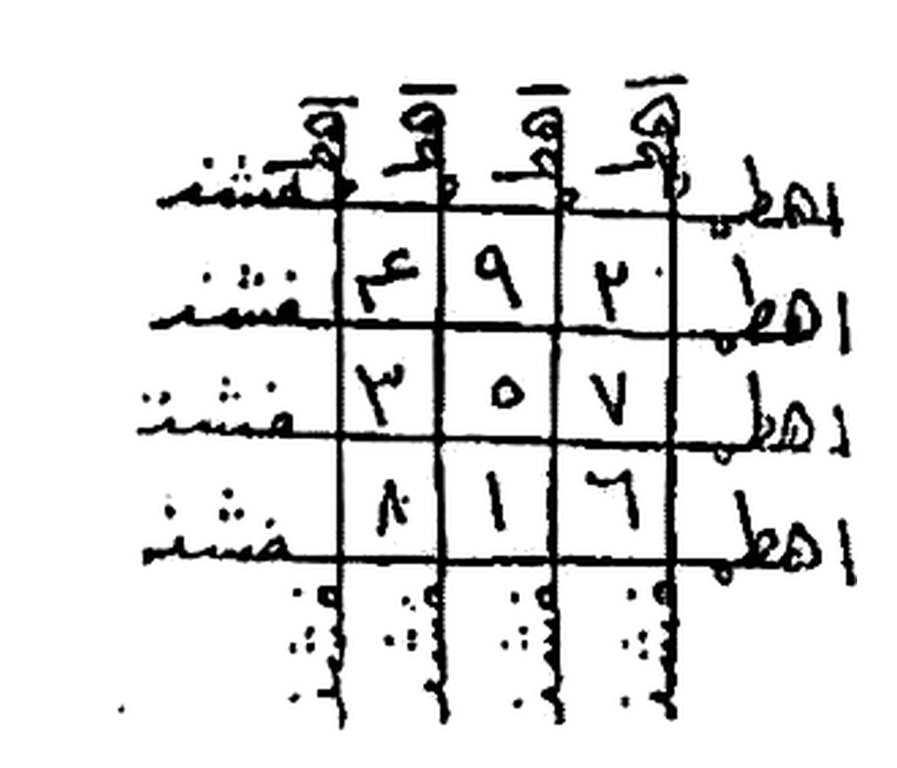

Hasil: 2112×1808 px, 300 DPI, LANCZOS 6.42×; putih murni 77.6% seluruh kanvas (86.8% piksel non-tinta), tanpa threshold keras atau redraw.

---

## Halaman PDF 22

Sumber: gambar tersemat (image XObject) pada PDF indeks halaman 22, BOX `(0,90,700,220)` px. Crop mempertahankan baris tulisan tangan dan tanda di sisi kiri yang tampak pada sumber; tepian halaman dan baris teks sekitar dikeluarkan. Tidak ada SAKK 111 yang terlihat pada crop ini.

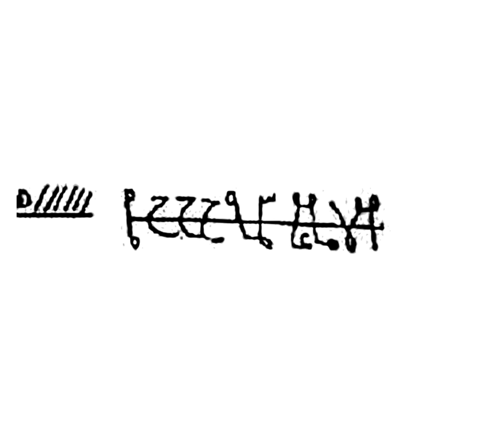

Hasil: 2112×1808 px, 300 DPI, LANCZOS 2.82×; putih 95.5% seluruh kanvas (97.9% piksel non-tinta). Tinta dan tanda yang tampak dipertahankan tanpa redraw.

---

## Halaman PDF 28

Sumber: gambar tersemat (image XObject) pada PDF indeks halaman 28, BOX `(250,90,1116,475)` px. Crop menampilkan empat baris tulisan tangan yang terlihat pada objek sumber, tanpa tepi halaman kiri dan teks di luar blok. Tepi kanan baris mengikuti batas XObject sumber; tidak ada bagian yang direkonstruksi. Tidak ada SAKK 111 yang terlihat pada crop ini.

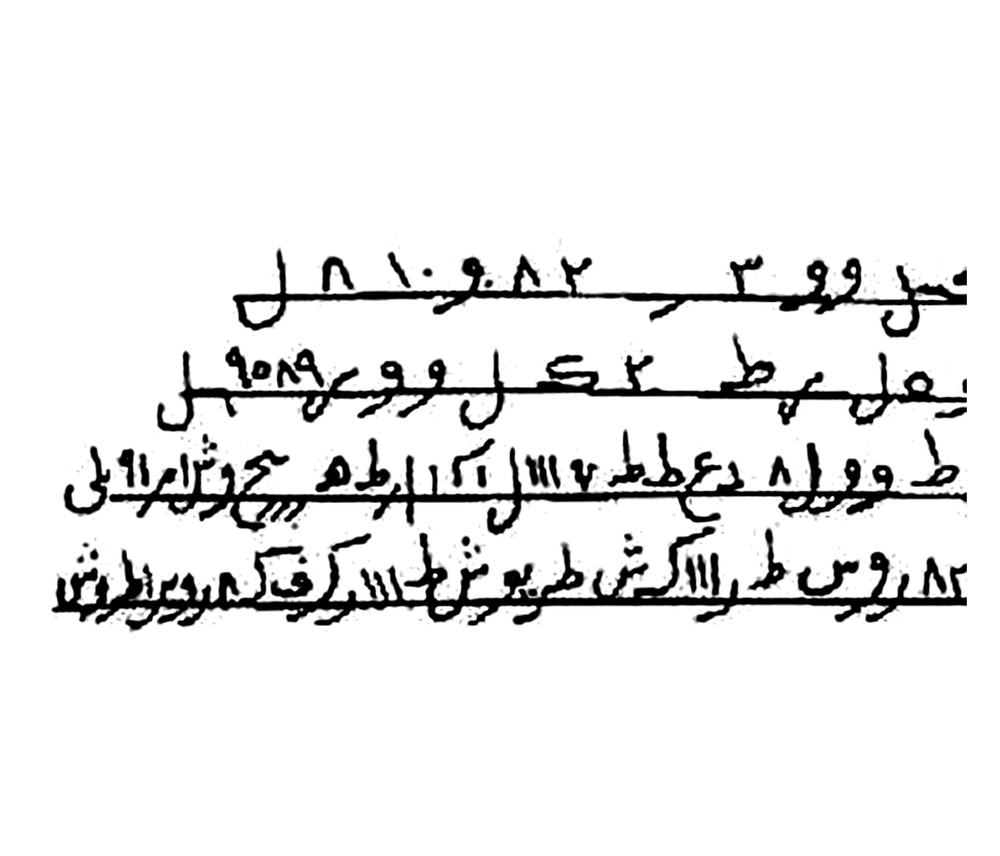

Hasil: 2112×1808 px, 300 DPI, LANCZOS 2.28×; putih 86.2% seluruh kanvas (93.4% piksel non-tinta). Tinta dipertahankan tanpa redraw.

---

## Halaman PDF 31–32 (satu kelompok revisi)

Kedua crop memakai seluruh gambar tersemat (image XObject) dari indeks halaman PDF masing-masing, sehingga tidak ada pemotongan tambahan terhadap tabel, tulisan tepi, atau tanda yang terlihat pada XObject. Sumber XObject PDF halaman 31 berukuran 957×963 px; halaman 32 berukuran 987×570 px. Tidak ada tanda yang digambar ulang atau ditambahkan.

### Halaman PDF 31

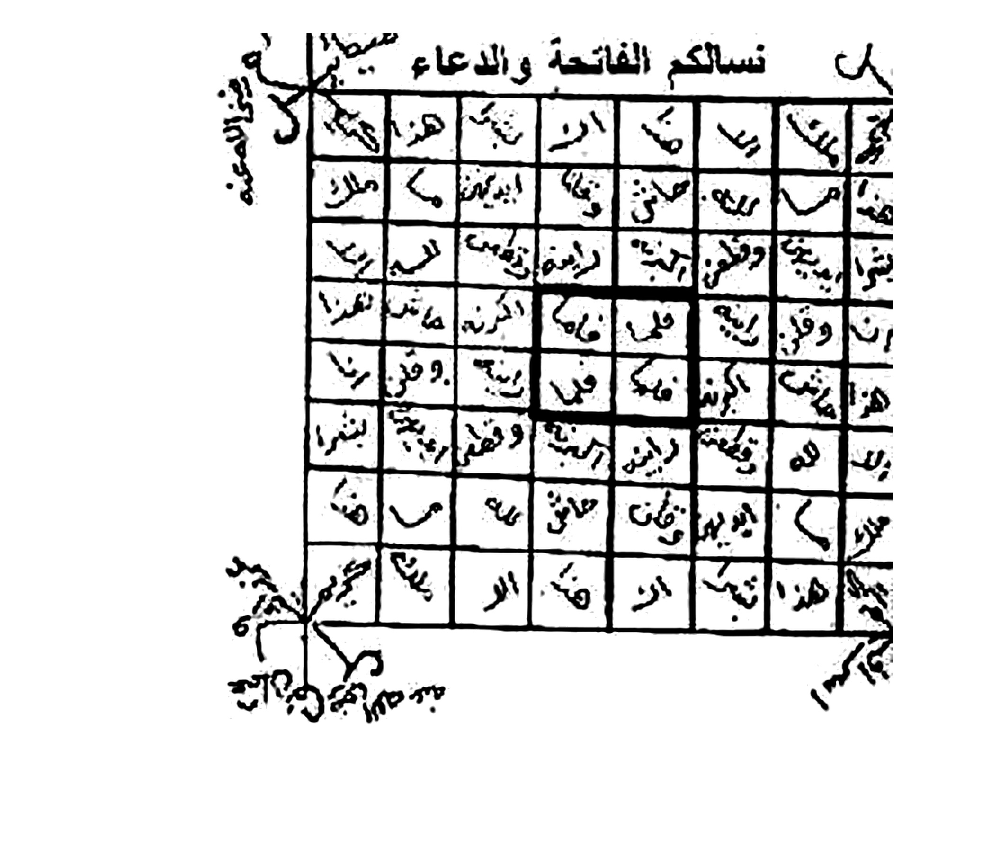

Hasil: 2112×1808 px, 300 DPI, LANCZOS 1.73×; putih 77.5% seluruh kanvas (88.3% piksel non-tinta).

### Halaman PDF 32

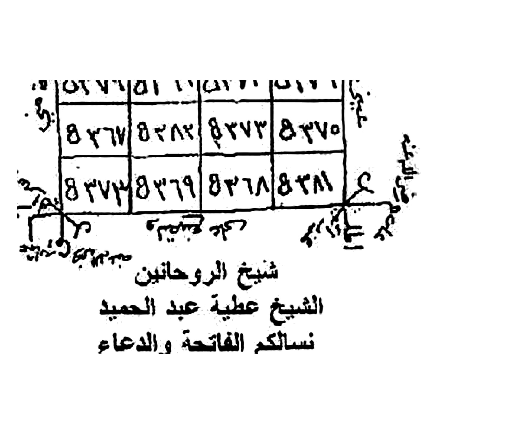

Hasil: 2112×1808 px, 300 DPI, LANCZOS 2.00×; putih 85.8% seluruh kanvas (93.0% piksel non-tinta).

---

## Halaman PDF 42

Sumber: `Picture 011.jpg`, scan cetak Halaman 22. Dua bbox dipakai agar bagian-bagian tulisan yang berjauhan tidak bercampur dengan prosa cetak di antaranya.

### Image 01

BOX `(275,340,865,535)` px; tiga baris tulisan tangan dipertahankan.

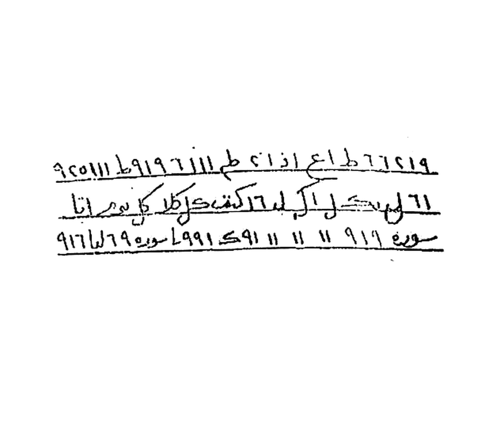

Hasil: 2112×1808 px, 300 DPI, LANCZOS 3.34×; putih 93.2% seluruh kanvas (95.7% piksel non-tinta).

### Image 02

BOX `(1280,490,1530,550)` px; satu baris tulisan dan tanda dipertahankan, tanpa prosa cetak di sekelilingnya. Tidak ada SAKK 111 yang terlihat.

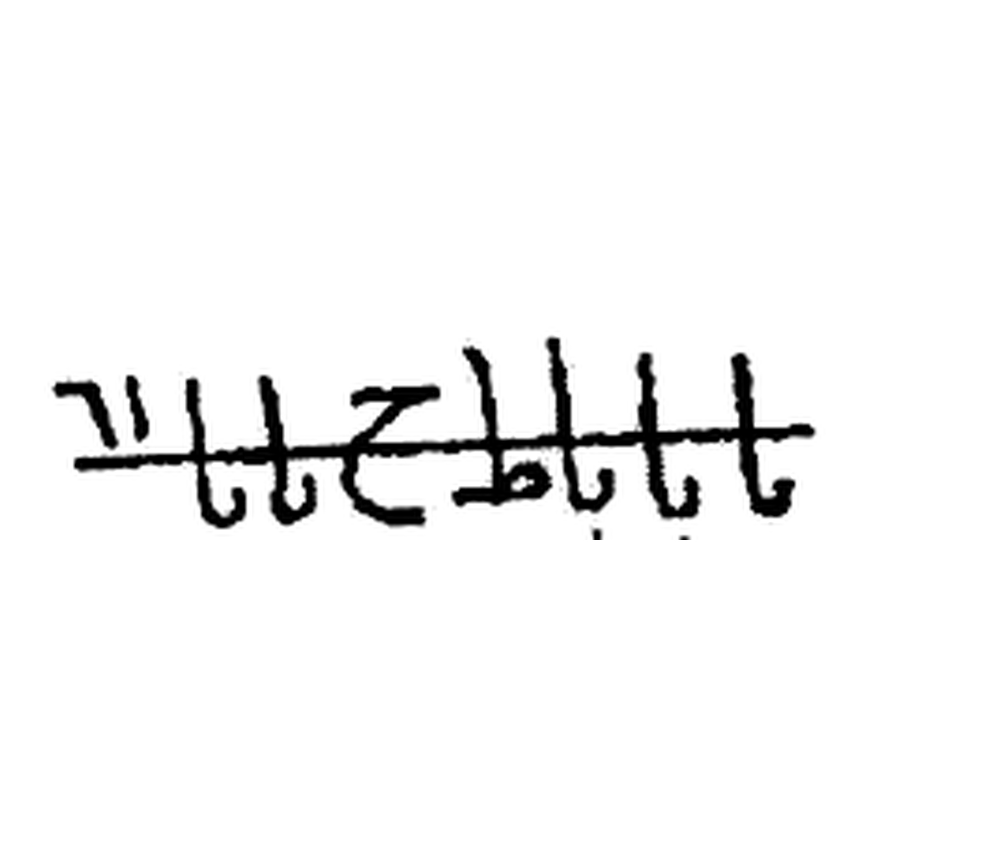

Hasil: 2112×1808 px, 300 DPI, LANCZOS 7.89×; putih 92.7% seluruh kanvas (96.1% piksel non-tinta).

---

## Halaman PDF 49

Sumber: `Picture 012.jpg`, scan cetak Halaman 24. Crop dipisah mengikuti dua blok gambar pada halaman cetak; teks dan tanda terlihat dibiarkan seperti pada scan, tanpa redraw.

### Image 01

BOX `(965,460,1535,620)` px; baris tulisan tangan dan sigil.

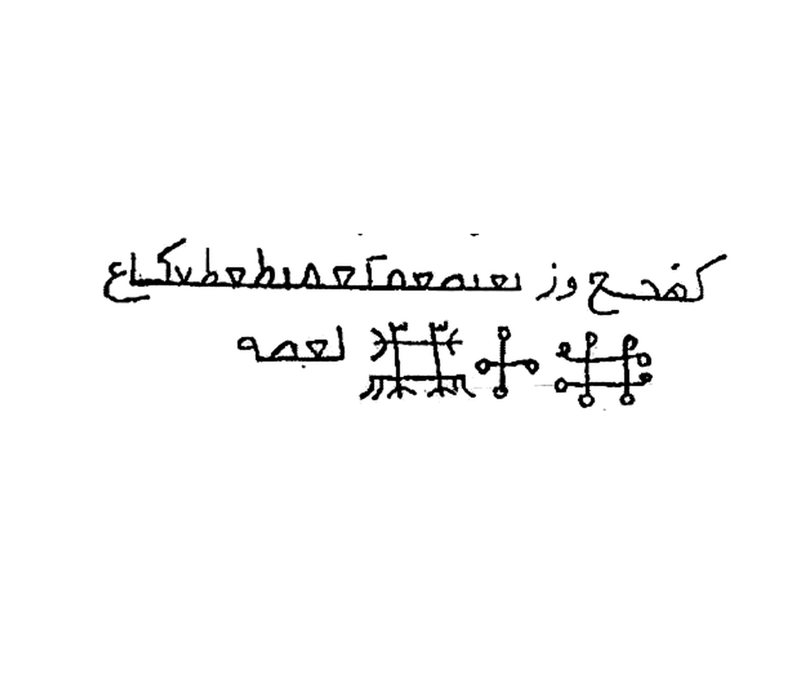

Hasil: 2112×1808 px, 300 DPI, LANCZOS 3.46×; putih 95.3% seluruh kanvas (97.5% piksel non-tinta).

### Image 02

BOX `(970,850,1510,1045)` px; tulisan tangan dan baris titik.

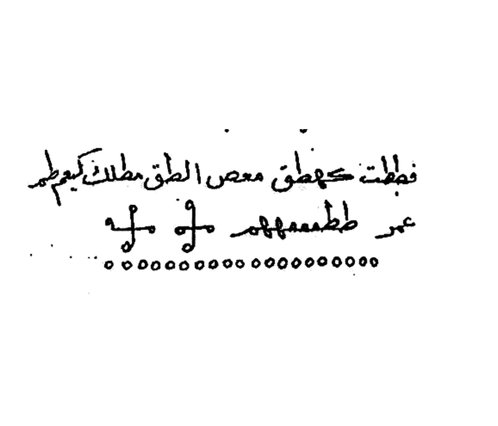

Hasil: 2112×1808 px, 300 DPI, LANCZOS 3.65×; putih 94.1% seluruh kanvas (96.9% piksel non-tinta).

---

## Halaman PDF 54

Dua crop dari scan sumber beresolusi lebih tinggi `Picture 013.jpg` dipautkan pada bagian halaman cetak 26–27 di BATCH 05 dan BATCH 06. Isi tulisan tangan dan tanda pada kedua kotak dipertahankan tanpa redraw.

### Image 01 — scan cetak Halaman 26

BOX `(960,760,1525,1015)` px; memuat pengantar tulisan tangan dan deretan angka/label yang terlihat.

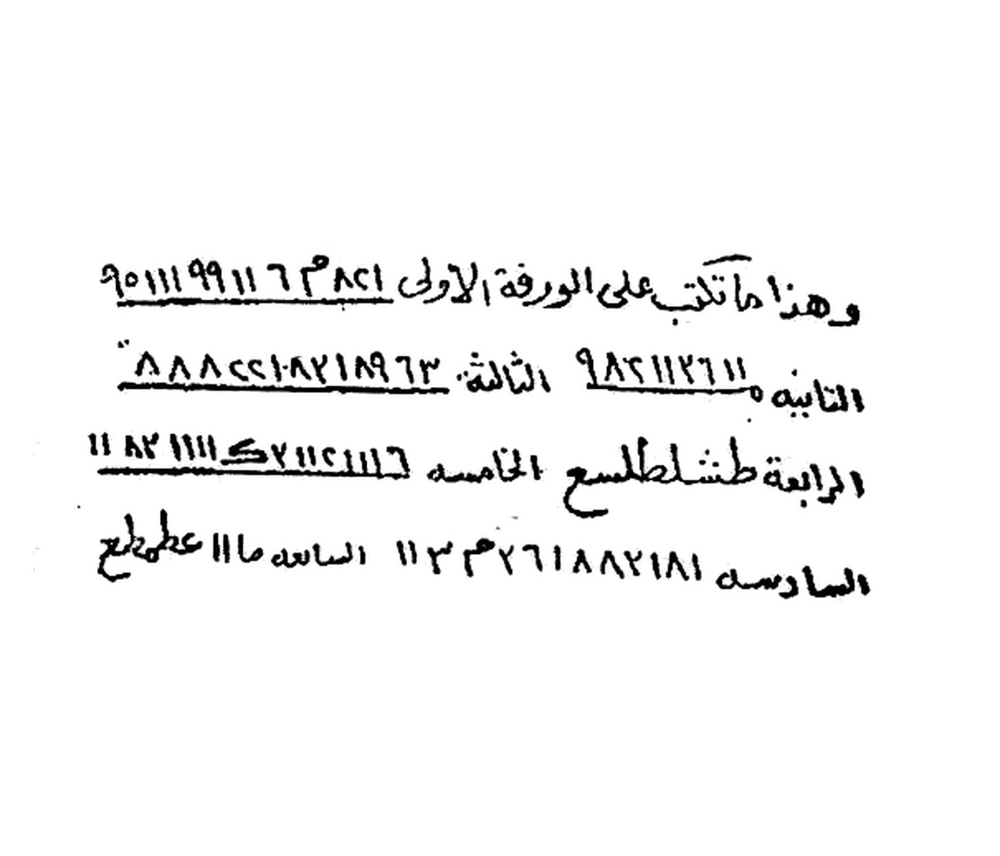

Hasil: 2112×1808 px, 300 DPI, LANCZOS 3.49×; putih 91.1% seluruh kanvas (94.7% piksel non-tinta).

### Image 02 — scan cetak Halaman 27

BOX `(300,810,770,1050)` px; memuat dua baris thilasm dan tiga simbol yang tampak, tanpa teks pengantar di atas kotak. Tidak ada SAKK 111 yang terlihat.

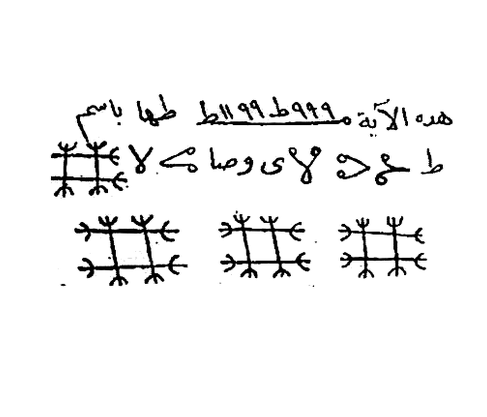

Hasil: 2112×1808 px, 300 DPI, LANCZOS 4.20×; putih 90.1% seluruh kanvas (94.5% piksel non-tinta).
